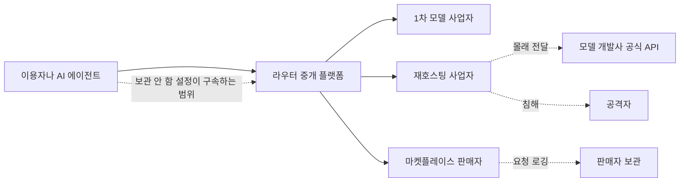

# '데이터 보관 안 함'은 첫 경유지까지만 지켜진다…미끼 200만 건이 보여 준 AI의 진짜 위험은 모델의 국적이 아니라 프롬프트가 지나가는 길이다

## 판단: 모델이 아니라 길을 봐야 한다

산업제어 보안업체 Dragos의 HD 무어 최고연구책임자는 19일 "2026년 7월부터 11월까지 5개월 동안 고유 URL과 카나리 자격증명이 든 프롬프트 약 200만 건을 널리 쓰이는 AI 서비스에 보냈다"고 밝혔다. 카나리는 누군가 건드리면 바로 알 수 있게 심어 둔 미끼다. Dragos가 넣은 AWS 키는 전체 로깅이 켜진 빈 계정에 묶인 진짜 키였고, 토큰을 건드린 모든 요청은 그것을 실어 보낸 프롬프트, 모델, 라우터, 프라이버시 설정까지 추적됐다([Dragos](https://www.dragos.com/blog/ai-supply-chain-security-canary-tokens)).

결과는 세 갈래였다. 호스팅 사업자 3곳이 침해돼 있었고, 일부 마켓플레이스 판매자는 표준 로깅 기능만으로 고객 프롬프트를 보관했으며, 여러 사업자가 '데이터 수집 안 함'이나 '데이터 보관 안 함'(ZDR) 설정을 무시했다. 사흘 뒤 AI 모델 중개 플랫폼 OpenRouter는 사업자 3곳을 퇴출하고 엔드포인트 125개의 보관 안 함 자격을 박탈했다([OpenRouter](https://openrouter.ai/blog/announcements/data-processing-incidents-on-inference-providers/)).

이 글의 판단은 세 가지다. **첫째, AI를 쓸 때의 위험은 모델이 어느 나라 것이냐보다 요청이 어떤 길로 가느냐에 있다.** 같은 모델이라도 어떤 판매자와 라우터를 거치느냐에 따라 프롬프트는 안전하기도 하고 새기도 했다. **둘째, '보관 안 함'은 기술적 보장이 아니라 계약상의 약속이고, 그 약속은 첫 번째 경유지까지만 구속한다.** **셋째, 한국 공공과 금융의 AI 관리는 아직 어떤 서비스를 막고 어떤 모델을 허용하느냐에 머물러 있다.** 망분리 규제를 풀고 외부 AI를 들이기 시작한 지금, 심사해야 할 것은 모델의 이름이 아니라 경로다. 둘째와 셋째는 해석이다.

## 세 가지 발견

**침해된 호스팅 사업자.** Dragos는 "세 호스팅 사업자에서 공격자가 데이터를 훔치고 있었다"며 가장 이른 사건은 7월 중순이고 세 곳 모두 Dragos가 알릴 때까지 침해를 몰랐다고 했다. 가장 큰 침해에서는 10월 말 짧은 몇 개 시간대에 보낸 AWS 키 200개 안팎이 털렸고, 그 시간대의 요청은 모두 도난당했다. 모델이 돌기도 전에 사업자가 거부한 요청까지 포함됐다. 나머지 두 침해에서는 도난된 요청 일부에 보관 안 함 표시가 붙어 있었다. Dragos는 "공격자가 이미 안에 있으면 프라이버시 플래그는 소용없다"고 썼다. 미끼 키는 수만 건의 AWS 호출에 쓰였고, 공격자는 저장소와 비밀 관리 서비스를 뒤지고 관리자 계정을 만들려 했다. 한 공격자는 11월 1일 AI 침투 도구 ARTEX를 추가했지만, Dragos에 따르면 이미 가진 키가 살아 있는지 몇 번 확인하는 데 그쳤다([Dragos](https://www.dragos.com/blog/ai-supply-chain-security-canary-tokens)).

**판매자를 따라간 유출.** 남는 연산 용량을 싸게 파는 마켓플레이스에서 Dragos가 잡은 판매자들은 "최저가로 모델을 올리고 요청 로깅을 켠 뒤 기다리기만 하면 됐다." 같은 모델이라도 다른 판매자를 거친 프롬프트는 건드려지지 않았다. Dragos는 "유출은 마켓플레이스 전체가 아니라 판매자를 따라간다"고 했다. 마켓플레이스와 무관한 한 라우터는 트래픽 일부를 몰래 마켓플레이스로 넘기고 있었다. Dragos가 약 2,000개 경로를 추적해 보니 수백 개에 식별할 수 없는 시스템이 끼어 있었고, 몇 개는 광고된 경로에 없는 회사로 데이터를 보냈다.

**무시된 프라이버시 설정.** 이름을 밝히지 않은 한 중국 AI 연구소의 시스템은 7~10월 그 모델로 보낸 프롬프트의 절반 이상에서 비밀 URL을 가져갔고, 여기에는 '데이터 수집 안 함'이나 보관 안 함 표시가 붙은 요청의 약 3분의 2가 포함됐다. 수집기는 보통 요청 2~3일 뒤 나타났다. Dragos는 "여러 미국 호스팅 사업자가 이 연구소의 모델을 재판매하는데, 그쪽으로 보낸 프롬프트도 같은 수집기를 불렀다"며 "데이터를 미국에 두려고 미국 사업자를 고른 고객은 돈값을 받지 못했다"고 썼다. 미국의 대형 사업자 한 곳도 검색 기능 호출 한 번 뒤 두 달 넘게 URL을 크롤링했다. Dragos는 사업자들이 "의도적으로든 처리 흐름의 버그로든 이 설정을 자주 무시한다"며 고의인지 버그인지는 가리지 않았다. 결론은 이랬다. "보관 안 함은 뭔가를 의미해야 한다. 실제로 이 프롬프트들은 보관되고, 다른 회사와 공유되고, 사람이 읽었다."

## 사업자들이 인정한 것

Dragos는 사업자 이름을 하나도 밝히지 않았다. 대신 사업자들이 스스로 공지를 냈다. OpenRouter는 자사 침해는 없었다면서 사업자 3곳을 퇴출하고 엔드포인트 125개의 보관 안 함 자격을 박탈했으며, 요청과 응답이 제3자로 넘어가는지 네트워크 경로를 기술적으로 검증하고 자격을 되돌리기 전에 보증과 검증을 요구하겠다고 했다. OpenRouter는 "연구자들의 시험 방식을 상시 점검에 쓸 수 있게 바꾸고 있다"고 했다([OpenRouter](https://openrouter.ai/blog/announcements/data-processing-incidents-on-inference-providers/)).

재호스팅 사업자 Novita는 특정 고객용 전달 경로가 라우팅 설정 문제로 넓게 적용돼 5월 28일부터 11월 11일까지 "일부 요청이 MiniMax 공식 API로 전달됐다"고 밝혔다. 직접 요청과 OpenRouter를 거친 요청이 모두 포함됐고, Novita는 접근 패턴상 자동 콘텐츠 검토가 개입했을 수 있다고 했다([Novita](https://novita.ai/blog/minimax-requests-privacy-notice/)). 고객은 Novita의 서버에서 모델을 쓴다고 생각했지만, 요청은 모델을 만든 회사의 공식 API로 갔다. Together AI는 6~7월 요청의 저장된 프롬프트 샘플이 무단으로 내려받혔다며 그 안에 Dragos 실험의 카나리 자격증명 5개가 있었다고 밝히고, 신규 계정의 보관 안 함을 기본값으로 바꿨다([Together AI](https://www.together.ai/blog/security-event-prompt-leakage-for-requests-in-june-and-july-of-2026)). Phala도 10월 21일부터 11월 8일까지 한 추론 배포가 장악돼 처리 중인 요청이 노출됐다는 예비 보고서를 냈다([Phala](https://phala.com/posts/phala-november-preliminary-incident-report)). 이들이 Dragos가 말한 침해 3곳과 같은지는 확인되지 않았다.

이 글은 OpenRouter의 조치가 이 사건의 핵심을 요약한다고 본다. 보관 안 함은 지금까지 사업자가 붙이는 '라벨'이었다. 이제 중개 플랫폼 스스로 그것을 '검증해야 할 주장'으로 다루겠다고 했다. 라벨을 믿고 비용을 지불한 고객은 그동안 무엇을 샀는지 확인할 방법이 없었다. 이는 해석이다.

## 국적 프레임과 경로 프레임

같은 주 OpenAI는 적대적 증류 대응 현황을 공개했다. 딥시크가 미국 프런티어 모델을 증류하려 했다는 정황을 2월 의회에 보고했고, 그 활동의 핵심을 문샷 AI 관련 인물들과 연결했으며, 매주 수천~수만 개 계정에 조치하고 있다고 했다. OpenAI는 칩 수출통제를 강화하는 법안들을 지지했다([OpenAI](https://openai.com/index/combatting-adversarial-distillation/)). 이 글은 이를 '누가 훔치나'를 묻는 국적 프레임으로 본다. Dragos의 실험은 '어디로 새나'를 묻는 경로 프레임이다. 미국 사업자를 골랐는데 프롬프트가 중국 연구소로 돌아갔고, 중국 모델을 쓰지 않았는데 미국 사업자가 두 달 동안 크롤링했다. 국적 프레임은 이 둘을 모두 놓친다.

한국의 대응은 대부분 국적과 서비스 단위였다. 2025년 2월 행정안전부가 생성형 AI에 민감정보를 입력하지 말라는 공문을 보낸 뒤 18개 부처가 각자 딥시크 접속을 막았다([뉴시스](https://www.newsis.com/view/NISX20250206_0003056114)). 막은 것은 딥시크 앱과 웹이었다. 같은 모델을 미국 호스팅이나 라우터로 부르는 길은 그대로였다. 흥미롭게도 한국 당국이 실제로 찾아낸 문제는 경로였다. 개인정보보호위원회는 그해 4월 딥시크가 "이용자가 AI 프롬프트에 입력한 내용을 볼케이노사에 전송하고 있는 것"을 확인하고 이미 넘어간 프롬프트를 파기하라고 권고했다([정책브리핑](https://www.korea.kr/news/policyNewsView.do?newsId=156686001)). 다만 그 수단은 처리방침 점검이었지, 실제로 데이터가 어디로 가는지 미끼를 심어 확인하는 시험은 아니었다.

금융권은 지금 문을 열고 있다. 금융위원회는 2024년 8월 망분리 개선 로드맵에서 금융회사가 생성형 AI를 쓸 수 있도록 혁신금융서비스 특례를 줬고, 올해 4월에는 "현재까지 169건이 지정되어 45개 서비스가 출시되었다"며 단순한 모델 변경은 서면 확인만으로 바로 출시할 수 있게 했다([금융위원회](https://www.fsc.go.kr/no010101/86712)). 이 발표에는 데이터 보관, 보관 안 함 계약, 중계·재판매 경로에 관한 언급이 없다. 금융회사가 모델을 바꾸는 절차는 가벼워졌는데, 그 모델이 어떤 경로로 서비스되는지는 심사 기준에 보이지 않는다.

이 글은 금융회사가 외부 AI를 쓸 때 승인받아야 할 것이 '어떤 모델'이 아니라 '어떤 경로'여야 한다고 본다. 계약서에 보관 안 함이 적혀 있는지보다, 요청이 1차 사업자에게 직접 가는지, 중간에 어떤 라우터와 재판매자가 끼는지, 그 각각이 같은 약속을 지는지가 심사 대상이 돼야 한다. 이틀 전 이 사이트가 다룬 은행 계좌 AI 에이전트 문제와도 이어진다([관련 기사](https://now.zeta4.net/a/2026-11-20-ai-agent-bank-liability-korea-law)). Dragos는 "AI 에이전트는 자격증명을 포함해 읽을 수 있는 건 뭐든 보낸다"고 경고했다. 이는 해석이다.

## 무엇을 해야 하나

Dragos의 권고는 단순하다. 가장 민감한 작업은 자체 호스팅하고, 그다음은 1차 모델 사업자와 직접 연결하며, 라우터를 쓴다면 상위 사업자를 직접 고르고 프라이버시 설정이 실제 경로를 바꾸는지 검증하고, 재판매 마켓은 피하라는 것이다. 마지막 권고가 가장 중요하다. "에이전트와 파이프라인이 이미 보내는 맥락에 가짜 자격증명을 넣고, 그것이 쓰이면 사고로 취급하라"([Dragos](https://www.dragos.com/blog/ai-supply-chain-security-canary-tokens)).

이 글은 이 권고를 한국 제도에 옮기면 세 가지가 된다고 본다.

1. **경로를 계약과 심사의 단위로 삼는다.** 금융당국의 혁신금융서비스 심사와 공공기관의 AI 도입 지침에 요청 경로(1차 사업자 직결 여부, 중계·재판매·재호스팅 여부)와 각 경유지의 보관 약정을 적게 한다.
2. **미끼 시험을 의무 점검 항목으로 넣는다.** 금융보안원이 하는 보안 점검에 카나리를 심어 프롬프트가 약속한 곳 밖으로 나가는지 확인하는 시험을 포함한다. 처리방침을 읽는 것으로는 이번에 드러난 유출을 하나도 잡지 못한다.
3. **특정 서비스 차단으로 끝내지 않는다.** 앱과 도메인을 막는 것은 같은 모델을 다른 길로 부르는 것을 막지 못한다.

## 확인하지 못한 것

- Dragos는 침해된 사업자, 중국 연구소, 미국 재판매사와 대형 사업자, 판매자의 이름을 하나도 밝히지 않았다. Novita, Together AI, Phala의 공지가 Dragos 발견의 어느 사례와 대응하는지는 추론이며 확인되지 않았다. 일부 보도는 OpenRouter의 고객 이메일을 인용해 중국 연구소를 MiniMax로 지목했지만 이메일 원문을 보지 못해 쓰지 않았다.
- Dragos 원문은 프롬프트를 보낸 지 24일 뒤 비밀 링크가 중국의 사내 메신저 채팅방에 올라온 사례를 소개하면서, 같은 사업자를 한 번은 중국 사업자로, 한 번은 미국 사업자로 적어 국적이 엇갈린다. 이 글은 그 사례의 국적을 단정하지 않았다.
- 중국 연구소의 '절반 이상'과 '3분의 2'가 직접 요청만의 수치인지 재판매 경유분을 합친 수치인지는 원문이 분명히 밝히지 않는다. Dragos는 채널별 프롬프트 수와 대상 사업자 수를 공개하지 않았다.
- 국가정보원의 2025년 12월 AI 보안 가이드북과 행정안전부의 2026년 공공부문 AI 도입 가이드는 원문을 열지 못해, 경로 검증이나 보관 약정을 다루는지 확인하지 못했다. 국내에서 중계·재판매 경로로 프롬프트가 유출된 사례는 찾지 못했다.

## 출처

- [Three breaches, endless leaks: Your AI supply chain needs canaries — Dragos (2026-11-19)](https://www.dragos.com/blog/ai-supply-chain-security-canary-tokens)
- [Data processing incidents on inference providers — OpenRouter (2026-11-22)](https://openrouter.ai/blog/announcements/data-processing-incidents-on-inference-providers/)
- [MiniMax requests privacy notice — Novita (2026-11-22)](https://novita.ai/blog/minimax-requests-privacy-notice/)
- [Security event: prompt leakage for requests in June and July of 2026 — Together AI (2026-11-21)](https://www.together.ai/blog/security-event-prompt-leakage-for-requests-in-june-and-july-of-2026)
- [Phala November preliminary incident report — Phala (2026-11-10)](https://phala.com/posts/phala-november-preliminary-incident-report)
- [Combatting adversarial distillation — OpenAI (2026-11-20)](https://openai.com/index/combatting-adversarial-distillation/)
- ['딥시크 금지령' 정부부처, 18개로 확대 — 뉴시스 (2025-02-06)](https://www.newsis.com/view/NISX20250206_0003056114)
- [개인정보위, 딥시크 점검 결과 — 정책브리핑 (2025-04-24)](https://www.korea.kr/news/policyNewsView.do?newsId=156686001)
- [혁신금융서비스 생성형 AI 지정 현황과 절차 개선 — 금융위원회 (2026-04-15)](https://www.fsc.go.kr/no010101/86712)

---

이 글은 공개 출처를 바탕으로 AI가 자동 생성한 초안을 검토해 발행했으며, 중요한 판단 전에는 연결된 원문을 확인해야 합니다.
