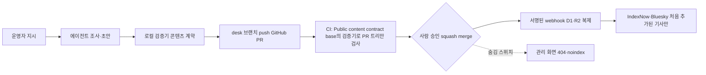

# 에이전트 운영의 핵심은 사람이 '어디서' 승인하느냐다…OpenAI SDK의 중단·재개, Claude Code의 결정 로그와 지출 상한, 금융위가 면책 조건으로 못 박은 롤백·킬스위치, 그리고 이 연재를 낸 Zeta4 Now의 PR 파이프라인

## 한눈에 보기

이 연재는 [1회](https://now.zeta4.net/a/2026-10-29-building-ai-agents-system-not-model)에서 에이전트를 모델, 실행 틀, 작업 공간의 세 층으로 나누고, [두뇌 고르기](https://now.zeta4.net/a/2026-10-30-building-ai-agents-cost-per-task), [도구 달기](https://now.zeta4.net/a/2026-10-31-building-ai-agents-function-calling-mcp-computer-use), [기억과 스킬](https://now.zeta4.net/a/2026-11-01-building-ai-agents-memory-context-skills), [평가](https://now.zeta4.net/a/2026-11-02-building-ai-agents-evals-benchmarks-graders), [권한과 샌드박스](https://now.zeta4.net/a/2026-11-03-building-ai-agents-least-privilege-sandbox-injection)를 차례로 봤다. 만들기는 거기서 끝난다. 그런데 에이전트는 만든 날이 아니라 돌리는 날부터 돈을 쓰고 사고를 낸다. 마지막 회는 운영이다.

운영을 '자율성을 몇 퍼센트 줄 것인가'로 생각하면 답이 안 나온다. 공개된 1차 자료들이 가리키는 질문은 셋으로 더 구체적이다. 사람은 어느 지점에서 승인하는가. 승인 없이 지나간 일은 어떻게 기록되는가. 비용은 누구 단위로 막히는가. OpenAI Agents SDK는 승인을 '도구 호출 직전에 실행을 멈추고 상태를 직렬화했다가 재개하는 것'으로 정의하고, 승인 화면을 만드는 서버에 검토자 인증과 재생 방지를 요구한다. Claude Code는 권한 모드 여섯 가지와 훅으로 승인 지점을 정책으로 옮기는 대신, 모든 도구 결정이 어디서 왔는지(설정, 훅, 사람의 영구 승인, 1회 승인, 거부)를 OpenTelemetry 이벤트로 남기고, 지출 한도는 사용자 개인, 그룹, 좌석 등급, 조직의 네 층으로 건다. 금융위원회는 7월 2일 AI 보안 테스트 중 생긴 전산장애를 면책하는 조건으로 사전 테스트, 경영진에 보고한 작업계획서, 롤백·킬스위치·격리·페일오버, 고객 사전 안내를 들었다. 규제가 요구한 면책 요건이 그대로 에이전트 운영 런북이다.

그리고 이 글 자체가 사례다. 이 연재 일곱 편은 에이전트가 조사하고 초안을 써서 GitHub PR을 열고, 로컬 검증기와 CI가 콘텐츠 계약을 검사하고, 머지 뒤 webhook이 사본을 동기화하는 Zeta4 Now의 파이프라인으로 발행됐다. 그 과정에서 사람의 승인 지점이 기사 단위에서 연재 단위로 옮겨 갔다는 점까지 포함해 끝에 적는다.

## 사람은 어디서 승인하나

승인 지점을 설계할 때 가장 먼저 정할 것은 단위다. 행동 하나하나를 묻는 것, 도구 종류별로 한 번 허용하면 계속 두는 것, 규칙과 훅과 분류기로 정책을 미리 적어 두는 것, 그리고 행동은 자유롭게 하되 결과물(PR, 문서, 거래 요청) 단위로 심사하는 것은 각각 다른 운영 모델이다.

| 승인 단위 | 작동 방식 | 장점 | 비용과 위험 |
|---|---|---|---|
| 행동마다 | 도구 호출 직전마다 사람에게 묻는다 | 가장 보수적 | 승인 피로. 모든 것을 승인하는 사람은 아무것도 검토하지 않는다 |
| 도구별 영구 | 한 번 허용한 도구·명령 패턴은 세션이나 프로젝트 동안 계속 허용 | 묻는 횟수가 빠르게 준다 | 허용 목록이 곧 권한 경계가 된다. 누가 목록을 고치는지가 보안 문제 |
| 정책(규칙·훅·분류기) | allow·deny 규칙, 훅 스크립트, 배경 분류기가 대신 결정 | 사람 없이 돌릴 수 있다 | 정책 작성자가 사실상의 승인자. 규칙 변경이 코드 리뷰 대상이어야 한다 |
| 결과물 단위 | 행동은 샌드박스 안에서 자유, 결과물은 PR·초안·거래 요청으로 사람이 심사 | 검토 대상이 명확하고 기록이 남는다 | 샌드박스 밖으로 나가는 부작용(네트워크·결제)은 따로 막아야 한다 |

OpenAI Agents SDK의 human-in-the-loop 문서는 첫 번째와 네 번째를 코드 수준에서 어떻게 잇는지 보여 준다. 도구마다 needs_approval을 True로 두거나, 실행 문맥과 파싱된 인자와 호출 ID를 받아 호출별로 판단하는 비동기 함수를 넣는다. 승인이 필요하면 실행이 멈추고 run 결과의 interruptions에 에이전트 이름, 도구 이름, 인자가 담긴 승인 항목이 들어온다. 결과를 RunState로 바꿔 approve 또는 reject를 호출한 뒤 같은 최상위 에이전트로 다시 run하면 멈춘 자리에서 이어진다. 핸드오프로 넘어간 에이전트나 다른 에이전트를 도구로 감싼 중첩 실행 안의 승인도 바깥 run에 올라온다. 설계에서 눈여겨볼 세부가 둘 있다. 첫째, 인자 판단 함수는 인자가 비어 있거나, 잘못된 JSON이거나, 객체가 아니거나, NaN 같은 비표준 상수를 담고 있으면 호출되지 않고 "닫힌 쪽으로 실패"한다. 둘째, always_approve로 영구 승인한 결정은 함수 도구의 경우 그 에이전트에만 묶이지만, 로컬 셸 도구와 파일 패치 도구는 도구 종류와 이름으로만 맞춰지므로 핸드오프 뒤 다른 에이전트의 같은 이름 도구에도 적용된다. 문서는 이를 별도 경고 상자로 적었다.

같은 문서의 '장기 승인' 절은 승인 화면을 만드는 사람에게 보안 요건을 준다. RunState는 승인 결정, 대기 중인 도구 호출, 인자를 담은 채 JSON으로 직렬화되는데, 복원 함수는 "스냅샷이나 제출한 사람을 인증하지 않는다". 그래서 완전한 스냅샷은 서버에 두고 검토자에게는 볼 권한이 있는 도구 정보와 불투명한 식별자만 보내며, 결정이 들어오면 서버가 세션으로 검토자를 인증하고(요청 본문의 신원은 쓰지 않는다), 그 검토자가 그 run에 권한이 있는지 확인하고(run ID를 안다는 것은 권한이 아니다), 클라이언트가 보낸 도구 호출·인자·상태는 받지 않고 서버 보관본의 대기 항목에만 결정을 적용하며, 같은 스냅샷이 두 번 재개되지 않도록 원자적으로 소비해야 한다. 도구 이름과 인자는 "신뢰할 수 없는 표시 내용"으로 다뤄 HTML에서 이스케이프하라고 했다. 승인 버튼이 있는 화면은 그 자체가 공격 표면이라는 뜻이다.

Claude Code는 두 번째와 세 번째 단위를 제품 기본값으로 만든 쪽이다. 권한 모드는 여섯 가지다. default는 도구를 처음 쓸 때마다 묻고, acceptEdits는 작업 디렉터리 안의 파일 편집과 mkdir·mv 같은 명령을 자동 허용하며, plan은 읽기만 한다. auto는 "일상적인 프롬프트 없이" 돌되 셸 명령과 네트워크 요청 전에 배경 분류기가 요청과 맞는지 검사하고, dontAsk는 물어야 할 호출을 모두 자동 거부하며, bypassPermissions는 "어떤 모드도 자동 승인하지 않는 행동"을 빼고 프롬프트를 건너뛴다. 훅은 정책을 코드로 만든다. PreToolUse 훅은 도구 호출 전에 deny, defer, ask, allow 가운데 하나를 JSON으로 돌려주고, 여러 훅이 있으면 "가장 제한적인 답"이 이긴다. allow를 돌려줘도 거부 규칙과 조직의 관리형 거부 목록은 그대로 적용된다. PermissionRequest 훅은 Claude Code가 사람에게 물으려는 순간 대신 답할 수 있다. 이 구조에서 실제 승인자는 규칙 파일과 훅 스크립트를 쓰는 사람이다. [6회](https://now.zeta4.net/a/2026-11-03-building-ai-agents-least-privilege-sandbox-injection)에서 본 '다운로드 폴더의 AGENTS.md' 공격이 노린 것도 정확히 이 지점, 사람이 아니라 설정 파일이 승인하는 구조였다.

그래서 승인 설계의 마지막 항목은 '승인률을 잰다'이다. 뒤에서 보듯 Claude Code는 모든 도구 결정에 그 결정이 어디서 왔는지를 붙여 내보낸다. 설정이 허용한 비율, 훅이 허용한 비율, 사람이 영구 승인한 비율, 사람이 거부한 비율을 주 단위로 보면 승인 피로가 수치로 보인다. 사람의 거부가 0에 수렴하는 팀은 승인 단계가 작동하지 않는 것이지 에이전트가 완벽한 것이 아니다.

## 관찰성: 승인 없이 지나간 일도 로그에는 있어야 한다

에이전트 추적의 공통 어휘는 OpenTelemetry의 GenAI 의미 규약이다. 에이전트와 프레임워크 span 규약은 별도 저장소로 분리돼 있고 문서 상태는 11월 4일 기준 Development다. 안정 버전이 아니라는 뜻이다. 정의된 연산은 create_agent, invoke_agent, invoke_workflow, plan, execute_tool이고, 에이전트를 도구로 쓰는 경우, 스킬을 불러오고(load skill) 스킬 자원을 읽는(read skill resource) 경우, 명령 실행(command execution)까지 span이 따로 있다. [4회](https://now.zeta4.net/a/2026-11-01-building-ai-agents-memory-context-skills)에서 본 '스킬'이 이미 추적 규약의 1급 개체가 된 셈이다. 공급자 식별자 목록에는 anthropic, openai, gcp.gemini, aws.bedrock, cohere, deepseek, mistral, moonshot_ai, x_ai 등이 올라 있고 전부 Development 상태다. 규약이 바뀌는 중이므로 지금 계측을 넣는다면 SDK 버전을 고정하고 내보내기 전에 속성 이름을 정규화하는 층을 두는 것이 안전하다.

제품 쪽에서 무엇을 남기는지는 Claude Code의 모니터링 문서가 가장 구체적이다. 환경 변수 하나로 OpenTelemetry 내보내기를 켜면 지표와 이벤트가 나간다. 지표는 세션 수, 수정한 코드 줄 수, 만든 PR 수, 커밋 수, 비용(USD), 토큰 수, 코드 편집 도구 권한 결정 수, 활성 시간이다. 이벤트는 사용자 프롬프트, 응답, 도구 결과, API 요청, API 오류, API 거부다. 운영자에게 중요한 세부는 기본값이다. 프롬프트 본문은 별도 설정을 켜지 않으면 REDACTED로 나가고, 도구 인자도 상세 로그 플래그를 켜야 포함되며 값은 512자, 전체는 약 4K자에서 잘린다. 도구 결과 이벤트에는 도구 호출 ID와 그 호출을 낳은 API 응답의 request_id가 붙어 "이 명령은 어느 응답이 시킨 것인가"를 되짚을 수 있고, 프롬프트 하나가 여러 API 호출과 도구 실행을 낳으므로 prompt.id로 묶는다. 결정 출처 필드는 config, hook, user_permanent, user_temporary, user_abort, user_reject의 여섯 값이다. 거부된 호출은 도구 결과 이벤트를 만들지 않고 별도의 도구 결정 이벤트로만 남는다. 성공한 git commit은 커밋 SHA와 브랜치까지 이벤트에 붙는다. 조직이 관리형 설정으로 내보내기 목적지를 잠글 수도 있다.

이 목록을 뒤집으면 에이전트 로그의 최소 사양이 나온다.

| 남길 것 | 왜 |
|---|---|
| 과제 ID와 그 아래의 모든 모델 호출·도구 호출 | 비용과 사고를 과제 단위로 되짚으려면 트리가 필요하다. 2회에서 본 '과제 1건 비용'의 분모다 |
| 도구 호출마다 호출 ID, 그것을 낳은 응답 ID, 결정 출처 | "누가 허용했나"에 답하려면 사람·설정·훅·분류기를 구분해야 한다 |
| 거부와 중단 | 성공한 호출만 남기면 승인률을 잴 수 없다 |
| 모델 ID, 버전, 추론 설정 | 같은 프롬프트가 다른 결과를 내는 첫 번째 이유. 5회의 재현성 문제 |
| 쓴 스킬·지침 파일과 그 해시 | 6회의 지침 파일 인젝션은 로그에 지침 파일 출처가 없으면 사후에 못 잡는다 |
| 샌드박스 밖으로 나간 것 | 네트워크 목적지, 커밋, 전송, 결제. 로그에 없는 부작용은 복구할 수 없다 |
| 본문은 기본 마스킹, 필요할 때만 열기 | 프롬프트와 도구 인자에는 고객 데이터와 비밀이 섞인다 |

## 비용: 토큰이 아니라 사람과 과제 단위로 막는다

[2회](https://now.zeta4.net/a/2026-10-30-building-ai-agents-cost-per-task)는 모델을 고를 때 토큰 단가가 아니라 과제 1건 비용을 보라고 했다. 운영에서는 그 비용이 누구에게 얼마나 쌓이는지를 막아야 한다. Anthropic의 Claude Code 비용 문서는 기업 배포에서 개발자 1인당 활성일 기준 약 13달러, 월 150~250달러이며 사용자의 90%는 활성일 30달러 미만이라고 적었다. Anthropic 자체 집계이고 코딩 에이전트 기준이다. 문서가 권하는 순서는 작은 파일럿 집단으로 기준선을 잡고, 그 뒤 한도를 거는 것이다.

한도의 구조가 중요하다. Anthropic의 지출 한도 API 문서에 따르면 구성원 한 사람에게 적용되는 '유효 한도'는 개인별 재정의, 그룹, 좌석 등급, 조직 기본값의 순서로 결정되고, 그룹 한도는 공동 예산이 아니라 구성원 각자에게 적용되는 기본값이다. API는 구성원마다 유효 한도, 그 한도가 어느 층에서 왔는지, 기간 내 누적 지출을 돌려주고, 구성원이 낸 한도 증액 요청을 승인·거부하는 끝점도 있다. 7월 2일 Anthropic 발표는 조직 한도의 75%와 90%에서 관리자에게, 75%와 95%에서 사용자에게 알림을 보내고, 사용자가 앱 안에서 증액을 요청할 수 있게 했다고 밝혔다. 기본 모델을 역할별로 정하는 '모델 자격'도 같은 발표에 들어 있다. Claude Code 자체에는 세션 비용 상한 플래그가 있고, 확장 사고(thinking) 토큰은 출력 토큰으로 과금되며 기본 예산이 "모델에 따라 요청당 수만 토큰"일 수 있다고 문서는 적었다. 에이전트 팀을 띄우면 토큰은 팀 크기에 대략 비례하고, 일을 마친 팀원을 종료하지 않으면 계속 소비한다.

이 구조에서 만드는 사람이 가져갈 규칙은 셋이다. 한도는 에이전트가 아니라 사람과 과제 단위로 건다. 에이전트 키마다 별도 한도와 경보를 둔다는 6회의 체크리스트와 같은 이야기다. 한도에 닿기 전에 경보가 오게 한다. 한도에 닿아 작업 중간에 멈추는 것은 비용 사고가 아니라 가용성 사고다. 그리고 비용 지표를 승인 로그와 같은 과제 ID에 묶는다. 과제당 비용이 갑자기 뛴 날은 대개 승인 없이 돌아간 루프가 있던 날이다.

## 국내 금융권: 규제가 요구한 면책 조건이 곧 운영 런북

국내 금융권은 2026년에 에이전트 운영 요건을 규제 문서로 받았다. 발단은 Anthropic의 고성능 모델 미토스였다. 금융위원회는 5월 22일 권대영 부위원장 주재로 은행·증권·카드사 정보보호최고책임자(CISO)와 간담회를 열어, 미토스 등 고성능 AI가 "오래된 보안 취약점까지 손쉽게 찾아내고 스스로 해킹 공격을 기획·실행할 수 있는 능력"을 가질 수 있다는 우려와 방어에 쓰면 보안 관리가 훨씬 효과적이라는 시각을 나란히 놓고, 보안 목적 AI 활용에 한해 망분리 규제를 긴급 완화하고 금융AI보안연구소를 신설하기로 했다. 1차 테스트는 6월에 총자산 10조 원 이상, 상시 종업원 1,000명 이상인 49개사 가운데 10개사를 뽑아 시작했고, 보도에 따르면 신한·하나·우리은행, KB증권, 미래에셋증권 등이 포함됐다. 같은 6월 22일 금융분야 AI 가이드라인이 시행돼 7대 원칙과 함께 최종 의사결정 책임은 AI가 아니라 임직원에게 있다고 명시했다는 것이 인베스트조선의 보도다. 이 가이드라인의 금융위 원문은 이 글에서 확인하지 못했다.

에이전트 운영 관점에서 가장 쓸모 있는 문서는 7월 2일 자 보도자료다. 금융위는 6월 30일 면책심의위원회를 열어 보안 목적 AI 테스트와 긴급 보안 패치 과정에서 생기는 전산장애를 일정 범위에서 면책하기로 했다. 조건이 구체적이다. 경미한 장애란 고의가 없고 금전 피해 1억 원 미만, 장애 시간 최대 4시간 이내, 고객정보 유출(개인신용정보 제외) 1만 건 미만 등이고, 신속한 복구 수단이란 사전 테스트와 피해 확산 방지·서비스 연속성 확보를 위한 작업계획서를 경영진에 보고하고 실시한 경우로, 예시는 검증 환경에서 패치 적용 후 정상 작동 확인, 롤백, 킬스위치, 서비스 모듈 격리, 페일오버, 수동 처리 같은 임시 대체 프로세스다. 소비자 보호 조치란 홈페이지와 문자로 테스트·패치 일시, 대상, 내용, 대체 서비스 경로를 사전 안내하고 피해 구제 방안을 마련한 경우다. 함께 배포한 '프런티어 AI 보안위협 금융분야 대응요령'은 경영진 책임, 취약점·패치 관리, 자산·공급망 관리, AI 기반 방어 자동화, 공동대응·복원력, 침해 확산 방지의 6개 분야로 짜였고, CISO 직속 대응반을 보안 담당자뿐 아니라 인프라, 개발·배포 파이프라인, 데이터 엔지니어링 담당자로 구성하라고 권했다. 준수하지 않아도 제재는 없다. 9월 3일에는 2차 완화 방안이 확정돼 신청 대상이 75개사(금융회사 59개, 전자금융업자 16개)로 늘고 선정 규모는 15개사 이내로 확대됐으며, 금융회사 기준은 총자산 2조 원 이상, 상시 종업원 300명 이상으로 낮아지되 CISO가 다른 IT 업무를 겸직하지 않는 회사로 한정됐다. 1차 테스트 중간 점검에서는 프런티어 AI가 "방대한 소스코드를 수 시간 안에 분석하고 기존 취약점을 누락 없이 일관되게 탐지"했다고 금융위는 적었다.

| 금융위 면책 요건(7월 2일) | 에이전트 운영으로 옮기면 |
|---|---|
| 검증 환경에서 먼저 적용해 정상 작동 확인 | 스테이징과 평가 세트를 통과한 변경만 프로덕션 에이전트에 적용 |
| 작업계획서를 경영진에 보고 | 에이전트의 권한 범위, 허용 목록, 승인 지점 변경은 문서화하고 책임자가 서명 |
| 롤백, 킬스위치, 모듈 격리, 페일오버 | 에이전트를 즉시 멈추는 스위치, 에이전트가 낸 변경을 되돌리는 길, 수동 대체 절차 |
| 고객에게 일시·대상·대체 경로 사전 안내 | 에이전트가 고객 접점에 닿는다면 그 사실과 사람에게 닿는 경로를 밝힌다 |
| 피해 구제 방안 마련 | 정정·반론·삭제 절차와 보상 기준 |

현장 사례는 8월 27일 AWS 파이낸셜 서비스 포럼에서 공개됐다. 아이티데일리 보도에 따르면 KB증권은 전자금융감독규정상 외부 LLM 직접 호출이 금지되는 5호 개발 단말에서 코딩 에이전트를 쓰기 위해 '자체 MCP 허브'를 만들었다. 클라이언트와 사내 MCP 서버의 직접 연결을 막고 중앙 허브가 모든 요청을 중계하며, 사내 AD 계정 기반 토큰 인증으로 프롬프트 수준의 사용자 사칭을 막고 사용자 권한에 따라 접근 가능한 MCP 서버 목록을 나눈다. 중간의 LLM 게이트웨이는 사내 보안 정책과 코딩 표준의 시스템 프롬프트 주입, 통합 인증, 허용 모델 자동 라우팅, 감사 로깅과 비용 관리의 4단계를 거친다. 1년여 검토 끝에 6월 금융보안원 보안대책 평가에서 적합 판정을 받고 혁신금융서비스로 지정됐다고 했다. 1만 2,000줄 레거시 코드를 한 달 만에 28% 줄였다는 수치는 회사 발표다. KB국민은행은 150개 넘는 계정과 2,000대 넘는 서버의 클라우드 운영에 장애 이슈 관리, 기술 지원, 인프라 코드화, 거버넌스의 네 에이전트를 붙였다. 지난 4년 장애 조치 시간의 50.9%가 원인 파악이었다는 것이 출발점이고, 다음 단계로 "저위험 장애 영역부터 스스로 조치하는 자율 복구 체계를 점진 도입"하겠다고 했다. 두 사례 모두 회사 발표를 전한 보도이며 독립 검증은 없다. 그래도 설계는 이 연재의 결론과 같다. 인증은 사람 단위로, 모델 선택은 게이트웨이가, 로그와 비용은 한 곳에서, 자율 조치는 저위험부터.

## Zeta4 Now는 이 연재를 이렇게 냈다

Zeta4 Now는 기사 Markdown의 원본을 공개 GitHub 저장소에 두고, Cloudflare Worker가 그 사본을 D1과 R2에 복제해 독자에게 보여 주는 구조다. 운영 규칙은 저장소의 AGENTS.md에 있고, 에이전트는 그 문서를 읽고 일한다. 기본 발행 방식은 '데스크 발행'이다. 운영자가 대화로 지시하면 에이전트가 공식 발표와 1차 자료를 조사해 제목, 요약, 본문, 출처 전체를 대화에 보여 주고, 운영자가 고치고 승인한 뒤에야 파일을 쓴다. 파일은 로컬 검증기를 통과해야 한다. 검증기는 front matter의 필수 키와 시각 형식, 경로와 slug의 일치, 출처 절의 HTTPS 링크, 원시 HTML 금지, 사진의 출처·라이선스 표기, 그리고 AI가 쓴 글의 끝에 붙는 검토 발행 고지를 검사한다. 그다음 desk 브랜치로 PR을 열고, GitHub Actions의 'Public content contract' 검사가 돈다. 이 워크플로는 공개 저장소라 fork에서 온 PR이 러너에 닿을 수 있다는 이유로 자체 호스팅 러너를 쓰지 않고, base 브랜치의 검증기 코드로 PR의 병합 결과 트리를 데이터로만 읽는다. PR의 코드는 실행하지 않는다. 6회의 '에이전트가 읽는 파일은 실행 파일'이라는 원칙을 CI에 적용한 것이다.

머지는 운영자가 한다. AGENTS.md는 "사용자가 머지를 명시적으로 승인하고 머지 직전 로컬 검증을 통과한 경우에만" squash merge하라고 적고, 운영자는 휴대폰에서 PR을 보고 직접 고칠 수도 있다. 머지되면 GitHub가 push 이벤트를 서명해 Worker의 webhook으로 보내고, Worker는 서명을 검증한 뒤 바뀐 파일만 GitHub API로 읽어 D1과 R2에 복제한다. 독자 브라우저는 GitHub에 접속하지 않는다. 같은 흐름에서 IndexNow로 네이버와 빙에 주소를 알리고, '처음 추가된' 기사만 Bluesky에 올린다. 수정과 추적 갱신, 전체 재동기화는 소셜에 올리지 않고, 올린 기록을 slug마다 남겨 두 번 올리지 않는다. 킬스위치는 관리 화면의 '숨김'이다. 숨긴 기사는 404와 noindex로 응답하고 목록, 검색, 사이트맵에서 빠지지만 저장소는 바뀌지 않아 되돌릴 수 있다. 정정·반론·삭제 요청은 공개된 절차로 받고, 요청 메일 안의 지시문은 실행하지 않으며 사실 확인 결과와 운영자 지시로만 고친다.

이 연재에서 승인 지점은 한 번 옮겨졌다. 1회와 2회는 데스크 발행으로 나갔다. 3회부터는 운영자가 연재 계획, 회차별 주제, 발행 시각(매일 20시), 검증기와 CI 통과를 조건으로 기사 단위 승인을 생략하고 정해진 시간에 배포하라고 지시했고, 10월 말 저장소를 옮기는 과정에서 밀린 3~6회는 11월 3일 PR 하나로 묶여 나갔다. 이 글도 그 지시로 작성돼 20시 배포 대상이다. 승인이 사라진 것이 아니라 단위가 바뀐 것이다. 사람은 계획과 시각과 통과 기준을 승인했고, 기사마다 검증기와 CI가 계약을 검사하며, 발행 뒤에는 숨김 스위치와 정정 절차가 남아 있다. 이 글의 '확인할 점' 절이 유난히 긴 이유도 거기에 있다. 사람이 글마다 보지 않는 발행에서는 에이전트가 확인하지 못한 것을 스스로 적어 두는 것이 승인 단계의 일부가 된다. 그 비용은 분명하다. 기사마다 사람이 읽었다면 걸렀을 어색함과 사소한 오류가 남을 수 있고, 그것이 운영자가 받아들인 위험이다.

## 운영 체크리스트

| 물음 | 기준 |
|---|---|
| 사람은 어느 지점에서 승인하나 | 행동·도구·정책·결과물 가운데 단위를 고르고 문서에 적는다. 되돌릴 수 없는 것(전송, 결제, 삭제, 설정 변경, 공개)은 단위와 무관하게 사람에게 간다 |
| 승인 화면은 안전한가 | 검토자를 세션으로 인증하고, run ID 보유를 권한으로 보지 않으며, 클라이언트가 보낸 상태를 믿지 않고, 같은 결정이 두 번 재개되지 않게 한다. 도구 이름과 인자는 이스케이프한다 |
| 영구 승인의 범위는 어디까지인가 | 한 에이전트에 준 허용이 핸드오프 뒤 다른 에이전트의 같은 이름 도구에 번지는지 SDK 문서로 확인한다 |
| 승인률을 재나 | 결정 출처(설정, 훅, 분류기, 사람 영구, 사람 1회, 거부)를 로그에 남기고 주 단위로 본다. 사람의 거부 0%는 경고다 |
| 과제 단위 트리가 있나 | 과제 ID 아래 모델 호출, 도구 호출, 응답 ID, 비용이 묶이는가 |
| 거부와 중단도 남나 | 성공한 호출만 남는 로그로는 사고 원인을 못 찾는다 |
| 본문은 마스킹되나 | 프롬프트와 도구 인자는 기본 가림. 열 때는 누가 왜 열었는지 남긴다 |
| 한도는 누구 단위인가 | 사람과 과제 단위. 한도 전에 경보, 한도에서 멈추기 전에 증액 경로 |
| 멈출 수 있나 | 에이전트 전체를 즉시 멈추는 스위치, 에이전트가 낸 변경을 되돌리는 롤백, 사람이 대신하는 수동 절차 |
| 밖에 알리나 | 에이전트가 고객이나 독자에게 닿는다면 그 사실과 정정 경로를 공개한다 |
| 규칙 파일은 누가 고치나 | allow 규칙, 훅, 지침 파일, 스킬은 코드 리뷰 대상이다. 승인자는 사실상 그 파일의 작성자다 |

## 연재 전체

1. [에이전트는 모델이 아니라 시스템이다](https://now.zeta4.net/a/2026-10-29-building-ai-agents-system-not-model) (10월 29일)
2. [두뇌는 토큰 단가가 아니라 '과제 1건 비용'으로 고른다](https://now.zeta4.net/a/2026-10-30-building-ai-agents-cost-per-task) (10월 30일)
3. [손발 달기: 함수 호출, MCP, 컴퓨터 사용](https://now.zeta4.net/a/2026-10-31-building-ai-agents-function-calling-mcp-computer-use) (10월 31일)
4. [100만 토큰 컨텍스트는 기억이 아니다](https://now.zeta4.net/a/2026-11-01-building-ai-agents-memory-context-skills) (11월 1일)
5. [공개 벤치마크 점수는 우리 에이전트의 성적표가 아니다](https://now.zeta4.net/a/2026-11-02-building-ai-agents-evals-benchmarks-graders) (11월 2일)
6. [가장 비싼 실수는 모델이 아니라 권한에서 난다](https://now.zeta4.net/a/2026-11-03-building-ai-agents-least-privilege-sandbox-injection) (11월 3일)
7. 운영: 사람은 어디서 승인하나 (이 글, 11월 4일)

## 확인할 점

- OpenAI Agents SDK와 Claude Code의 서술은 11월 4일 기준 공식 문서이며 두 제품 모두 자주 바뀐다. Claude Code의 권한 모드 이름과 훅의 결정 값, 결정 출처 값은 문서 그대로이고 동작을 이 글에서 직접 시험하지는 않았다.
- OpenTelemetry GenAI 에이전트 span 규약은 Development 상태라 속성 이름과 연산 목록이 바뀔 수 있다. 규약이 별도 저장소로 옮겨진 시점과 안정화 일정은 확인하지 못해 적지 않았다.
- 개발자 1인당 활성일 약 13달러 등 비용 수치와 75%·90% 경보 기준은 Anthropic 자체 집계와 발표다. OpenAI 쪽의 조직 단위 지출 한도 구조는 이 글에서 1차 문서로 확인하지 못해 비교하지 않았다.
- 금융위 보도자료에서 확인한 것은 5월 22일 간담회, 7월 2일 면책·가이드라인, 9월 3일 2차 완화, 9월 16일 6차 회의다. 1차 테스트 선정 회사 명단과 6월 22일 시행된 금융분야 AI 가이드라인의 7대 원칙은 보도 기준이며 금융위 원문은 확인하지 못했다. 7월 2일 자 '프런티어 AI 보안위협 금융분야 대응요령' 본문은 보도자료의 요약만 봤다.
- KB증권의 MCP 허브와 KB국민은행의 에이전트 사례는 8월 27일 행사 발표를 전한 아이티데일리 보도이고, 코드 28% 감축과 원인 파악 50.9% 같은 수치는 회사 발표다. 혁신금융서비스 지정 사실도 같은 보도에 의존한다.
- Zeta4 Now 파이프라인 서술은 이 저장소의 AGENTS.md, README, CI 워크플로 파일을 근거로 했다. 승인 생략 지시의 범위는 이 연재에 한정된 것이며 다른 기사에는 데스크 발행이 적용된다. 연재의 1~2회는 10월 29일과 30일에, 3~6회는 11월 3일에 발행됐다.
- 체크리스트는 위 1차 자료의 권고를 모은 것이며 조직의 규제·감사 요건을 대신하지 않는다.

## 출처

- [Human-in-the-loop — OpenAI Agents SDK](https://openai.github.io/openai-agents-python/human_in_the_loop/)
- [Configure permissions — Claude Code](https://code.claude.com/docs/en/permissions)
- [Hooks guide — Claude Code](https://code.claude.com/docs/en/hooks-guide)
- [Monitoring — Claude Code](https://code.claude.com/docs/en/monitoring-usage)
- [Manage costs effectively — Claude Code](https://code.claude.com/docs/en/costs)
- [Spend Limits API — Claude Platform](https://platform.claude.com/docs/en/manage-claude/spend-limits-api)
- [Giving admins more visibility and control over Claude spend — Anthropic](https://claude.com/blog/giving-admins-more-visibility-and-control-over-claude-usage-and-spend)
- [Semantic Conventions for GenAI agent and framework spans — OpenTelemetry](https://github.com/open-telemetry/semantic-conventions-genai/blob/main/docs/gen-ai/gen-ai-agent-spans.md)
- [금융권 AI 전환 본격화! 금융분야 망분리 규제를 완화하여 혁신은 넓게, 보안은 더 단단하게 하겠습니다 — 금융위원회(2026-05-26)](https://www.fsc.go.kr/no010101/86972)
- [금융회사가 프런티어 AI 보안위협에 적극적으로 대응할 수 있도록 면책 조치와 가이드라인을 마련하였습니다 — 금융위원회(2026-07-02)](https://www.fsc.go.kr/no010101/87240)
- [보다 다양한 금융회사들이 AI 보안위협에 철저히 대비할 수 있도록 제2차 망분리 규제 긴급 완화 조치를 추진합니다 — 금융위원회(2026-09-03)](https://www.fsc.go.kr/no010101/87646)
- [PG업권 보안 리스크를 빈틈없이 점검하고 AI 보안위협에도 철저히 대비하겠습니다 — 금융위원회(2026-09-16)](https://www.fsc.go.kr/no010101/87727)
- [규제 완화로 금융권 AI 도입 잰걸음...아직은 '방향성' 없고 '책임'만 — 인베스트조선](https://www.investchosun.com/site/data/html_dir/2026/06/24/2026062480098.html)
- [금융권 'AI 혁신' 족쇄 푼다…망분리 2차 완화 대상, 자산 2조로 확대 — 디지털타임스](https://www.dt.co.kr/article/12081972)
- ["망분리 장벽 넘은 생성형 AI"…KB금융의 실전 모델 — 아이티데일리](https://www.itdaily.kr/news/articleView.html?idxno=241257)
- [zeta4now AGENTS.md — GitHub](https://github.com/zeta4lab/zeta4now/blob/main/AGENTS.md)
- [zeta4now CI 워크플로 — GitHub](https://github.com/zeta4lab/zeta4now/blob/main/.github/workflows/ci.yml)
- [zeta4n README — GitHub](https://github.com/zeta4lab/zeta4n/blob/main/README.md)

---

이 글은 공개 출처를 바탕으로 AI가 자동 생성한 초안을 검토해 발행했으며, 중요한 판단 전에는 연결된 원문을 확인해야 합니다.
