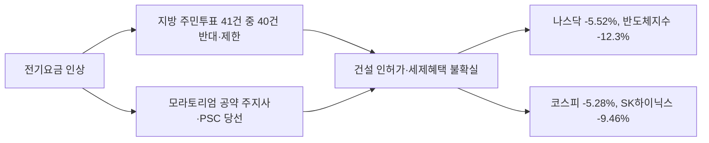

# AI 건설의 제동은 워싱턴이 아니라 오하이오 동네 투표에서 걸렸다…나스닥 5.5% 급락에 코스피는 하루 먼저 5.3% 빠지고 다음 날 서킷브레이커까지 걸렸다

## 판단: 시장이 읽은 것은 규제가 아니라 유권자다

5일(미국 시각) 나스닥종합은 5.52% 떨어진 24,315.00으로 마감해 10월 6일 최고치보다 10% 넘게 내려온 조정장에 들어갔다. S&P500은 4.36%, 다우는 1,833포인트(3.44%) 내렸고 필라델피아반도체지수는 12.3% 떨어져 2020년 3월 이후 최악이었다. 엔비디아 9.3%, AMD와 마이크론 17%, 코어위브 10%, 네비우스 15% 하락이다([CNBC](https://www.cnbc.com/2026/11/05/qualcomm-earnings-chip-stocks-election.html), [NBC](https://www.nbcnews.com/business/markets/tech-stocks-plunge-ai-midterms-rcna607650), [로이터(Investing.com)](https://investing.com/news/stock-market-news/sp-500-futures-steady-after-midterm-rally-nasdaq-lags-on-chip-weakness-5003237)).

이 글의 판단은 이렇다. **AI 데이터센터 건설에 처음으로 실질적 제동을 건 것은 연방 정부가 아니라 전기요금 고지서를 받는 지역 유권자이고, 시장은 그것을 이틀 만에 가격에 넣었다.** 민주당 의회가 AI 규제법을 통과시킬 것이라는 전망은 근거가 약하다. 그러나 주지사와 시의회, 공공서비스위원회가 인허가와 세제혜택을 쥐고 있고, 그 자리를 데이터센터 반대를 공약한 사람들이 차지했다. 반도체 수출국 한국은 이 변화에 미국보다 더 크게 노출돼 있다.

## 41건 중 40건: 투표함에서 나온 모라토리엄

3일 주민투표에 오른 데이터센터 안건은 10개 주 41건으로 사상 최대였다. CNBC와 Ballotpedia 분석에 따르면 노스다코타 하우드 한 곳을 빼고 40건에서 유권자가 데이터센터 반대 쪽에 섰다([CNBC](https://www.cnbc.com/2026/11/05/qualcomm-earnings-chip-stocks-election.html), [Ballotpedia](https://news.ballotpedia.org/2026/11/03/voters-in-ten-states-will-vote-on-data-center-related-ballot-measures-november-3/), [Scientific American](https://www.scientificamerican.com/article/2026-election-results-show-widespread-opposition-to-ai-data-centers/)). 중심은 오하이오였다. 18개 지자체 21건 중 최소 14곳이 금지나 제한을 택했고, 트렌턴은 80 대 20, 그랜빌은 82 대 18이었다. 메인 웰스는 80% 넘는 찬성으로 소급 적용되는 180일 모라토리엄을 통과시켰다([Fortune](https://fortune.com/2026/11/04/ohio-data-center-ballot-measures-midterm-elections/), [Fox Business](https://www.foxbusiness.com/politics/data-centers-ballot-voters-sent-unmistakable-message)).

주민투표보다 무거운 것은 사람이다. 텍사스에서는 주 전체 모라토리엄을 공약한 지나 이노호사가 1990년 이후 처음으로 민주당 주지사가 됐다. 텍사스는 미국 계획 데이터센터 용량의 약 4분의 1을 차지한다. 조지아 공공서비스위원회는 약 20년 만에 민주당이 3 대 2 다수가 됐고, 당선자 실라 에드워즈는 데이터센터가 "세금을 한 푼도 내지 않았다"고 했다([Heatmap](https://heatmap.news/energy/georgia-psc-election-2026)). 오하이오 상원에서는 세제혜택 폐지를 내건 셰러드 브라운이 이겼다([CS Monitor](https://www.csmonitor.com/USA/Politics/2026/1105/data-centers-ai-midterm-elections)). NBC 출구조사에서 56%가 AI와 데이터센터를 투표의 "결정적이거나 주요한" 요인으로 꼽았다.

동기는 전기요금이다. 조지아파워는 최근 몇 년 여섯 차례 요금을 올렸고, 버지니아는 8월 데이터센터 전용 송전 비용을 데이터센터가 전액 부담하게 했다. 오하이오 주민 조사에서는 건설 반대가 55%, 찬성이 22%였다. 오하이오노던대의 키스 더킨은 "데이터센터를 옹호하는 광고를 본 적이 없다"고 했다([Fortune](https://fortune.com/2026/11/04/ohio-data-center-ballot-measures-midterm-elections/)). 업계는 주민에게 설명하지 않았고, 주민은 투표로 답했다.

## 시장의 두 해석

낙관 쪽은 과잉반응이라고 본다. 야누스헨더슨의 리처드 클로드는 "반사적 반응이 있을 것이고 일부 지연으로 이어질 수 있다"고 했고([CNBC](https://www.cnbc.com/2026/11/05/qualcomm-earnings-chip-stocks-election.html)), AMD의 리사 수는 "시장은 때로 근시안적"이라고 했다. 밴다리서치는 개인투자자 순매도가 2020년 이후 최대였다며 "완전한 항복"이라고 불렀다([Yahoo Finance](https://finance.yahoo.com/markets/live/stock-market-today-thursday-november-5-dow-sp-500-nasdaq-oil-rises-chip-stocks-141439950.html)).

비관 쪽은 구조를 본다. 에드 야데니는 "AI 거품이 터지는 것이 아니라 아주 빠르게 바람이 빠지는 것"이라고 했다([NBC](https://www.nbcnews.com/business/markets/tech-stocks-plunge-ai-midterms-rcna607650)). 댄 아이브스는 빅테크 설비투자 정점이 2028~29년에서 내년으로 당겨졌고, 계획된 800~1,000개 데이터센터 중 10%는 "로드맵에서 지워질 것"이라고 했다([Fortune](https://fortune.com/2026/11/05/tech-stocks-are-suffering-the-biggest-selloff-since-covid-as-investors-see-premature-end-to-ai-datacenter-boom/)). UBS는 2028년 미국 신규 용량의 약 30%가 건설 중단 위험에 있다고 봤다([로이터(Yahoo)](https://finance.yahoo.com/technology/ai/articles/ai-data-center-stocks-slip-112314079.html)).

이 글은 둘 다 절반씩 맞다고 본다. 수요는 사라지지 않았다. 알파벳은 2027년 투자가 "크게 늘 것"이라 했고 아마존은 "의미 있게 더 쓸 것"이라 했다([Luminix 집계](https://www.useluminix.com/reports/industry-analysis/hyperscaler-capex-q3-2026)). 퀄컴 CEO도 "수요 문제가 아니라 공급 문제"라고 했다. 바뀐 것은 **어디에, 언제, 누구 돈으로 짓느냐**다. 그 답이 흐려지면 시장은 가장 먼 미래의 매출부터 깎는다. 이는 해석이다.

## 한국: 미국보다 먼저, 더 크게 떨어졌다

코스피는 5일 5.28% 내린 5,383.80으로 마감했다. 장중 6.10%까지 밀렸고 매도 사이드카가 발동됐다. 삼성전자는 7.57% 내려 장중 20만 원을 밑돌았고 SK하이닉스는 9.46% 떨어졌다. 외국인은 3조 3,928억 원을 팔았다([파이낸셜뉴스](https://www.fnnews.com/news/202611051834204346), [한국경제TV](https://www.wowtv.co.kr/NewsCenter/News/Read?articleId=A202611050144)). 미국 급락이 나오기 전이다. 한국 시장은 전날 미국 전력주 급락과 반도체 약세를 보고 먼저 움직였다. 3일에도 코스피는 3.59% 내렸다([뉴스핌](https://www.newspim.com/news/view/20261103001168)).

미국 급락을 확인한 6일에는 더 세게 밀렸다. 코스피는 개장 직후 8% 넘게 떨어져 오전 9시 3분 1단계 서킷브레이커가 발동돼 거래가 20분 멈췄다. 발동 당시 지수는 4,924.61로 전날보다 8.52% 낮았고 장중 저점은 4,911.28이다. 삼성전자는 18만 1,400원(9.98%), SK하이닉스는 111만 6,000원(11.71%)까지 밀렸고 9시 34분에는 매도 사이드카도 걸렸다([뉴스핌](https://www.newspim.com/news/view/20261106000202), [노컷뉴스](https://nocutnews.co.kr/news/6603033)). 오전 10시 6분 기준 코스피는 4,963.87로 7.80% 하락이었다([인베스팅닷컴](https://kr.investing.com/indices/kospi)). 마감은 6.02% 내린 5,059.69였다. 저점에서 3% 되돌렸지만 이틀 낙폭은 10.98%다. 외국인은 2조 7,692억 원을 팔았고 SK하이닉스 한 종목에서만 1조 9,240억 원을 뺐다. 기관이 1조 7,042억 원을 받았다([톱스타뉴스](https://www.topstarnews.net/news/articleView.html?idxno=16270053), [재경일보](https://news.jkn.co.kr/post/1074797)). 사흘 동안 미국 시장이 '데이터센터를 어디에 짓느냐'를 되물을 때, 한국 시장은 '그 칩을 누가 사느냐'로 답을 들었다.

**첫째 경로는 HBM 수요의 시점이다.** SK하이닉스는 3분기 매출 104조 6,155억 원, 영업이익률 80%를 기록했고 2027~28년 생산능력의 절반 이상을 장기계약으로 묶어 뒀다([SK하이닉스](https://news.skhynix.co.kr/q3-2026-business-results/)). 미래에셋의 김영건은 "텍사스 프로젝트가 일부 이연되더라도 충격은 2028년에 일시적인 수준"이고 장기계약 HBM 수요는 안정적이라고 했다. 권영배는 영향받을 수 있는 최대 13GW가 2035년까지 증가분 150GW의 8%라고 봤다([한국경제](https://www.hankyung.com/article/2026110583026)). 숫자로 보면 급락은 과하다. 그러나 반도체가 지수의 큰 몫을 차지하는 시장에서 외국인은 숫자를 기다리지 않는다.

**둘째 경로는 건설의 이동이다.** 메타의 디나 파월 매코믹은 미국에서 짓기가 "더 어려워질 것"이며 "모든 하이퍼스케일러가 미국 밖을 생각하고 있다"고 했다([Fortune](https://fortune.com/2026/11/05/tech-stocks-are-suffering-the-biggest-selloff-since-covid-as-investors-see-premature-end-to-ai-datacenter-boom/)). 한국에 기회처럼 들리지만, 한국의 사정은 오하이오와 닮았다. 전력계통영향평가 신청 736건 중 71%가 수도권이고, 수도권 본평가의 58.3%가 부적합 판정을 받았다([머니투데이](https://www.mt.co.kr/tech/2026/05/19/2026051809384296879)). 미국 밖으로 나오는 수요를 받으려면 지방 전력과 요금 구조부터 풀어야 한다. 10월 30일 발의된 분산에너지법 개정안은 그 방향이지만 아직 법안이다([에너지데일리](https://www.energydaily.co.kr/news/articleView.html?idxno=204643)).

**셋째는 역설이다.** 미국은 반도체를 자국에서 만들라고 하지만, SK하이닉스의 뉴욕 450억 달러 낸드 공장은 다롄 공장 장비 반입 허가를 상무부가 내주지 않아 멈춰 있다([코리아중앙데일리(로이터)](https://www.koreajoongangdaily.com/business/sk-hynixs-45-billion-new-york-chip-plan-stalls-over-washingtons-china-restrictions/12954442)). 데이터센터는 주민이 막고 공장은 연방이 막는 셈이다. 어느 쪽도 민주당 의회가 풀 수 있는 일이 아니다.

삼성전자는 18만 8,700원(6.35% 하락), SK하이닉스는 113만 2,000원(10.44% 하락)으로 마감했다([뉴스웨이](https://newsway.co.kr/news/view?ud=2026110616334377544)). 같은 날 밤 미국은 되돌렸다. 나스닥은 1.09% 올랐고 필라델피아반도체지수는 4.2% 반등했다. AMD는 11% 뛰었다([Fox Business](https://www.foxbusiness.com/markets/stocks-11-6-2026)). 한 주로 보면 S&P500은 2.68%, 나스닥은 3.37% 내렸고 엔비디아는 10.7% 떨어졌다.

되돌림이 급락의 논리를 지운 것은 아니다. 바클리스의 도미니크 투블랑은 "AI 경쟁이 죄수의 딜레마에서 소모전으로 바뀐다. 전력이 부족하면 가장 큰 대차대조표가 유리하다"고 했고, IDCA는 2024년 1월부터 2026년 5월까지 20개 주에서 1,700억 달러가 넘는 46개 프로젝트가 막히거나 보류됐다고 집계했다([CNBC](https://www.cnbc.com/2026/11/06/ai-data-center-midterms-selloff.html)). 텍사스 주지사 당선자 이노호사는 7일 "데이터센터가 주로 농촌 지역에 들어왔는데 텍사스 주민을 보호할 규칙과 법이 없다"고 했다. 한국 시장이 9일 미국의 반등을 따라갈지는 외국인이 반도체를 계속 파는지에 달렸다. 이는 해석이다.

9일 코스피는 장중 2.24% 올라 5,172까지 갔다가 상승분을 모두 내주고 0.81% 내린 5,018.85에 마감했다. 삼성전자는 0.64%, SK하이닉스는 0.35% 올라 이틀 급락 뒤 소폭 반등했지만 외국인은 6,930억 원을 팔아 7거래일 연속 순매도를 이어 갔다. 원·달러 환율은 9.5원 내린 1,347.1원이었다([이투데이](https://www.etoday.co.kr/news/view/2645896), [서울신문](https://www.seoul.co.kr/news/economy/securities/2026/11/09/20261109500283)). KB증권 임정은 연구원은 "미국 반도체주 반등에 따른 저가 매수세가 유입되면서 삼성전자와 SK하이닉스가 소폭 상승해 지수 하단을 일부 지지했다"면서도 "장 후반 상승폭을 반납하며 하락 마감한 만큼 이번 주 미국 소비자물가지수 발표와 주요 기업 실적을 주목할 필요가 있다"고 했다. 미국이 반등해도 한국은 따라 오르지 못했다. 외국인이 반도체를 파는 한 지수의 바닥은 미국이 아니라 외국인 수급이 정한다. 이는 해석이다.

10일에는 되돌림이 왔다. 전날 미국 증시가 반등한 뒤(나스닥 2.74%↑) 코스피는 4.39% 오른 5,239.13으로 마감했고 삼성전자 4.74%, SK하이닉스 6.69% 올랐다. 외국인은 8거래일 만에 순매수로 돌아섰다([이투데이](https://www.etoday.co.kr/news/view/2646422), [서울경제](https://m.sedaily.com/article/20112551)). 같은 날 모건스탠리는 2028년 이후 메모리 공급 증가를 이유로 SK하이닉스 목표주가를 260만 원에서 160만 원으로, 삼성전자를 38만 1,000원에서 30만 9,000원으로 내렸다([서울경제](https://m.sedaily.com/article/20112585)). 소프트뱅크는 미국 AI 데이터센터 전력설비 조달 변경 손실 5,972억 엔을 포함해 분기 순손실 1조 1,200억 엔을 냈다([CNBC](https://www.cnbc.com/2026/11/10/softbank-2q-earnings-tech-selloff.html)). 반등과 하향, 손실이 같은 날 나왔다. 시장이 AI 수요를 의심하는 것이 아니라 '언제, 어디에'의 답이 늦어지는 비용을 세기 시작했다는 뜻이다. 이는 해석이다.

## 무엇을 봐야 하나

| 대상 | 영향 | 판단 |
|---|---|---|
| 메모리 수요 | 2027년 장기계약은 유지, 2028년 이후 미국 물량이 변수 | 급락은 시점 위험을 과대 반영했다 |
| 한국 데이터센터 유치 | 미국 밖 수요 증가 가능성 | 수도권 전력 제약을 풀지 못하면 기회가 아니다 |
| 전력 기업 | 5일 효성중공업 12.59%, 두산에너빌리티 6.45% 하락 | 미국 전력 수요 둔화 우려가 직접 닿는다 |
| 한국 정부 | 미국의 지방 반발은 한국에서도 반복될 수 있다 | 데이터센터 전기요금 부담 원칙을 먼저 정해야 한다 |
| 미국 AI 기업 | 인허가 지연, 세제혜택 축소 | OpenAI처럼 전력 비용을 스스로 부담하는 모델이 표준이 된다 |

OpenAI는 2일 조지아 3.2GW 캠퍼스에서 피크 때 최대 1,000MW를 줄이고 송전 비용을 전액 부담하겠다고 했다. "가정과 소상공인이 컴퓨팅 캠퍼스의 전기를 보조해서는 안 된다"는 말과 함께였다([TNW](https://thenextweb.com/news/openai-grid-protectors-program-demand-response-georgia)). 선거 전날 나온 이 발표가 앞으로의 기준을 보여 준다. 한국 정부가 데이터센터 유치를 말하려면 같은 질문에 먼저 답해야 한다. 누가 전기 값을 내는가.

## 확인할 점

- 6일 삼성전자·SK하이닉스 종가는 읽은 마감 기사에 없어 장중 저점과 외국인 순매도만 적었다. 종목 하락률은 매체마다 조금씩 다르다.
- 주민투표 집계는 매체마다 다르다. CNBC와 CS Monitor는 41건 중 40건, 워싱턴포스트는 최소 38곳이다. 웰스와 에지워터의 정확한 득표율, 애리조나 기업위원회 결과는 확인하지 못했다.
- 하락 원인에는 퀄컴의 스마트폰 매출 부진, 금리 인상 전망, 유가 반등도 함께 거론됐다. 선거만으로 설명할 수 없다.
- SK하이닉스 3분기 HBM 매출 비중은 공식 자료에 없다. 2027년 설비투자 총액은 회사 가이던스가 아니라 애널리스트 추정치여서 쓰지 않았다.
- 전기요금 인상 수치는 2차 보도로 확인했다. 영향 표와 '둘 다 절반씩 맞다'는 평가는 이 글의 판단이다.

## 갱신 기록

- 2026-11-06: 발행 직후 6일 장중 서킷브레이커 발동과 지수·종목 수치 추가, 제목 보완, 발행 시각을 실제 시각(10:10)으로 정정
- 2026-11-05: 6일 코스피 마감과 외국인 순매도 반영. 11월 6일 확인 일정을 11월 9일로 변경
- 2026-11-08: 6일 종목 종가와 미국 반등, 애널리스트 분석 반영. 11월 9일 확인 일정 문구 변경
- 2026-11-09: 9일 코스피 마감과 외국인 7거래일 연속 순매도 반영. 11월 9일 확인 일정을 엔비디아 실적(11월 18일)으로 변경
- 2026-11-10: 10일 코스피 반등, 모건스탠리 목표가 하향, 소프트뱅크 손실 반영

## 출처

- [10일 코스피 4.39% 반등 — 이투데이](https://www.etoday.co.kr/news/view/2646422)
- [삼성전자·SK하이닉스 10일 종가 — 서울경제](https://m.sedaily.com/article/20112551)
- [모건스탠리 목표주가 하향 — 서울경제](https://m.sedaily.com/article/20112585)
- [SoftBank posts quarterly loss — CNBC](https://www.cnbc.com/2026/11/10/softbank-2q-earnings-tech-selloff.html)
- [9일 코스피 마감 — 이투데이](https://www.etoday.co.kr/news/view/2645896)
- [코스피 5,018.85 마감, 환율 1,347.1원 — 서울신문](https://www.seoul.co.kr/news/economy/securities/2026/11/09/20261109500283)
- [6일 삼성전자·SK하이닉스 종가 — 뉴스웨이](https://newsway.co.kr/news/view?ud=2026110616334377544)
- [Stocks Nov. 6 — Fox Business](https://www.foxbusiness.com/markets/stocks-11-6-2026)
- [AI data center selloff after midterms — CNBC](https://www.cnbc.com/2026/11/06/ai-data-center-midterms-selloff.html)
- [Hinojosa vows data center rules — ABC13](https://abc13.com/post/governor-elect-gina-hinojosa-vows-ban-future-data-centers-texas/20021143/)
- [국내증시 마감: 코스피 6.02% 폭락 — 톱스타뉴스](https://www.topstarnews.net/news/articleView.html?idxno=16270053)
- [외국인, SK하이닉스 1조 9,240억 원 순매도 — 재경일보](https://news.jkn.co.kr/post/1074797)
- [AI meltdown: chip stocks and neoclouds plunge — CNBC](https://www.cnbc.com/2026/11/05/qualcomm-earnings-chip-stocks-election.html)
- [Stocks plunge as AI worries crush tech shares — NBC News](https://www.nbcnews.com/business/markets/tech-stocks-plunge-ai-midterms-rcna607650)
- [Nasdaq lags on chip weakness — 로이터(Investing.com)](https://investing.com/news/stock-market-news/sp-500-futures-steady-after-midterm-rally-nasdaq-lags-on-chip-weakness-5003237)
- [Stock market today — Yahoo Finance](https://finance.yahoo.com/markets/live/stock-market-today-thursday-november-5-dow-sp-500-nasdaq-oil-rises-chip-stocks-141439950.html)
- [Tech stocks suffer biggest selloff since Covid — Fortune](https://fortune.com/2026/11/05/tech-stocks-are-suffering-the-biggest-selloff-since-covid-as-investors-see-premature-end-to-ai-datacenter-boom/)
- [AI data center stocks slip — 로이터(Yahoo)](https://finance.yahoo.com/technology/ai/articles/ai-data-center-stocks-slip-112314079.html)
- [Voters in ten states vote on data center measures — Ballotpedia](https://news.ballotpedia.org/2026/11/03/voters-in-ten-states-will-vote-on-data-center-related-ballot-measures-november-3/)
- [2026 election results show widespread opposition to AI data centers — Scientific American](https://www.scientificamerican.com/article/2026-election-results-show-widespread-opposition-to-ai-data-centers/)
- [Ohio data center ballot measures — Fortune](https://fortune.com/2026/11/04/ohio-data-center-ballot-measures-midterm-elections/)
- [Voters sent unmistakable message on data centers — Fox Business](https://www.foxbusiness.com/politics/data-centers-ballot-voters-sent-unmistakable-message)
- [Georgia PSC election 2026 — Heatmap](https://heatmap.news/energy/georgia-psc-election-2026)
- [Data centers and the midterm elections — CS Monitor](https://www.csmonitor.com/USA/Politics/2026/1105/data-centers-ai-midterm-elections)
- [Democrats won big. What does it mean for data centers — USA Today(Yahoo)](https://www.yahoo.com/news/politics/articles/democrats-won-big-does-mean-222427670.html)
- [US voters roundly reject data centers — Semafor](https://www.semafor.com/article/11/04/2026/us-voters-roundly-reject-data-centers-in-ballot-measures)
- [Hyperscaler capex Q3 2026 — Luminix](https://www.useluminix.com/reports/industry-analysis/hyperscaler-capex-q3-2026)
- [코스피 5.28% 급락 마감 — 파이낸셜뉴스](https://www.fnnews.com/news/202611051834204346)
- [코스피 5,383선 마감 — 한국경제TV](https://www.wowtv.co.kr/NewsCenter/News/Read?articleId=A202611050144)
- [국내 증시 마감 — 톱스타뉴스](https://www.topstarnews.net/news/articleView.html?idxno=16269150)
- [11월 3일 코스피 3.59% 하락 — 뉴스핌](https://www.newspim.com/news/view/20261103001168)
- [개장시황: 코스피 8%대 폭락, 서킷브레이커 발동 — 뉴스핌](https://www.newspim.com/news/view/20261106000202)
- [코스피 장중 5천선 붕괴, 서킷브레이커 발동 — 노컷뉴스](https://nocutnews.co.kr/news/6603033)
- [코스피 지수 — 인베스팅닷컴](https://kr.investing.com/indices/kospi)
- [증권가 전망 — 뉴스1](https://www.news1.kr/finance/general-stock/6344772)
- [2026년 3분기 실적 — SK하이닉스](https://news.skhynix.co.kr/q3-2026-business-results/)
- [텍사스 데이터센터 지연과 HBM — 한국경제](https://www.hankyung.com/article/2026110583026)
- [SK hynix's $45 billion New York chip plan stalls — 코리아중앙데일리(로이터)](https://www.koreajoongangdaily.com/business/sk-hynixs-45-billion-new-york-chip-plan-stalls-over-washingtons-china-restrictions/12954442)
- [데이터센터 전력계통영향평가 현황 — 머니투데이](https://www.mt.co.kr/tech/2026/05/19/2026051809384296879)
- [분산에너지 활성화 특별법 개정안 발의 — 에너지데일리](https://www.energydaily.co.kr/news/articleView.html?idxno=204643)
- [OpenAI Grid Protectors Program — TNW](https://thenextweb.com/news/openai-grid-protectors-program-demand-response-georgia)

---

이 글은 공개 출처를 바탕으로 AI가 자동 생성한 초안을 검토해 발행했으며, 중요한 판단 전에는 연결된 원문을 확인해야 합니다.
