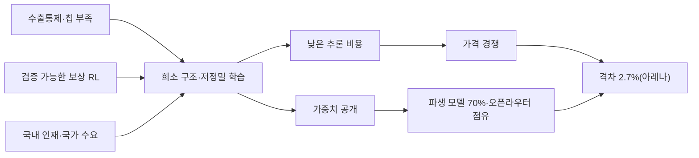

# 중국 AI는 '훔쳐서' 따라잡은 게 아니다…제약을 설계로 바꾼 다섯 가지 방법, 그리고 한국의 '독자 모델'이 놓치고 있는 것

*이 글은 Anthropic의 모델 Claude로 작성했다. 본문에 나오는 Anthropic의 증류 주장은 작성 모델 회사의 주장이므로 다른 쪽 반론을 같은 무게로 실었다.*

## 판단: 격차는 좁혀졌고, 이유는 미국이 말하는 것과 다르다

스탠퍼드 AI 인덱스 2026에 따르면 2026년 3월 기준 Anthropic 최상위 모델과 중국 최상위 모델의 아레나 점수 차이는 2.7%다. 2023년에는 17.5~31.6%였다([스탠퍼드 HAI](https://hai.stanford.edu/ai-index/2026-ai-index-report)). 허깅페이스에서는 지난 1년 다운로드의 41%가 중국 모델이었고, 새로 만들어지는 파생 모델의 70%가 중국 모델 기반이다([Hugging Face](https://huggingface.co/blog/huggingface/state-of-os-hf-spring-2026), [ATOM 보고서](https://arxiv.org/html/2604.07190v2)).

미국 정부와 선두 연구소는 이 추격의 원인으로 증류를 지목한다. Anthropic은 중국 3사가 2만 4,000개 위장 계정으로 1,600만 회 넘게 자사 모델을 추출했다고 했고, 백악관은 "산업 규모의 증류"라고 했다. 이 글은 그 주장을 부정하지 않는다. 그러나 **중국 모델이 따라잡은 핵심은 증류가 아니라, 컴퓨트 제약을 아키텍처로 바꾸고 결과를 즉시 공개해 생태계를 키운 방식이다.** 증류를 완전히 막아도 미국 오픈웨이트 모델의 우위가 1~2개월 늘어날 뿐이라는 네이선 램버트의 의회 브리핑이 이를 뒷받침한다([AI Weekly](https://aiweekly.co/alerts/chinese-labs-now-dominate-open-weight-ai-lambert-briefs-congress)).

이 판단은 한국에 직접 닿는다. 한국의 독자 AI 모델 사업은 '처음부터 직접 학습했는가'를 독자성의 기준으로 삼는다. 중국의 사례는 그 기준이 추격의 핵심 변수가 아니었음을 보여 준다.

## 방법 1: 칩이 모자라면 계산을 줄인다

DeepSeek-V2(2024년 5월)는 키·값 캐시를 93.3% 줄이는 MLA와 희소 전문가 구조로 같은 성능을 42.5% 적은 학습 비용에 냈다고 보고했다([arXiv](https://arxiv.org/abs/2405.04434)). V3(2024년 12월)는 6,710억 매개변수 중 토큰당 370억만 쓰는 구조를 FP8 정밀도로 H800 2,048장에서 학습했고, 공식 학습 비용을 557만 6,000달러로 적었다. 논문은 이 수치가 "사전 연구와 실험 비용을 제외한다"고 명시했다([arXiv](https://arxiv.org/abs/2412.19437)). Epoch AI는 하드웨어 기준으로 이 계산이 타당하며 Llama 3 70B의 절반 수준 컴퓨트라고 봤다([Epoch AI](https://epoch.ai/gradient-updates/what-went-into-training-deepseek-r1)).

이 흐름은 한 회사의 일이 아니다. V3.2의 희소 어텐션(DSA)은 즈푸 GLM-5와 바이두 ERNIE 5.5에 그대로 채택됐고([Hugging Face](https://huggingface.co/zai-org/GLM-5), [Hugging Face](https://huggingface.co/baidu/ERNIE-5.5-Flash-Base/raw/main/README.md)), 문샷 Kimi K2는 DeepSeek-V3와 거의 같은 구조를 1조 매개변수로 키웠다([Hugging Face](https://huggingface.co/moonshotai/Kimi-K2-Instruct)). 2026년 V4는 단일 토큰 추론 연산을 V3.2의 27%, 캐시를 10%로 줄였다고 밝혔다([Hugging Face](https://huggingface.co/deepseek-ai/DeepSeek-V4-Pro)).

| 모델 | 총 매개변수 | 활성 | 핵심 기법 |
|---|---|---|---|
| DeepSeek-V3 (2024.12) | 671B | 37B | MLA, FP8 학습, 다중 토큰 예측 |
| Kimi K2 (2025.7) | 1T | 32B | MuonClip 옵티마이저 |
| Qwen3.5 (2026.2) | 397B | 17B | Gated DeltaNet 하이브리드 |
| GLM-5 (2026.2) | 744B | 40B | DSA, 비동기 RL 인프라 |
| DeepSeek-V4 Pro (2026.4) | 1.6T | 49B | CSA/HCA, FP4+FP8 |
| ERNIE 5.5 Flash (2026.11) | 280B | 14B | HCA+DSA, ECHO |

수출통제는 이 설계를 강제한 조건이었다. 2023년 10월 규정은 H800까지 막았고, 2025년 4월 H20도 허가 대상이 됐다([연방관보](https://www.govinfo.gov/content/pkg/FR-2023-10-19/html/2023-23048.htm)). 제약이 혁신을 낳았다는 말은 반만 맞다. DeepSeek R2는 화웨이 Ascend로 학습에 실패해 엔비디아로 돌아갔다는 보도가 있고([TrendForce(FT 인용)](https://www.trendforce.com/news/2025/08/14/news-deepseek-r2-model-launch-reportedly-delayed-amid-huawei-ascend-chip-hurdl)), 2026년 11월 현재 R2는 공개되지 않았다. DeepSeek은 V4 Pro 가격이 Flash의 최대 12배인 이유로 "고급 컴퓨트 용량의 제약"을 들었다([Asia Financial(로이터)](https://www.asiafinancial.com/chinas-deepseek-says-new-v4-ai-model-can-run-on-huawei-chips)). 제약은 효율을 낳았지만 상한도 만들었다.

## 방법 2: 답이 맞았는지만 보상한다

R1(2025년 1월)의 핵심은 지도학습 없이 강화학습만으로 추론을 끌어낸 R1-Zero다. 보상은 "최종 답의 정답 여부"뿐이었고, 그 결과 AIME 2024 정답률이 15.6%에서 77.9%로 올랐다. 이 논문은 네이처 동료심사를 통과한 첫 주요 LLM 논문이 됐다([Nature](https://www.nature.com/articles/s41586-025-09422-z)). 비평 모델을 없앤 GRPO는 이후 미니맥스의 CISPO, 즈푸의 비동기 RL 인프라, 샤오미의 보상 합성으로 변주됐다([arXiv](https://arxiv.org/abs/2506.13585)). 미니맥스는 M1의 강화학습 전체를 H800 512장에서 3주, 53만 4,700달러에 끝냈다고 보고했다.

이 방법의 특징은 데이터가 아니라 검증기가 자산이라는 점이다. 수학과 코드처럼 정답을 기계가 확인할 수 있는 영역에서 중국 모델이 먼저 치고 나온 이유이고, 2026년 모델들의 벤치마크 격차가 코딩·에이전트 영역에서 가장 작은 이유이기도 하다. 이는 해석이다.

## 방법 3: 가중치를 공개해 표준을 가져간다

알리바바는 Qwen 계열 460개 이상을 공개했고, 파생 모델은 11만 3,000개가 넘는다. 알리바바 한 회사의 파생 모델이 구글과 메타를 합친 것보다 많다([Hugging Face](https://huggingface.co/blog/huggingface/state-of-os-hf-spring-2026)). 오픈라우터의 토큰 점유율에서 메타 Llama는 2025년 1월 37.4%에서 8월 0%로 떨어졌고, 중국 모델은 2026년 1월 72.7%까지 올랐다([ATOM 보고서](https://arxiv.org/html/2604.07190v2)). 에어비앤비 CEO는 Qwen에 "많이" 의존한다고 했고, 커서의 코딩 모델 Composer 2는 Kimi K2.5 위에 만들어졌다([TechCrunch](https://techcrunch.com/2026/03/22/cursor-admits-its-new-coding-model-was-built-on-top-of-moonshot-ais-kimi/)).

공개는 선의가 아니라 전략이다. 가중치를 공개하면 세계의 파인튜닝 연구가 자기 아키텍처 위에서 이뤄지고, 미국 스타트업의 제품이 자기 모델 위에 쌓인다. 다만 공개 범위는 가중치까지다. 2025년 주목 모델 95개 중 80개가 학습 코드를 공개하지 않았고, 완전한 오픈소스는 4개였다([스탠퍼드 HAI](https://hai.stanford.edu/ai-index/2026-ai-index-report)). 학습 데이터는 어느 회사도 공개하지 않는다.

## 방법 4: 추론 가격으로 싸운다

2024년 5월 DeepSeek-V2는 입력 100만 토큰에 1위안, 바이트댄스 두바오는 1,000토큰에 0.0008위안을 불렀고 알리바바는 최대 97%를 내렸다([Fortune](https://fortune.com/asia/2024/05/22/china-ai-llm-price-war-discounts-bytedance-alibaba-baidu-iflytek/)). 2026년 DeepSeek V4.1 Flash는 입력 0.15달러로, GPT-6.1 Sol의 2달러와 Claude Opus 5.5의 4달러와 비교된다([DeepSeek](https://api-docs.deepseek.com/quick_start/pricing), [뉴스1](https://www.news1.kr/it-science/internet-platform/6325065)). 가격이 가능한 이유는 방법 1이다. DeepSeek은 2025년 3월 이론상 545%의 비용 대비 마진을 공개했는데, 할인과 무료 이용으로 실제 수입은 그보다 낮다고 명시했다([SCMP](https://www.scmp.com/tech/big-tech/article/3300734/deepseek-shows-power-v3-r1-models-theoretical-545-profit-margin)).

마이크로소프트의 브래드 스미스는 중국 기업이 "정부 보조금 혜택을 받고 있다"고 했다([ZDNet](https://zdnet.co.kr/view/?no=20260127161634)). 체계적인 보조금 분석은 찾지 못했다. 확인되는 것은 DeepSeek이 2026년 6월 첫 외부 투자를 받기 전까지 창업자의 헤지펀드 자금으로 운영됐고, 그 투자에 국가 AI 펀드가 참여했다는 점이다([The Decoder](https://the-decoder.com/deepseek-takes-outside-money-for-the-first-time-at-a-50-billion-valuation/)).

## 방법 5: 인재는 국내에서, 수요는 국가가

DeepSeek 초기 논문 저자 201명 중 85%가 중국 기관 소속이었고 54%는 중국에서만 교육받았다. 후버연구소는 "중국이 서구 전문성에 기대지 않고 세계 수준의 AI 인재를 자국에서 기를 수 있다"고 평가했다([Hoover Institution](https://www.hoover.org/research/update-deepseek-ai-and-the-great-talent-competition)). 2025년 상위 AI 연구자의 57%가 중국 학부 출신이라는 집계도 있다. 미국으로 가는 AI 연구자 수는 2017년 이후 89% 줄었다([스탠퍼드 HAI](https://hai.stanford.edu/ai-index/2026-ai-index-report)).

수요는 국가가 만든다. 2025년 11월 중국은 국가 자금이 들어간 신규 데이터센터에 국산 AI 칩만 쓰도록 했고([자카르타포스트(로이터)](https://www.thejakartapost.com/business/2025/11/05/china-bans-foreign-ai-chips-from-state-funded-data-centers-sources-say)), 알리바바는 3년간 3,800억 위안 인프라 투자의 절반을 1년 반 만에 집행했다([SCMP](https://www.scmp.com/tech/big-tech/article/3334253/alibaba-lead-ai-capital-spending-among-chinas-big-tech-firms-amid-strong-market-demand)). 다만 민간 투자액은 미국이 23배다. 2025년 미국 2,859억 달러, 중국 124억 달러다.

## 증류 논쟁: 양쪽 다 맞는 부분이 있다

Anthropic은 2026년 2월 DeepSeek이 Claude를 채점 보상 모델로 썼고, 문샷은 340만 회, 미니맥스는 1,300만 회 교환으로 에이전트 코딩 능력을 추출했다고 밝혔다([Anthropic](https://www.anthropic.com/news/detecting-and-preventing-distillation-attacks)). 10월에는 방어로 추출을 90~99% 줄였다고 했지만 "얼마나 오래 갈지 모른다"고 덧붙였다. 중국 상무부는 증류를 "중립적이고 널리 쓰이는 산업 관행"이라 했고, 외교부는 미국 주장이 "근거 없다"고 했다([알자지라](https://www.aljazeera.com/economy/2026/9/9/china-slams-us-claims-of-industrial-scale-ai-theft)).

사실은 둘 사이에 있다. 중국 모델이 미국 모델의 출력을 학습한 정황은 여럿이다. V3가 자신을 GPT-4라고 답한 사례, Copyleaks의 문체 지문 74.2% 일치가 그렇다. 동시에 Anthropic 자신도 저작물 학습으로 15억 달러 합의를 했고, 증류는 R1에서 Qwen·Llama로, Qwen3 안에서 대형에서 소형으로, 미국 스타트업에서 중국 모델로 모든 방향으로 일어난다. 이 글은 증류가 추격 속도를 올린 보조 수단이었고, 그것만으로 2.7%를 설명할 수 없다고 본다. 설명되지 않는 부분이 위 다섯 가지다.

## 지금 어디에 있나

독립 지표는 추격이 '거의'라는 데 일치한다. Artificial Analysis 지수에서 상위 15위 안에 중국 모델은 없고, 최상위 Gemini 4 Carbon과 Claude Opus 5.5가 60·59점인 반면 중국 오픈웨이트 최상위는 46점 안팎이다([Artificial Analysis](https://artificialanalysis.ai/leaderboards/models), [i-SCOOP](https://www.i-scoop.eu/chinese-ai-labs/)). 그러나 오픈웨이트 상위 6개는 모두 중국 모델이다. 미국 NIST CAISI는 DeepSeek V4 Pro가 미국 선두에 약 8개월 뒤지고, 탈옥 시 악의적 요청에 94% 응답하며(미국 모델 8%), 중국 공산당 서사를 4배 더 낸다고 평가했다([NIST](https://nist.gov/news-events/news/2026/05/caisi-evaluation-deepseek-v4-pro), [NIST](https://www.nist.gov/news-events/news/2025/09/caisi-evaluation-deepseek-ai-models-finds-shortcomings-and-risks)). 램버트는 "중국 오픈웨이트는 미국 폐쇄형 최전선에 2~5개월, 미국 오픈웨이트는 6~9개월 뒤진다"고 정리했다.

| 기준 | 중국 | 미국 | 출처 |
|---|---|---|---|
| 아레나 최고점(2026) | 1,464 | 1,503 | 스탠퍼드 AI 인덱스 |
| AA 지수 최고 | 약 46(오픈) | 60(폐쇄) | Artificial Analysis |
| 선두와의 시차 | 2~5개월(오픈) / 8개월(CAISI) | — | 램버트, NIST |
| HF 다운로드 비중 | 41% | 36.5% | Hugging Face |
| 민간 투자(2025) | 124억 달러 | 2,859억 달러 | 스탠퍼드 |

## 한국: 기준을 잘못 잡으면 추격도 어긋난다

한국의 사정은 세 가지 숫자로 드러난다. **첫째,** 과기정통부 배경훈 장관은 7월 "아직 많은 현장에서 중국의 오픈웨이트 모델을 쓰고 있다는 사실을 무겁게 받아들여야 한다"고 했다([서울신문](https://m.seoul.co.kr/news/economy/2026/07/20/20260720500210)). 오픈라우터 10월 둘째 주 요청량에서 중국 모델 합산은 44.3%였다([뉴스1](https://www.news1.kr/it-science/internet-platform/6325065)). **둘째,** 한국어 지식 벤치마크 KMMLU-Pro에서 Qwen3-235B가 70.9점으로 K-EXAONE 63.5점, A.X K1 60.3점보다 높다([SOTA2](https://www.sota2.com/research/sota/knowledge-on-kmmlu-pro)). **셋째,** 정부가 확보했다는 GPU 26만 장 가운데 실제 서비스 중인 것은 지난해 추경분 1만 3,100장이고, 올해 협약분 9,704장 중 10월 8일까지 반입은 2,608장이다([ZDNet](https://zdnet.co.kr/view/?no=20261014164011)).

이 조건에서 독자 AI 파운데이션 모델 사업은 "모델 아키텍처 설계, 데이터 확보·가공, 사전학습 전 과정을 자체 수행"한 모델만 독자 AI로 인정한다. 네이버클라우드는 Qwen2.5의 비전 인코더를 가중치 변경 없이 썼다는 이유로 1차에서 탈락했고, 정부는 "국가 안보에 대한 위협 등이 발생할 가능성"을 들었다([서울경제](https://www.sedaily.com/article/14171391)). 네이버는 "검증된 외부 인코더를 전략적으로 채택"한 "고도의 엔지니어링 판단"이라고 했다. 같은 시기 SKT의 상용 모델 A.X 4.0은 공식적으로 Qwen2.5 기반이고 KMMLU 78.32점으로 GPT-4o를 앞선다([Hugging Face](https://huggingface.co/skt/A.X-4.0)).

**이 글의 판단은 이렇다. 중국이 보여 준 것은 '처음부터 만들기'가 아니라 '빨리 만들고 바로 공개하고 싸게 돌리기'였다. 한국의 기준은 그 반대편에 서 있다.** DeepSeek이 Llama 구조를 참고하고, Kimi가 DeepSeek 구조를 베끼고, 샤오미가 Qwen으로 증류하는 동안 어느 회사도 '독자성'을 묻지 않았다. 그들이 물은 것은 토큰당 비용과 벤치마크였다. 2차 평가에서 AA 지수 1위였던 모티프가 사용자 평가 점수로 탈락한 일은([AI경제연구소](https://www.aieconlab.com/post/trend21_dokpamo_2nd_eval/)) 이 사업이 무엇을 재고 있는지 보여 준다.

반론도 분명하다. 하정우 AI수석은 "민간은 중국 오픈소스도 많이 쓰고 막을 이유도 없다"면서 "정부나 공공영역까지 과하게 의존하면 리스크"라고 했다([미디어오늘](https://www.mediatoday.co.kr/news/articleView.html?idxno=333890)). CAISI의 탈옥 94%와 검열 수치, 미국 국토안보부의 연방 시스템 DeepSeek 금지는 그 리스크가 실제임을 보여 준다. 그래서 답은 둘로 나눠야 한다.

| 대상 | 영향 | 판단 |
|---|---|---|
| 공공·안보 영역 | 중국 모델의 검열·탈옥 취약성이 확인됨 | 독자 모델이 필요하다. 다만 기준은 '처음부터'가 아니라 '학습 데이터와 가중치를 끝까지 통제했는가'여야 한다 |
| 민간 기업 | 중국 모델이 가장 싸고 한국어도 강함. 정책 변경 시 주권 리스크 | 쓰되 출처 표시와 대체 경로를 의무화해야 한다. 김두현 교수의 "마킹 제도"가 그 예다 |
| 독파모 3팀 | K-EXAONE 2.0의 SWE-bench 68.2 vs 중국 73.6~80.6 | 3차 목표 '글로벌 오픈웨이트 근접'은 중국 모델을 이기는 것이 아니라 격차를 몇 달로 줄이는 것이어야 한다 |
| 한국 반도체 | 화웨이의 병목은 HBM이고 중국은 국산 칩을 강제한다 | 중국 AI의 성장은 한국 HBM 수요로 바로 이어지지 않는다. 수출통제가 그 길을 막고 있다 |
| 한국 정부 | GPU 반입 26.9%, 활용률 51.5% | 중국이 증명한 것은 칩보다 칩을 아끼는 설계였다. 반입을 기다리는 동안 효율에 투자해야 한다 |

중국이 한국에 준 교훈은 하나로 모인다. 격차를 줄인 것은 자원의 양이 아니라 자원을 쓰는 방식과 공개 속도였다. 한국은 특허 밀도에서 세계 1위이고([스탠퍼드 HAI](https://hai.stanford.edu/ai-index/2026-ai-index-report)), 메모리를 만드는 나라다. 부족한 것은 처음부터 만들 결의가 아니라, 만든 것을 바로 내놓고 싸게 돌리며 다음 버전을 두 달 안에 내는 리듬이다. 이는 해석이다.

## 확인할 점

- 벤치마크 수치는 대부분 기업 자체 보고이며 독립 지표(Artificial Analysis, 스탠퍼드, NIST)와 구분해 적었다. Artificial Analysis 지수는 열람 시점 값이고 날짜 표기가 없다.
- DeepSeek의 학습 비용은 자체 보고이고 감사받지 않았다. R1의 강화학습 비용(29만 4,000달러)은 보충자료를 보지 못해 본문에 넣지 않았다.
- Anthropic의 10월 방어 글은 원문 접속이 막혀 2차 보도로 확인했다. 이 글을 쓴 모델이 Anthropic의 것이라는 이해관계를 첫머리에 밝혔다.
- DeepSeek R2의 미출시는 허깅페이스 저장소 기준이고 공식 확인은 없다. Qwen 4의 출시 여부, ERNIE 5.5 라이선스의 한국 제외 조항은 확인하지 못했다.
- 한국어 벤치마크 비교는 단일 사이트 집계이고 공식 통합표는 없다. 독파모 3차 평가 기준은 확정되지 않았다.
- '증류는 보조 수단'이라는 평가, 다섯 가지 방법의 분류, 한국에 대한 판단은 이 글의 해석이다.

## 출처

- [AI Index Report 2026 — Stanford HAI](https://hai.stanford.edu/ai-index/2026-ai-index-report)
- [State of Open Source on Hugging Face: Spring 2026 — Hugging Face](https://huggingface.co/blog/huggingface/state-of-os-hf-spring-2026)
- [The ATOM Report — arXiv](https://arxiv.org/html/2604.07190v2)
- [Chinese labs now dominate open-weight AI: Lambert briefs Congress — AI Weekly](https://aiweekly.co/alerts/chinese-labs-now-dominate-open-weight-ai-lambert-briefs-congress)
- [DeepSeek-V2 — arXiv](https://arxiv.org/abs/2405.04434)
- [DeepSeek-V3 Technical Report — arXiv](https://arxiv.org/abs/2412.19437)
- [What went into training DeepSeek-R1 — Epoch AI](https://epoch.ai/gradient-updates/what-went-into-training-deepseek-r1)
- [GLM-5 — Hugging Face](https://huggingface.co/zai-org/GLM-5)
- [ERNIE-5.5-Flash-Base — Hugging Face](https://huggingface.co/baidu/ERNIE-5.5-Flash-Base/raw/main/README.md)
- [Kimi-K2-Instruct — Hugging Face](https://huggingface.co/moonshotai/Kimi-K2-Instruct)
- [DeepSeek-V4-Pro — Hugging Face](https://huggingface.co/deepseek-ai/DeepSeek-V4-Pro)
- [Export Controls on Advanced Computing Items — Federal Register](https://www.govinfo.gov/content/pkg/FR-2023-10-19/html/2023-23048.htm)
- [DeepSeek R2 reportedly delayed amid Huawei Ascend hurdles — TrendForce](https://www.trendforce.com/news/2025/08/14/news-deepseek-r2-model-launch-reportedly-delayed-amid-huawei-ascend-chip-hurdl)
- [DeepSeek says new V4 model can run on Huawei chips — Asia Financial](https://www.asiafinancial.com/chinas-deepseek-says-new-v4-ai-model-can-run-on-huawei-chips)
- [DeepSeek-R1 incentivizes reasoning in LLMs through reinforcement learning — Nature](https://www.nature.com/articles/s41586-025-09422-z)
- [MiniMax-M1 — arXiv](https://arxiv.org/abs/2506.13585)
- [Cursor admits its new coding model was built on Moonshot's Kimi — TechCrunch](https://techcrunch.com/2026/03/22/cursor-admits-its-new-coding-model-was-built-on-top-of-moonshot-ais-kimi/)
- [China AI LLM price war — Fortune](https://fortune.com/asia/2024/05/22/china-ai-llm-price-war-discounts-bytedance-alibaba-baidu-iflytek/)
- [Pricing — DeepSeek API Docs](https://api-docs.deepseek.com/quick_start/pricing)
- [中 AI 안 쓸 수도 없고 — 뉴스1](https://www.news1.kr/it-science/internet-platform/6325065)
- [DeepSeek shows theoretical 545% profit margin — SCMP](https://www.scmp.com/tech/big-tech/article/3300734/deepseek-shows-power-v3-r1-models-theoretical-545-profit-margin)
- [딥시크 충격 1년 — ZDNet Korea](https://zdnet.co.kr/view/?no=20260127161634)
- [DeepSeek takes outside money at $50 billion valuation — The Decoder](https://the-decoder.com/deepseek-takes-outside-money-for-the-first-time-at-a-50-billion-valuation/)
- [Update: DeepSeek, AI and the great talent competition — Hoover Institution](https://www.hoover.org/research/update-deepseek-ai-and-the-great-talent-competition)
- [China bans foreign AI chips from state-funded data centers — The Jakarta Post(Reuters)](https://www.thejakartapost.com/business/2025/11/05/china-bans-foreign-ai-chips-from-state-funded-data-centers-sources-say)
- [Alibaba leads AI capital spending — SCMP](https://www.scmp.com/tech/big-tech/article/3334253/alibaba-lead-ai-capital-spending-among-chinas-big-tech-firms-amid-strong-market-demand)
- [Detecting and preventing distillation attacks — Anthropic](https://www.anthropic.com/news/detecting-and-preventing-distillation-attacks)
- [China slams US claims of industrial-scale AI theft — Al Jazeera](https://www.aljazeera.com/economy/2026/9/9/china-slams-us-claims-of-industrial-scale-ai-theft)
- [Copyleaks: 74% stylistic overlap — Copyleaks](https://copyleaks.com/about-us/press-releases/copyleaks-identifies-over-74-percent-stylistic-overlap-between-deepseek-openai-models)
- [Why DeepSeek's new AI model thinks it's ChatGPT — TechCrunch](https://techcrunch.com/2024/12/27/why-deepseeks-new-ai-model-thinks-its-chatgpt/)
- [Anthropic, misanthropic — The Register](https://www.theregister.com/2026/02/24/anthropic_misanthropic_chinese_ai_labs/)
- [LLM Leaderboard — Artificial Analysis](https://artificialanalysis.ai/leaderboards/models)
- [Chinese AI labs — i-SCOOP](https://www.i-scoop.eu/chinese-ai-labs/)
- [CAISI Evaluation of DeepSeek V4 Pro — NIST](https://nist.gov/news-events/news/2026/05/caisi-evaluation-deepseek-v4-pro)
- [CAISI Evaluation of DeepSeek AI Models — NIST](https://www.nist.gov/news-events/news/2025/09/caisi-evaluation-deepseek-ai-models-finds-shortcomings-and-risks)
- [배경훈 "중국 오픈웨이트 모델 현장 사용 무겁게" — 서울신문](https://m.seoul.co.kr/news/economy/2026/07/20/20260720500210)
- [KMMLU-Pro Knowledge — SOTA2](https://www.sota2.com/research/sota/knowledge-on-kmmlu-pro)
- [GPU 26만장 중 실제 서비스 1.3만장 — ZDNet Korea](https://zdnet.co.kr/view/?no=20261014164011)
- [네이버클라우드 독파모 1차 탈락 사유 — 서울경제](https://www.sedaily.com/article/14171391)
- [A.X-4.0 — Hugging Face](https://huggingface.co/skt/A.X-4.0)
- [독파모 2차 평가 분석 — AI경제연구소](https://www.aieconlab.com/post/trend21_dokpamo_2nd_eval/)
- [하정우 AI수석 인터뷰 — 미디어오늘](https://www.mediatoday.co.kr/news/articleView.html?idxno=333890)
- [독파모 1차 평가 결과 — 인공지능신문](https://www.aitimes.kr/news/articleView.html?idxno=38163)
- [독파모 2차 평가 브리핑 — 대한민국 정책브리핑](https://www.korea.kr/briefing/policyBriefingView.do?newsId=156774781)
- [독파모 2차 세부 점수 — 뉴스핌](https://www.newspim.com/news/view/20260827001289)
- [DHS blocks DeepSeek from federal IT systems — House Select Committee on the CCP](https://chinaselectcommittee.house.gov/media/press-releases/dhs-blocks-china-based-deepseek-from-federal-it-systems)

---

이 글은 공개 출처를 바탕으로 AI가 자동 생성한 초안을 검토해 발행했으며, 중요한 판단 전에는 연결된 원문을 확인해야 합니다.
