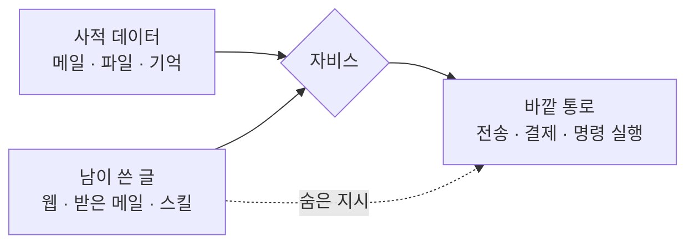

# 자비스의 부품은 다 나왔다, 없는 것은 맡겨도 되는 구조다…오픈클로 1년이 보여 준 '나만의 비서'의 진짜 재료

## 한눈에 보기

영화 속 자비스를 만들려면 무엇이 필요한가. 2026년 11월의 답은 "부품은 이미 다 있다"이다. 말귀를 알아듣는 두뇌, 귀와 입, 어제를 기억하는 장치, 메일과 캘린더를 만지는 손, 시키지 않아도 깨어 있는 상시 구동까지 모두 오픈소스나 월 구독으로 구할 수 있다. 그런데도 자비스를 쓰는 사람은 드물다. 모자란 것은 지능이 아니라 그 지능에 내 메일함과 지갑을 맡겨도 되는 구조다.

근거는 지난 1년의 실험이다. 2025년 11월 24일 오스트리아 개발자 페터 슈타인베르거가 공개한 오픈클로(OpenClaw)는 위 부품을 한 사람이 조립할 수 있음을 보였고, 2026년 3월 2일 기준 GitHub 별 24만 7,000개를 받았다([위키백과](https://en.wikipedia.org/wiki/OpenClaw)). 같은 프로젝트가 낸 GitHub 보안 권고는 4월까지 255건을 넘었다([IBM X-Force](https://www.ibm.com/think/x-force/what-openclaw-reveals-about-agentic-ai-security-risks)). 조립은 쉬웠고, 망가진 곳은 전부 권한이었다.

영화의 자비스는 토니 스타크의 말만 듣는다. 현실의 자비스는 자기가 읽는 모든 글의 말을 듣는다. 나만의 자비스를 만드는 일은 이 차이를 메우는 일이고, 아래 다섯 부품보다 여섯 번째 항목에 시간을 더 써야 한다.

## 다섯 부품은 이미 선반에 있다

**두뇌.** 클라우드 모델을 API로 부르거나 집 안 기기에서 오픈 가중치 모델을 돌린다. 스탠퍼드의 Hazy Research와 Scaling Intelligence 연구실이 만든 개인 에이전트 틀 OpenJarvis는 5월 28일 1.0을 내면서 로컬 모델이 일상적인 대화와 추론 대부분을 이미 감당한다고 밝혔다. 다만 수치는 제시하지 않았다([Ollama 블로그](https://ollama.com/blog/openjarvis)). 집에 둘 기기의 선택지와 가격은 [10월 기사](https://now.zeta4.net/a/2026-10-15-personal-ai-dev-hardware-october-2026)에 정리했다. 내 판단으로는 처음부터 기기를 살 이유가 없다. 두뇌는 가장 갈아 끼우기 쉬운 부품이다.

**귀와 입.** 자비스다움의 절반은 목소리인데, 여기서 중요한 것은 음질이 아니라 첫마디까지 걸리는 시간이다. Home Assistant가 공개한 측정에서 로컬 음성 합성 Piper는 답변 전체를 기다리면 5.31초, 모델이 내는 첫 단어부터 흘려보내면 0.56초 만에 말을 시작했다(RTX 3090에서 gemma3:4b 기준, [Home Assistant](https://www.home-assistant.io/blog/2025/09/11/ai-in-home-assistant)). 8월 5일 나온 2026.8은 llama.cpp 서버를 대화 에이전트로 붙이는 통합을 기본 탑재했다([릴리스 노트](https://www.home-assistant.io/blog/2026/08/05/release-20268/)). 집 안의 음성 비서는 이제 클라우드 없이도 선다.

**기억.** 자비스가 챗봇과 갈리는 지점이다. 답은 의외로 소박해서, 오픈클로는 설정과 대화 이력, 사용자에 대한 기억을 작업 폴더의 Markdown 파일에 평문으로 쌓는다. 이 방식이 조잡해 보여도 틀리지 않았다는 점은 [기억과 스킬 편](https://now.zeta4.net/a/2026-11-01-building-ai-agents-memory-context-skills)에서 다뤘다. 파일과 검색이 그래프 메모리를 이긴 측정이 있다. 다만 사람이 읽고 고칠 수 있는 기억은 공격자도 고칠 수 있다. 이 점은 뒤에서 다시 나온다.

**손.** 메일, 캘린더, 메신저, 집 안 기기에 닿는 연결이다. MCP가 표준 플러그 역할을 하고, 오픈클로는 Signal·Telegram·Discord·WhatsApp을 대화 창구로 쓴다. 기능은 `SKILL.md` 파일이 든 폴더, 곧 스킬로 늘린다.

**심장박동.** 부르지 않아도 도는 주기 실행이다. 오픈클로는 기본 설정에서 30분마다 `HEARTBEAT.md`에 적힌 일을 수행한다([HiddenLayer](https://www.hiddenlayer.com/research/exploring-the-security-risks-of-ai-assistants-like-openclaw)). 아침 브리핑과 "택배 오면 알려 줘"가 여기서 나온다. 챗봇은 물어야 답하고 비서는 먼저 말한다. 그 차이를 만드는 것이 모델이 아니라 이 타이머 하나다.

## 여섯 번째 재료: 읽는 것과 따르는 것을 가르는 벽

다섯 부품을 이으면 자비스처럼 보이는 것이 나온다. 문제는 그 순간 사이먼 윌리슨이 2025년 6월 '치명적 삼중주'라고 부른 조합이 완성된다는 점이다. 사적 데이터 접근, 신뢰할 수 없는 콘텐츠 노출, 외부로 내보낼 수 있는 통로다. 그의 설명대로 언어 모델은 지시가 어디서 왔는지에 따라 그 무게를 안정적으로 구분하지 못한다([Simon Willison](https://simonwillison.net/2025/Jun/16/the-lethal-trifecta/)). 주인의 말과 웹페이지에 숨은 문장이 같은 입력으로 들어간다.

오픈클로의 사고 기록은 이 그림 그대로다.

- **기억과 심장박동이 뒷문이 됐다.** HiddenLayer는 2월 3일, 웹페이지 요약을 시키는 것만으로 숨은 지시가 설치 스크립트를 실행시키고 `HEARTBEAT.md`에 공격자의 지시를 써넣는 과정을 시연했다. 그 뒤로 비서는 30분마다 공격자 서버에서 할 일을 받아 온다. 자비스를 자비스답게 만드는 두 부품이 그대로 지속 감염 수단이 됐다.
- **손이 공급망이 됐다.** Cisco가 1월 28일 분석한 스킬 'What Would Elon Do?'는 저장소 1위로 순위가 부풀려져 있었고, 치명적 2건과 높음 5건을 포함해 보안 문제 9건이 나왔다. 사용자 모르게 데이터를 외부 서버로 보내는 명령이 들어 있었다([Cisco](https://blogs.cisco.com/ai/personal-ai-agents-like-openclaw-are-a-security-nightmare)). IBM은 스킬 장터에 올라온 악성 스킬을 1,100개 이상으로 집계했다.
- **고쳐지지 않았다.** 8월 30일 나온 오픈클로 2.0에서도 비밀 저장소는 저장 시 암호화되지 않고 샌드박스는 자동으로 켜지지 않는다. 더 레지스터는 설치는 쉬워졌지만 기본 보안은 따라오지 않았다고 평가했다(위키백과 인용). 중국 당국은 3월에 국유기업과 정부 기관의 사무용 컴퓨터에서 오픈클로 실행을 제한했다.

이것을 오픈클로의 미숙함으로만 읽으면 틀린다. 어떤 틀로 만들든 세 요소를 한 에이전트에 모으면 같은 일이 난다. 윌리슨은 공격의 95%를 막는다는 방어 제품을 두고 웹 보안에서 95%는 낙제점이라고 했다. 그의 결론은 조합 자체를 피하라는 것이다. 그래서 내 자비스의 설계 원칙은 하나로 줄어든다. **다리 하나를 자른다.**

- 받은 메일과 웹을 읽는 비서에게는 보내는 권한을 주지 않는다. 답장은 초안까지만 쓰게 하고, 발송은 사람이 누른다.
- 결제, 삭제, 외부 전송은 건별 승인으로 둔다. 승인 지점을 어디에 둘지는 [운영 편](https://now.zeta4.net/a/2026-11-04-building-ai-agents-operations-approval-observability-cost)에서 다뤘다.
- 기억 파일과 주기 실행 목록은 비서가 스스로 고치지 못하게 하거나, 고친 내용을 사람이 보게 한다.
- 스킬은 남의 코드다. 설치 전에 읽고, 못 읽겠으면 깔지 않는다. 최소 권한 점검표는 [권한 편](https://now.zeta4.net/a/2026-11-03-building-ai-agents-least-privilege-sandbox-injection)에 있다.

이렇게 만든 비서는 영화보다 답답하다. 하지만 "알아서 다 하는 자비스"와 "내 계정으로 무엇이든 할 수 있는 낯선 사람" 사이에는 지금 기술로 벽이 없다. 답답함은 결함이 아니라 현재 지불할 수 있는 유일한 보험료다.

## 한국에서 만들면: 손이 닿는 곳은 '나와의 채팅방'까지

한국 사용자에게는 제약이 하나 더 있다. 생활이 담긴 곳이 열려 있지 않다. 카카오는 5월 1일 MCP 플랫폼 PlayMCP에 오픈클로 연동을 붙였다. 등록 서버는 200여 개이고 연결에는 10분짜리 일회용 토큰을 쓴다. 보도자료가 카카오 서비스로 든 것은 카카오톡 '나와의 채팅방', 톡캘린더, 카카오맵, 선물하기, 멜론이다([카카오](https://www.kakaocorp.com/page/detail/12012)). 가족·직장 대화방 같은 일반 채팅방은 거기에 없다.

나는 이 닫힘을 불편이면서 동시에 방어로 본다. 대화방은 남이 쓴 글로 가득한 곳, 곧 삼중주의 두 번째 다리다. 카카오가 문을 좁게 연 덕에 한국의 자비스는 덜 유능하고 덜 위험하다. 카카오는 독립 앱 카나나를 접으면서 12월 '카나나 스페이스' 비공개 베타를 예고했다([10월 기사](https://now.zeta4.net/a/2026-10-15-kakao-kanana-shutdown-kakaotalk-ai)). 그때 볼 것은 기능 목록이 아니라 대화방 데이터를 누구의 에이전트에, 어떤 승인 구조로 여는가다. 이 글은 그 결과를 추적한다.

## 그래서 무엇부터 만들까

순서는 권한이 작은 쪽에서 큰 쪽이다.

1. **읽기 전용 아침 브리핑.** 캘린더, 날씨, 내가 고른 뉴스만 읽고 나에게만 말한다. 바깥 통로가 없으니 삼중주가 성립하지 않는다. 심장박동과 기억을 여기서 익힌다.
2. **집 안의 목소리.** Home Assistant에 로컬 모델을 붙여 조명과 가전을 맡긴다. 잘못돼도 피해가 집 안의 스위치에 머문다.
3. **초안까지만 쓰는 손.** 메일 답장과 일정 조율을 초안으로 받는다. 발송 버튼은 계속 사람 것이다.
4. **건별 승인이 붙은 실행.** 여기서부터가 자비스이고, 여기서부터가 위험이다. 3단계를 몇 달 써 보고, 비서가 틀린 방식을 충분히 본 다음에 연다.

대부분의 사람에게 쓸모 있는 자비스는 2단계와 3단계 사이에 있다. 영화의 자비스는 4단계 너머에 있고, 거기까지 가는 길은 더 큰 모델이 아니라 아직 아무도 풀지 못한 권한 문제로 막혀 있다. 모델 발표를 기다릴 이유는 없다. 지금 필요한 재료는 주말 하루와, 비서에게 주지 않을 권한의 목록이다.

## 출처

- [OpenClaw (Wikipedia)](https://en.wikipedia.org/wiki/OpenClaw)
- [What OpenClaw reveals about agentic AI security risks (IBM X-Force, 2026-04-23)](https://www.ibm.com/think/x-force/what-openclaw-reveals-about-agentic-ai-security-risks)
- [Exploring the Security Risks of AI Assistants like OpenClaw (HiddenLayer, 2026-02-03)](https://www.hiddenlayer.com/research/exploring-the-security-risks-of-ai-assistants-like-openclaw)
- [Personal AI Agents like OpenClaw Are a Security Nightmare (Cisco, 2026-01-28)](https://blogs.cisco.com/ai/personal-ai-agents-like-openclaw-are-a-security-nightmare)
- [The lethal trifecta for AI agents (Simon Willison, 2025-06-16)](https://simonwillison.net/2025/Jun/16/the-lethal-trifecta/)
- [OpenJarvis: a local-first personal AI (Ollama 블로그, 2026-05-28)](https://ollama.com/blog/openjarvis)
- [Building the AI-powered local smart home (Home Assistant, 2025-09-11)](https://www.home-assistant.io/blog/2025/09/11/ai-in-home-assistant)
- [2026.8: Approachable by design (Home Assistant, 2026-08-05)](https://www.home-assistant.io/blog/2026/08/05/release-20268/)
- [카카오 'PlayMCP', 오픈소스 AI 에이전트 '오픈클로' 연동 지원 (카카오, 2026-05-01)](https://www.kakaocorp.com/page/detail/12012)

---

이 글은 공개 출처를 바탕으로 AI가 자동 생성한 초안을 검토해 발행했으며, 중요한 판단 전에는 연결된 원문을 확인해야 합니다.
