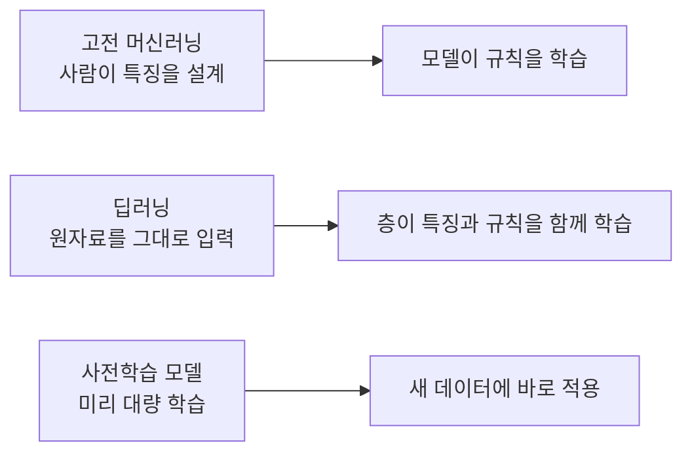

# 머신러닝, 신경망, 딥러닝을 가르는 것은 '특징을 누가 만드나'다…딥러닝이 10년 넘게 못 넘던 표 데이터의 벽도 무너지고 있다

## 한눈에 보기

머신러닝, 신경망, 딥러닝은 흔히 나란히 놓이지만 서로 다른 세 기술이 아니다. 큰 상자 안에 작은 상자가 든 관계다. 가장 큰 상자인 머신러닝은 규칙을 사람이 짜지 않고 컴퓨터가 데이터에서 배우게 하는 방법 전체다. 그 안의 신경망은 뇌의 신경세포를 흉내 낸 작은 계산 단위를 층층이 이은 모델이다. 가장 안쪽의 딥러닝은 그 층을 아주 깊게 쌓은 신경망이다. 용어만 외우면 여기서 끝난다.

실제로 셋을 가르는 질문은 하나다. **데이터에서 무엇을 봐야 하는지 누가 정하는가.** 고전 머신러닝에서는 사람이 정한다. 대출 심사 모델이라면 "소득 가운데 빚 갚는 데 쓰는 비율"을 사람이 계산해 넣는다. 딥러닝에서는 모델이 정한다. 사진의 픽셀을 그대로 넣으면 앞쪽 층은 선과 모서리를, 뒤쪽 층은 눈과 바퀴를 스스로 찾는다. 지난 15년의 AI 역사는 이 결정권이 사람에게서 모델로 넘어간 기록이다.

그 이동이 끝까지 실패한 곳이 있었다. 엑셀과 데이터베이스에 담긴 표 데이터다. 2022년까지도 이 영역에서는 고전 머신러닝의 나무 모델이 딥러닝을 이겼다. 나무 모델은 스무고개처럼 질문을 이어 가며 답을 찾는 방식이다. 그런데 나무 모델이 이긴다는 사실을 논문으로 정리한 연구자가 3년 뒤 반대 결론의 논문을 이끌었다. 기업 데이터 대부분이 표인 한국 실무자에게는 챗GPT보다 이 변화가 더 직접적이다.

처음 보는 용어는 글 끝의 용어집에 모았고, 어려운 대목마다 숫자로 따라 해 볼 수 있는 예제를 붙였다. 예제의 숫자는 이해를 돕기 위해 만든 가상의 값이다.

## 세 상자: 무엇이 무엇 안에 있나

먼저 일하는 순서로 견주면 이렇다. 고전 머신러닝은 사람이 특징을 만들어 주고, 딥러닝은 원자료를 그대로 받으며, 뒤에서 다룰 사전학습 모델은 미리 배워 둔 것을 새 데이터에 바로 쓴다.

**머신러닝**은 "이 메일은 스팸, 저 메일은 정상"처럼 답이 붙은 예시를 많이 보여 주고, 처음 보는 예시의 답도 맞히는 규칙을 컴퓨터가 스스로 찾게 하는 방법이다. 딥러닝 이전부터 쓰인 고전적인 방법이 여럿 있고, 그 가운데 지금도 실무의 주력은 나무 모델을 여러 개 묶은 그래디언트 부스팅이다(예제 4에서 설명한다). 이 고전적인 방법들은 사람이 골라 준 특징, 곧 "무엇을 볼지"가 정해진 입력 위에서 가장 잘 작동한다.

### 예제 1. 특징을 사람이 만드는 경우와 모델이 만드는 경우

은행이 대출 신청자의 연체 위험을 예측한다고 하자. 원자료에는 "월소득 400만 원", "매달 갚는 대출 원리금 160만 원" 같은 열이 있다.

- 사람이 만드는 특징: 심사 담당자는 경험상 두 숫자를 따로 보는 것보다 비율이 중요하다는 것을 안다. 그래서 160 ÷ 400 = 0.4, 곧 "소득 대비 상환 비율 40%"라는 새 열을 계산해 넣는다. 모델은 이 열을 보고 "40%를 넘으면 위험이 커진다" 같은 규칙을 배운다. 이 비율이 특징이고, 그것을 생각해 낸 것은 사람이다.
- 모델이 만드는 특징: 고양이 사진을 분류한다고 하자. 가로세로 224픽셀 컬러 사진은 224 × 224 × 3 = 15만 528개의 숫자다. "몇 번째 숫자가 얼마면 고양이"라는 규칙을 사람이 쓸 방법은 없다. 딥러닝은 이 숫자들을 그대로 받아, 앞쪽 층에서 선과 모서리를, 중간 층에서 눈과 귀 모양을, 뒤쪽 층에서 "고양이 얼굴"을 스스로 찾아낸다. 무엇을 볼지 모델이 정한 것이다.

**신경망**은 작은 계산 단위를 여러 겹 이은 모델이다. 단위 하나는 들어온 숫자들에 각각 가중치라는 숫자를 곱해 더한 뒤 다음 단위로 넘긴다. 가중치는 "이 입력을 얼마나 중요하게 볼지"를 정하는 값이고, 신경망이 배운다는 것은 이 가중치들을 고친다는 뜻이다. 고치는 방법이 역전파다. 답이 틀린 만큼을 출력 쪽에서 입력 쪽으로 거꾸로 따져 가며 모든 가중치를 조금씩 고친다. 이 계산법의 원형은 1970년 핀란드의 세포 린나인마가 발표했고, 1986년 데이비드 루멜하트, 제프리 힌턴, 로널드 윌리엄스가 네이처에 낸 논문이 신경망을 학습시키는 방법으로 널리 알렸다([위키백과](https://en.wikipedia.org/wiki/Backpropagation)). 2024년 노벨 물리학상은 존 홉필드와 힌턴에게 "인공 신경망으로 기계 학습을 가능하게 한 기초적 발견과 발명"을 이유로 돌아갔다([Science News](https://www.sciencenews.org/article/nobel-physics-2024-machine-learning)).

### 예제 2. 학습이란 가중치를 조금씩 고치는 일이다

가장 작은 신경망을 생각하자. 입력 x에 가중치 w를 곱한 값을 예측으로 내는 단위 하나다(예측 = w × x).

1. 처음에는 w를 아무 값, 예컨대 0.5로 둔다. 입력 x = 2를 넣으면 예측은 0.5 × 2 = 1이다.
2. 정답은 3이었다. 틀린 정도를 재는 손실을 (예측 − 정답)²로 정하면 (1 − 3)² = 4다.
3. 이제 w를 키워야 할지 줄여야 할지 알아본다. w를 0.5에서 0.51로 아주 조금 키워 보면 예측은 1.02, 손실은 (1.02 − 3)² = 약 3.92로 0.08쯤 줄어든다. w를 0.01 키웠더니 손실이 0.08 줄었으니, w를 1 키울 때 손실이 8 줄어드는 비율이다. 이 비율 −8을 기울기라고 한다. 기울기가 음수면 w를 키울수록 손실이 준다는 뜻이다. 실제로는 이렇게 일일이 넣어 보지 않고 미분 공식 2 × (예측 − 정답) × x = 2 × (−2) × 2 = −8로 한 번에 구한다.
4. 기울기가 가리키는 쪽으로 w를 옮긴다. 한꺼번에 너무 많이 옮기면 정답을 지나칠 수 있으니 기울기의 10분의 1만큼만 움직이기로 한다(이 0.1을 학습률이라 한다). 새 w는 0.5 − 0.1 × (−8) = 1.3이다.
5. 다시 넣어 보면 예측은 1.3 × 2 = 2.6, 손실은 (2.6 − 3)² = 0.16으로 4에서 크게 줄었다. 정답 3을 내는 w는 1.5인데, 한 걸음 만에 0.5에서 1.3까지 다가간 것이다. 이 과정을 수없이 되풀이하는 것이 학습이다.

실제 신경망에는 이런 가중치가 수백만에서 수천억 개 있고 층이 여러 겹이다. 출력 쪽에서 생긴 오차가 각 층의 가중치에 얼마씩 책임이 있는지를 출력에서 입력 방향으로 거꾸로 차례차례 계산하는 방법이 역전파다. 위 3단계의 기울기 계산을 뒤쪽 층에서 앞쪽 층으로 이어 붙이는 것이라고 보면 된다.

**딥러닝**은 층이 깊은 신경망이다. 이론은 1980년대에 있었지만 층을 깊게 쌓으려면 데이터와 계산 능력이 훨씬 많이 필요했다. 인터넷이 사진을 쌓고 그래픽카드(GPU)가 계산을 맡은 2012년에야 터졌다. 알렉스 크리제프스키, 일리야 수츠케버, 힌턴이 만든 신경망 AlexNet은 사진 분류 대회용 데이터 ImageNet에서 top-5 오류율 18.9%를 내며 기존 최고 기록을 크게 앞섰다(이 수치의 뜻은 예제 3에서 푼다)([NeurIPS 2012](https://proceedings.neurips.cc/paper/2012/hash/c399862d3b9d6b76c8436e924a68c45b-Abstract.html)). 2017년 6월 구글 연구진이 트랜스포머라는 새 신경망 구조를 논문 「Attention Is All You Need」로 내놓으면서([arXiv](https://arxiv.org/abs/1706.03762)) 같은 방식이 언어로 넘어갔고, 그 끝에 챗GPT 같은 지금의 대형 언어 모델이 있다.

### 예제 3. top-5 오류율 18.9%는 무슨 뜻인가

ImageNet은 사진마다 "시베리안 허스키", "에스프레소"처럼 1,000가지 분류 가운데 하나의 정답이 붙은 데이터다. 모델은 사진 한 장마다 가능성이 높은 순서로 후보를 낸다.

- 어떤 사진의 정답이 "시베리안 허스키"이고, 모델이 낸 상위 다섯 후보가 "알래스칸 맬러뮤트, 시베리안 허스키, 늑대, 에스키모견, 썰매"라면 다섯 안에 정답이 있으므로 맞힌 것으로 친다.
- 다섯 후보 어디에도 정답이 없으면 틀린 것이다.
- top-5 오류율 18.9%는 사진 100장 가운데 약 19장에서 다섯 후보 안에도 정답이 없었다는 뜻이다. 첫 번째 후보만 따지는 top-1 오류율은 같은 논문에서 39.7%였다. 비슷한 개 품종처럼 사람도 헷갈리는 분류가 많아서 다섯 후보 기준을 함께 쓴다.

## 사람의 지식은 매번 졌다

강화학습의 개척자 리처드 서튼은 2019년 3월 13일 짧은 글 「쓰라린 교훈(The Bitter Lesson)」에서 이 흐름을 이렇게 요약했다. "70년 AI 연구에서 읽어 낼 수 있는 가장 큰 교훈은 연산을 활용하는 범용 방법이 결국 가장 효과적이며, 그것도 큰 차이로 그렇다는 것이다."(원문은 서튼의 개인 사이트 incompleteideas.net, [위키백과 소개](https://en.wikipedia.org/wiki/Bitter_lesson)) 여기서 연산은 컴퓨터의 계산량을 뜻한다. 체스, 바둑, 음성 인식, 사진 인식에서 연구자들은 사람이 아는 지식을 시스템에 넣으려 했다. 그 방법은 당장은 도움이 됐지만 결국 한계에 부딪혔고, 돌파구는 매번 계산량을 키워 컴퓨터가 스스로 찾고 배우게 한 쪽에서 나왔다는 것이다.

내가 보기에 머신러닝과 딥러닝의 차이도 같은 교훈의 한 장면이다. 사람이 고른 특징은 사람이 아는 만큼만 좋다. 딥러닝은 그 상한을 치웠고, 대신 데이터와 연산을 요구했다. 이미지와 소리와 언어처럼 원자료가 크고 구조가 일정한 곳에서는 이 거래가 압도적으로 이득이었다.

## 마지막 벽: 표 데이터

그 거래가 통하지 않은 곳이 표였다. 레오 그린스타인, 에두아르 오얄롱, 가엘 바로쿠의 2022년 논문은 서로 다른 분야의 표 45개를 놓고 나무 모델과 신경망을 견줬다. 공정하게 하려고 모델마다 2만 시간어치 계산을 들여 가장 좋은 설정을 찾아 줬다. 결론은 1만 건 안팎의 중간 크기 표에서는 나무 모델이 여전히 가장 정확하다는 것이었다. 더 빠르다는 장점을 빼고도 그랬다. 논문이 든 이유는 셋이다. 신경망은 예측에 쓸모없는 열이 섞이면 쉽게 흔들린다. 열마다 뜻이 다르다는 표의 성격을 살리지 못한다. 그리고 "40%를 넘는 순간 위험이 확 뛴다"처럼 뚝뚝 끊기는 관계를 잘 배우지 못한다([arXiv](https://arxiv.org/abs/2207.08815)).

이 결론은 실무 감각과도 맞았다. 표의 열 하나하나는 사람이 이미 의미를 붙여 둔 특징이다. "나이", "최근 3개월 결제액" 같은 열은 그 자체로 사람이 만든 특징이므로, 특징을 스스로 찾는 딥러닝의 장점이 들어설 자리가 좁다. 데이터도 수천에서 수만 행이라 딥러닝이 이기는 규모에 못 미친다.

### 예제 4. 나무 모델과 그래디언트 부스팅은 어떻게 맞히나

결정 나무는 스무고개다. 대출 연체를 예측하는 나무 하나는 이렇게 생겼다.

- 첫 질문: 지난 1년간 연체한 적이 있는가? 있으면 "고위험"으로 보낸다.
- 없으면 두 번째 질문: 소득 대비 상환 비율이 40%를 넘는가? 넘으면 "중위험", 아니면 "저위험"이다.

나무는 데이터를 보고 어떤 질문을 어떤 순서로, 어느 기준값에서 던질지 스스로 고른다. 질문 하나하나가 "이 열이 이 값보다 큰가"라서, 열마다 의미가 다르고 경계가 뚝뚝 끊기는 표 데이터에 잘 맞는다.

그래디언트 부스팅은 나무 여러 그루가 앞 나무의 실수를 차례로 메우는 방식이다. 집값 예측으로 보자.

1. 실제 집값은 5억 원이다. 첫 번째 나무가 4억 원으로 예측했다. 남은 오차는 1억 원이다.
2. 두 번째 나무는 집값이 아니라 이 남은 오차 1억 원을 맞히도록 학습한다. 0.8억 원으로 예측했다면 지금까지 합은 4.8억 원이고 남은 오차는 0.2억 원이다.
3. 세 번째 나무가 남은 0.2억 원 가운데 0.15억 원을 맞히면 합은 4.95억 원이 된다.

이렇게 수백 그루를 쌓으면 한 그루로는 못 잡는 미세한 패턴까지 잡는다. XGBoost, LightGBM, CatBoost가 모두 이 원리다.

벽에 금이 간 것은 2025년이다. 노아 홀만, 프랑크 후터 등이 2025년 1월 8일 네이처에 낸 TabPFN은 접근 자체가 다르다. 기존 방식은 회사마다 자기 표 하나로 모델을 새로 학습시킨다. 모델 안의 숫자를 그 데이터에 맞게 고치고 설정을 바꿔 가며 몇 시간씩 돌린다. TabPFN은 개발진이 원인과 결과가 얽힌 가상의 표를 약 1억 개 만들어, 표의 앞부분을 보고 나머지의 답을 맞히는 연습을 미리 시킨 신경망이다(구조는 챗GPT와 같은 트랜스포머다). 이 사전학습은 GPU 8장으로 2주 걸렸고 한 번만 했다. 사용자는 답이 있는 행과 예측할 행을 함께 넣기만 하면 되고, 모델은 가중치를 고치지 않은 채 한 번의 계산 안에서 표를 읽고 답을 낸다. 챗GPT가 대화창에 넣은 예시 몇 개를 보고 형식을 따라 하는 것과 같은 원리다.

논문은 1만 행, 500열까지의 표에서 TabPFN이 2.8초 만에 낸 답이, 기존 최강 기법들을 4시간 동안 설정을 바꿔 가며 다듬고 하나로 묶은 것(앙상블)보다 분류 문제에서 정확했다고 보고했다([Nature, PMC](https://pmc.ncbi.nlm.nih.gov/articles/PMC11711098/)).

2025년 11월 공개된 TabPFN-2.5는 범위를 5만 행, 2,000열로 넓혔다. 저자들은 둘 다 설정을 손대지 않은 상태로 대표적인 나무 모델 XGBoost와 견줬을 때, 1만 행 이하의 분류용 표에서는 시험한 표 전부에서, 10만 행까지의 더 큰 표에서는 87%에서 TabPFN-2.5가 더 정확했다고 밝혔다([arXiv](https://arxiv.org/abs/2511.08667)).

### 예제 5. 새로 학습하는 것과 사전학습 모델에 넣는 것

다음 표로 맨 아래 고객의 연체 여부를 예측한다고 하자.

| 소득 대비 상환 비율 | 연체 이력 | 연체 여부(정답) |
|---|---|---|
| 20% | 없음 | 아니오 |
| 55% | 있음 | 예 |
| 30% | 없음 | 아니오 |
| 60% | 없음 | 예 |
| 50% | 없음 | ? |

- 새로 학습하는 방식(XGBoost): 위 네 행(실제로는 수천 행)으로 나무들을 학습시킨다. 나무의 질문과 기준값이 이 표에 맞게 정해진다. 그다음 학습이 끝난 나무들에 맨 아래 행을 넣어 답을 얻는다. 다른 은행의 표가 오면 학습을 처음부터 다시 한다. 문제집 한 권을 받아 그 책만 몇 시간 파는 학생과 같다.
- 사전학습 모델에 넣는 방식(TabPFN): 다섯 행 전체를 물음표째로 한꺼번에 모델에 넣는다. 모델 안의 숫자는 하나도 바뀌지 않는다. 모델은 가상의 표 1억 개로 "앞의 행들을 보고 빈칸을 채우는 요령"을 이미 익혔으므로, 한 번 훑으며 "비율이 높을수록 연체가 많다"는 패턴을 그 자리에서 읽고 물음표의 답을 낸다. 문제집 1억 권을 미리 풀어 본 학생이 새 문제집의 예제를 쓱 보고 바로 나머지를 푸는 것과 같다. 이 학생도 공부는 했다. 다만 그 공부를 미리, 다른 문제집들로 해 뒀다.

논문은 이를 "학습 데이터를 문맥으로 받아 한 번의 신경망 계산 안에서 학습과 예측을 함께 한다"고 설명하고, 이것을 문맥 내 학습(in-context learning)이라 부른다. 필요하면 TabPFN도 자기 데이터로 추가 학습(미세조정)할 수 있지만, 위 결과는 그것 없이 낸 것이다.

TabPFN-2.5의 제1저자가 바로 2022년 "나무 모델이 아직 이긴다" 논문의 제1저자 그린스타인이다. 같은 연구자가 3년 사이 반대편 결론에 섰다는 사실이 이 변화의 성격을 보여 준다. 딥러닝이 표에서 이긴 방식은 데이터 세트마다 신경망을 새로 학습하는 것이 아니었다. 연산을 미리 대량으로 써 둔 사전학습이었다. 기존 방식은 회사마다 자기 데이터로 몇 시간씩 연산을 쓰고, TabPFN은 개발진이 2주 동안 미리 몰아서 쓴 덕에 사용자 쪽에서는 몇 초로 끝난다. 쓰라린 교훈은 틀리지 않았다. 연산이 쓰이는 시점이 데이터 세트마다의 학습에서 한 번의 사전학습으로 옮겨 갔을 뿐이다.

단서는 분명히 해 둔다. 위 수치는 모두 TabPFN을 만든 사람들이 스스로 낸 논문의 보고다. 다룰 수 있는 표의 크기에도 상한이 있다. 10만 행을 훌쩍 넘는 큰 표나, 매출 기록처럼 시간 순서가 중요한 데이터에서 나무 모델을 대신할 수 있다는 근거는 아직 충분하지 않다.

## 한국 실무에 주는 함의

한국 기업의 AI 논의는 지난 2년간 거의 대형 언어 모델 이야기였다. 그러나 은행의 대출 심사, 보험의 손해율 예측, 유통의 수요 예측, 제조의 불량 판정처럼 돈이 걸린 예측의 상당수는 여전히 표 데이터 위에서 돈다. 이런 일에 챗GPT 같은 대형 언어 모델을 가져다 추가로 학습시키는 것(미세조정)은 대개 비싼 우회로다. 내 판단으로는 순서가 이래야 한다.

1. **표는 표의 도구로 시작한다.** 그래디언트 부스팅으로 먼저 예측해 보고 그 정확도를 기준 점수로 삼는다. 몇 분이면 되고, 왜 그런 답이 나왔는지 설명하기도 쉽다.
2. **5만 건 이하라면 사전학습 표 모델을 함께 돌려 본다.** 설정을 손대지 않고도 1번의 기준 점수를 넘는지 확인하는 데는 돈과 시간이 거의 들지 않는다. 논문의 수치가 내 데이터에서도 그대로 나오는지가 관건이다.
3. **사진, 문서, 음성, 로그처럼 원자료가 크면 딥러닝이 기본값이다.** 이런 데이터에서 무엇을 볼지를 사람이 일일이 정해 주던 방식으로 돌아갈 이유는 거의 없다.
4. **언어 모델은 표를 만드는 데 쓴다.** 상담 기록이나 계약서 같은 글에서 "불만 유형", "계약 기간" 같은 항목을 뽑아 표의 열로 만드는 단계가 언어 모델이 가장 값을 하는 자리다. 그렇게 만든 표의 예측은 다시 1번과 2번의 몫이다.

머신러닝, 신경망, 딥러닝의 차이를 묻는 사람에게 가장 쓸모 있는 답은 정의가 아니라 이 질문이다. **내 데이터에서 무엇을 봐야 하는지, 지금 누가 정하고 있는가.** 사람이 정할 수 있고 데이터가 작다면 고전 머신러닝이 여전히 답이다. 사람이 정할 수 없을 만큼 데이터가 크고 복잡하면 딥러닝이다. 그리고 그 경계선은 지금 이 순간에도 표 데이터 쪽으로 밀려가고 있다.

## 용어집

| 용어 | 뜻 |
|---|---|
| 머신러닝(기계 학습) | 규칙을 사람이 직접 짜지 않고, 답이 붙은 예시 데이터에서 규칙을 찾게 하는 방법 전체 |
| 특징(feature) | 모델이 예측에 쓰는 입력값. 표에서는 열 하나, 예컨대 "소득 대비 상환 비율" |
| 레이블(정답) | 예시 데이터에 붙은 맞혀야 할 답. 예컨대 "연체함/안 함" |
| 학습(훈련) | 예측과 정답의 차이가 줄도록 모델 안의 숫자를 고쳐 가는 과정 |
| 가중치(매개변수) | 모델 안에서 학습으로 고쳐지는 숫자. 대형 언어 모델에는 수천억 개가 있다 |
| 손실 함수 | 예측이 정답에서 얼마나 틀렸는지를 하나의 숫자로 재는 식 |
| 경사하강법 | 손실이 줄어드는 방향(기울기의 반대 방향)으로 가중치를 조금씩 옮기는 학습 방법 |
| 학습률 | 경사하강법에서 한 번에 가중치를 고치는 폭 |
| 역전파 | 출력의 오차에 각 가중치가 얼마나 책임이 있는지를 출력에서 입력 쪽으로 거꾸로 계산하는 방법 |
| 신경망 | 입력에 가중치를 곱해 더하고 비선형 함수를 통과시키는 단위를 층으로 이은 모델 |
| 딥러닝 | 층을 여러 겹 깊게 쌓은 신경망과 그 학습 방법 |
| 결정 나무 | "이 열이 기준값보다 큰가" 같은 질문을 이어 가며 답을 정하는 스무고개 모양의 모델 |
| 그래디언트 부스팅 | 나무 여러 그루가 앞 나무가 남긴 오차를 차례로 메우게 하는 방법. XGBoost, LightGBM, CatBoost가 대표적이다 |
| 하이퍼파라미터(설정값) | 학습 전에 사람이 정하는 값. 나무 개수, 학습률 등. 이 값을 바꿔 가며 돌려 보는 것을 조정(튜닝)이라 한다 |
| 앙상블 | 여러 모델의 예측을 합쳐 하나의 답을 내는 방법 |
| 표 데이터 | 행과 열로 정리된 데이터. 엑셀 시트나 데이터베이스 테이블 |
| top-5 오류율 | 모델이 낸 상위 다섯 후보 안에 정답이 없는 비율 |
| 트랜스포머 | 입력의 각 부분이 다른 부분을 얼마나 참고할지(어텐션) 계산하는 신경망 구조. 대형 언어 모델과 TabPFN이 쓴다 |
| 사전학습 | 실제로 쓸 일과 별개로, 대량의 데이터로 모델을 미리 한 번 학습시켜 두는 것 |
| 미세조정 | 사전학습된 모델을 내 데이터로 조금 더 학습시켜 가중치를 다듬는 것 |
| 문맥 내 학습(in-context learning) | 가중치를 고치지 않고, 입력에 함께 넣어 준 예시를 보고 그 자리에서 패턴을 따라 답하는 것 |
| 추론(forward pass) | 학습이 끝난 모델에 입력을 넣어 답을 계산하는 한 번의 과정 |
| 파운데이션 모델 | 대량 사전학습으로 만들어 여러 과제에 두루 쓰는 범용 모델. TabPFN은 표 데이터용 파운데이션 모델을 표방한다 |

## 출처

- [Bitter lesson (Wikipedia, 원문 The Bitter Lesson은 Rich Sutton, 2019-03-13)](https://en.wikipedia.org/wiki/Bitter_lesson)
- [Backpropagation (Wikipedia)](https://en.wikipedia.org/wiki/Backpropagation)
- [The discovery of tools key to machine learning wins the 2024 physics Nobel (Science News)](https://www.sciencenews.org/article/nobel-physics-2024-machine-learning)
- [ImageNet Classification with Deep Convolutional Neural Networks (NeurIPS 2012)](https://proceedings.neurips.cc/paper/2012/hash/c399862d3b9d6b76c8436e924a68c45b-Abstract.html)
- [Attention Is All You Need (arXiv, 2017-06-12)](https://arxiv.org/abs/1706.03762)
- [Why do tree-based models still outperform deep learning on tabular data? (arXiv, 2022-07-18)](https://arxiv.org/abs/2207.08815)
- [Accurate predictions on small data with a tabular foundation model (Nature, 2025-01-08)](https://pmc.ncbi.nlm.nih.gov/articles/PMC11711098/)
- [TabPFN-2.5: Advancing the State of the Art in Tabular Foundation Models (arXiv, 2025-11-11)](https://arxiv.org/abs/2511.08667)

---

이 글은 공개 출처를 바탕으로 AI가 자동 생성한 초안을 검토해 발행했으며, 중요한 판단 전에는 연결된 원문을 확인해야 합니다.
