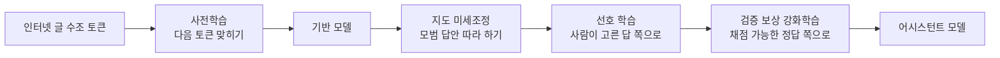

# LLM은 세 번 배운다…돈은 사전학습에 들고 성격은 사후학습에서 정해진다, 그리고 2025년부터는 실력도 사후학습에서 오른다

## 한눈에 보기

챗GPT 같은 대형 언어 모델(LLM)은 한 번에 만들어지지 않는다. 먼저 인터넷의 방대한 글로 다음 단어를 맞히는 연습을 하는 사전학습을 거치고, 그다음 사람이 쓴 모범 답안을 따라 하는 지도 미세조정을, 마지막으로 사람의 선호나 정답 채점을 보상으로 삼는 강화학습을 거친다. 뒤의 두 단계를 묶어 사후학습이라 부른다.

비용으로 보면 이야기는 사전학습에서 끝난다. 메타의 Llama 3 405B는 사전학습에만 H100 GPU 최대 1만 6,000장과 3.8×10²⁵번의 연산을 썼고, 논문은 사후학습을 "비교적 단순한 절차"라고 불렀다. 그러나 쓸모로 보면 이야기는 뒤에서 갈린다. 2022년 OpenAI는 사람 약 40명이 만든 데이터로 사후학습한 13억 파라미터 모델의 답이, 100배 큰 1,750억 파라미터 GPT-3의 답보다 사람들에게 더 선호됐다고 보고했다. 2025년 DeepSeek는 사람이 쓴 풀이 없이 정답 채점만으로 강화학습해 추론 능력을 끌어냈다.

내 판단은 이렇다. 사전학습은 모델이 무엇을 알 수 있는지의 상한을 정하고, 사후학습은 그 가운데 무엇을 꺼내 쓰는지를 정한다. 그리고 2025년 이후 성능 경쟁의 무게는 상한을 올리는 쪽에서 꺼내 쓰는 쪽으로 옮겨 가고 있다. 사전학습을 직접 했는지를 '독자 AI'의 기준으로 삼는 한국의 정책이 놓치는 지점도 여기다. 어려운 대목마다 숫자로 따라 해 볼 수 있는 예제를 붙였고, 용어는 글 끝의 용어집에 모았다. 예제의 숫자 가운데 논문에서 온 것이 아닌 값은 이해를 돕기 위해 만든 가상의 값이다.

## 1단계 사전학습: 다음 단어를 맞히며 세상을 압축한다

사전학습의 과제는 하나다. 앞의 글을 보고 다음 토큰(단어나 단어 조각)을 맞힌다. 2020년 OpenAI의 GPT-3 논문은 1,750억 파라미터의 자기회귀 언어 모델을 3,000억 토큰으로 학습했고, 논문은 이 모델이 과제의 예시 몇 개만 보고 "다음에 올 것을 예측하는 것만으로" 새 과제를 해낸다고 설명했다([GPT-3 논문](https://arxiv.org/abs/2005.14165)). 누가 가르치지 않아도 글 자체가 정답지다. "대한민국의 수도는"의 다음 단어를 맞히려면 지리를, 코드의 다음 줄을 맞히려면 문법을 알아야 하므로, 다음 단어 맞히기를 충분히 잘하게 되는 과정에서 지식이 모델 안에 쌓인다.

### 예제 1. 다음 토큰 맞히기와 손실

"오늘 날씨가 정말"의 다음 토큰으로 모델이 "좋다" 60%, "덥다" 25%, "춥다" 10%, 나머지 5%의 확률을 냈다고 하자.

1. 실제 글의 다음 단어가 "좋다"였다면 손실은 −ln(0.6) ≈ 0.51이다. 정답에 높은 확률을 줬으니 손실이 작다.
2. 실제 다음 단어가 "춥다"였다면 손실은 −ln(0.1) ≈ 2.30이다. 정답에 1%만 줬다면 −ln(0.01) ≈ 4.61까지 커진다.
3. 학습은 이 손실이 줄도록 모델의 가중치를 조금씩 고치는 일이다. 다음에 비슷한 문장을 보면 실제로 나온 단어의 확률이 조금 올라간다.

이 계산을 수조 개 토큰에 대해 되풀이한다. 정답에 준 확률의 로그에 마이너스를 붙인 이 손실을 교차 엔트로피라 하며, 사전학습의 손실은 처음부터 끝까지 이것 하나다.

얼마나 크게, 얼마나 오래 학습시킬지에 답을 준 것이 2022년 딥마인드의 친칠라 논문이다. 논문은 계산 예산이 정해져 있을 때 모델 크기와 학습 토큰 수를 "똑같이 늘려야 한다", 곧 "모델 크기를 두 배로 하면 학습 토큰도 두 배로 해야 한다"고 결론 냈다. 이를 확인하려고 고퍼(Gopher)와 같은 계산 예산으로 파라미터는 4분의 1인 700억, 데이터는 4배인 1.4조 토큰을 쓴 친칠라를 학습했고, 친칠라는 2,800억 파라미터 고퍼와 1,750억 GPT-3 등을 고르게 앞섰다([친칠라 논문](https://arxiv.org/abs/2203.15556)). 그전까지 업계는 모델을 키우는 데 비해 데이터를 너무 적게 먹였던 셈이다.

### 예제 2. 학습 계산량은 6 × 파라미터 × 토큰

친칠라 논문은 학습 연산량을 FLOPs(N, D) ≈ 6ND로 어림한다. N은 파라미터 수, D는 학습 토큰 수다. 토큰 하나를 학습할 때 파라미터 하나당 대략 6번의 연산이 든다는 뜻이다.

- GPT-3: 6 × 1,750억 × 3,000억 ≈ 3.15×10²³번이다.
- Llama 3 405B: 6 × 4,050억 × 15.6조 ≈ 3.79×10²⁵번이다. 논문이 밝힌 3.8×10²⁵와 거의 같다([Llama 3 논문](https://arxiv.org/abs/2407.21783)).
- 두 모델의 차이는 약 120배다. 4년 사이 파라미터는 2.3배 늘었는데 토큰은 52배 늘었다. 친칠라 이후 업계가 크기보다 데이터를 훨씬 빨리 늘렸다는 것이 이 숫자에 그대로 드러난다.

### 예제 3. 친칠라 비율, 파라미터 하나에 토큰 20개

- 친칠라: 1.4조 토큰 ÷ 700억 파라미터 = 파라미터 하나당 토큰 20개다.
- 고퍼: 3,000억 토큰 ÷ 2,800억 파라미터 = 파라미터 하나당 약 1개다.
- 예제 2의 어림식으로 계산량을 보면 고퍼는 약 5.0×10²³, 친칠라는 약 5.9×10²³으로 비슷하다. 같은 돈을 쓰되 모델을 4분의 1로 줄이고 데이터를 4배 이상 먹이자 더 똑똑해졌다.
- Llama 3 405B는 15.6조 ÷ 4,050억 ≈ 38개로 친칠라 비율보다도 많이 먹였다. 모델이 작을수록 실제 서비스에서 답할 때 비용이 싸므로, 학습 때 데이터를 더 먹여 작은 모델을 최대한 똑똑하게 만드는 쪽을 택한 것으로 볼 수 있다. 이 해석은 내 판단이다.

사전학습이 끝난 모델을 기반 모델이라 한다. 기반 모델은 아는 것은 많지만 대화 상대가 아니다. "김치찌개 끓이는 법을 알려 줘"를 넣으면 답을 하는 대신 "된장찌개 끓이는 법을 알려 줘" 같은 비슷한 질문을 이어 쓸 수도 있다. 인터넷에서는 질문 목록 다음에 또 질문이 오는 일이 흔하기 때문이다. 다음 단어를 맞히는 기계를 질문에 답하는 비서로 바꾸는 것이 사후학습이다.

## 2단계 지도 미세조정: 모범 답안을 따라 한다

2022년 3월 OpenAI의 InstructGPT 논문은 지금의 사후학습 틀을 세 단계로 정리했다. 첫째, 사람이 쓴 모범 답안을 모아 모델을 지도 학습한다. 둘째, 모델의 답들을 사람이 비교해 순위를 매긴 데이터로 보상 모델을 학습한다. 셋째, 그 보상 모델을 상대로 PPO라는 강화학습 알고리즘으로 모델을 최적화한다. 이 작업에는 업워크와 스케일AI를 통해 고용한 약 40명의 계약자가 참여했다([InstructGPT 논문](https://arxiv.org/abs/2203.02155)).

### 예제 4. 지도 미세조정 데이터 한 줄

지도 미세조정의 데이터는 질문과 모범 답안의 쌍이다.

- 질문: "김치찌개 끓이는 법을 세 단계로 알려 줘."
- 모범 답안: "1. 돼지고기와 김치를 냄비에 볶는다. 2. 물을 붓고 끓인다. 3. 두부와 파를 넣고 한소끔 더 끓인다."

학습 방식은 사전학습과 똑같다. 모범 답안의 토큰을 하나씩 다음 토큰으로 맞히며 예제 1의 손실을 줄인다. 다른 점은 데이터뿐이다. 수조 개의 아무 글 대신 수만에서 수십만 개의 '질문에는 이렇게 답한다'는 글을 먹인다. 모델은 새 지식보다 형식과 태도를 배운다. 질문을 받으면 질문을 이어 쓰지 않고 답을 한다는 것을.

## 3단계 강화학습: 사람이 고른 쪽으로, 채점되는 쪽으로

모범 답안을 쓰는 데는 한계가 있다. 사람은 좋은 답을 직접 쓰기보다 두 답 가운데 나은 쪽을 고르기가 훨씬 쉽다. InstructGPT의 둘째, 셋째 단계가 이 점을 이용한다. 사람의 피드백을 활용한 강화학습, 곧 RLHF다. 결과는 극적이었다. 논문 초록은 "13억 파라미터 InstructGPT의 출력이 파라미터가 100배 적은데도 1,750억 GPT-3의 출력보다 선호됐다"고 적었다.

### 예제 5. 사람의 선호를 보상으로 바꾸기

질문 "회의에 늦을 것 같다고 팀장에게 보낼 메시지를 써 줘"에 모델이 두 답을 냈다.

- 답 A: "팀장님, 교통 체증으로 10분 정도 늦을 것 같습니다. 죄송합니다. 도착하는 대로 바로 참석하겠습니다."
- 답 B: "늦음. 곧 감."

평가자는 A를 고른다. 이런 비교를 수만 건 모아 "A가 B보다 낫다"를 맞히도록 보상 모델을 학습시키면, 보상 모델은 아무 답에나 점수를 매길 수 있게 된다. 예컨대 A에 8점, B에 2점이다. 이제 언어 모델이 답을 쓸 때마다 보상 모델이 점수를 주고, 강화학습은 점수가 높은 답이 나올 확률을 높이는 쪽으로 가중치를 고친다. 2023년 5월 공개된 DPO는 보상 모델과 강화학습 없이 선호 데이터에서 바로 "단순한 분류 손실"로 같은 문제를 풀 수 있음을 보였고([DPO 논문](https://arxiv.org/abs/2305.18290)), Llama 3도 사후학습에 지도 미세조정, 거부 샘플링과 함께 DPO를 썼다.

사람의 선호를 보상으로 삼는 방식에는 약점이 있다. 보상 모델은 사람의 판단을 흉내 낼 뿐이라, 모델이 진짜로 좋은 답보다 평가자가 좋아 보이는 답을 내는 쪽으로 기울 수 있다. 그래서 2025년 1월 DeepSeek-R1 논문이 주목받았다. DeepSeek는 "인간이 라벨링한 추론 과정 없이 순수한 강화학습만으로 LLM의 추론 능력을 끌어낼 수 있다"고 밝혔다. 지도 미세조정 단계를 아예 건너뛴 R1-Zero는 신경망 보상 모델 대신 규칙 기반 보상을 썼다. 최종 답이 맞았는지를 따지는 정확도 보상, 그리고 생각하는 과정을 `<think>`와 `</think>` 태그 사이에 쓰게 하는 형식 보상이다. 알고리즘으로는 여러 답을 함께 뽑아 그 무리의 점수로 기준을 잡는 GRPO를 썼다([DeepSeek-R1 논문](https://arxiv.org/abs/2501.12948)).

### 예제 6. 채점 가능한 정답을 보상으로 쓰기

문제 "17 × 23은?"을 모델에게 네 번 풀게 했다고 하자.

1. 네 답의 최종 값이 391, 391, 381, 401이다. 정답 391과 비교하는 데는 사람이 필요 없다. 맞으면 1점, 틀리면 0점이다. 점수는 1, 1, 0, 0이다.
2. GRPO는 네 답의 평균 0.5를 기준으로 삼는다. 기준보다 높은 답 둘은 그런 풀이가 나올 확률을 높이고, 낮은 답 둘은 낮춘다. 보상 모델도, 기준을 따로 계산하는 별도 모델도 필요 없다.
3. 수학 문제 수십만 개로 이것을 되풀이하면, 모델은 정답에 이르는 풀이 습관, 예컨대 검산하기와 다시 생각하기를 스스로 강화한다. 누가 그런 풀이법을 써서 보여 준 적이 없는데도 그렇다.

이 방식은 정답을 기계로 채점할 수 있는 곳, 곧 수학, 코딩, 형식이 정해진 문제에서 가장 강하다. 반대로 좋은 글, 좋은 조언처럼 채점 기준이 사람의 판단에 달린 곳에서는 여전히 예제 5의 선호 학습에 기댄다.

## 무게가 옮겨 가는 곳

세 단계를 비용과 역할로 다시 놓으면 그림이 분명해진다. 사전학습은 수조 토큰과 수만 장의 GPU가 드는 단계이고 모델이 알 수 있는 것의 상한을 정한다. 사후학습은 데이터가 훨씬 작고 계산도 적게 들지만, 그 상한 안에서 무엇을 어떻게 꺼내 쓰는지를 정한다. InstructGPT는 그 차이가 파라미터 100배를 뒤집을 만큼 크다는 것을 보였고, DeepSeek-R1은 사후학습이 형식과 태도를 넘어 추론 실력까지 끌어올릴 수 있다는 것을 보였다.

내가 보기에 2025년 이후의 변화는 이것이다. 친칠라 이후 몇 년간 성능 경쟁은 사전학습의 크기 싸움이었다. 검증 가능한 보상으로 하는 강화학습이 통하면서 경쟁의 한 축이 채점할 수 있는 문제를 얼마나 많이, 얼마나 잘 만드느냐로 옮겨 갔다. [트랜스포머 기사](https://now.zeta4.net/a/2026-11-15-transformer-attention-stopped-waiting)에서 본 원칙, 곧 연산을 잘 받아먹는 방법이 이긴다는 원칙은 그대로다. 연산을 쏟는 곳이 사전학습 하나에서 사후학습까지 넓어졌을 뿐이다.

이 구도는 한국에 직접 닿는다. 이 사이트의 [중국 AI 추격 기사](https://now.zeta4.net/a/2026-11-08-how-chinese-ai-labs-caught-up)에서 짚었듯 한국의 독자 AI 파운데이션 모델 사업은 "모델 아키텍처 설계, 데이터 확보·가공, 사전학습 전 과정을 자체 수행"한 모델을 독자 AI로 인정한다. 사전학습을 직접 하는 능력은 중요하다. 그러나 그것은 가장 비싼 단계를 해냈는지를 묻는 기준이지, 모델의 쓸모가 실제로 갈리는 단계를 해냈는지를 묻는 기준은 아니다. 한국어로 된 채점 가능한 문제, 한국 법과 제도에 맞춘 선호 데이터, 한국 기업의 업무를 검증할 수 있는 보상을 누가 만드느냐는 질문이 사전학습 여부만큼, 어쩌면 그보다 더 중요해지고 있다.

## 용어집

| 용어 | 뜻 |
|---|---|
| 대형 언어 모델(LLM) | 방대한 글로 학습해 글을 이해하고 생성하는 대형 신경망. 대부분 트랜스포머 구조다 |
| 토큰 | 모델이 글을 처리하는 단위. 단어 하나이거나 단어의 일부 |
| 파라미터(가중치) | 모델 안에서 학습으로 정해지는 숫자. GPT-3는 1,750억 개 |
| 사전학습 | 대량의 글로 다음 토큰을 맞히게 해 모델에 언어와 지식을 쌓는 첫 단계 |
| 자기회귀 | 앞의 토큰들을 보고 다음 토큰 하나를 만들고, 그것을 다시 입력에 붙여 다음을 만드는 방식 |
| 교차 엔트로피 손실 | 정답 토큰에 준 확률의 로그에 마이너스를 붙인 값. 정답 확률이 높을수록 작다 |
| FLOPs | 부동소수점 연산 횟수. 학습에 든 계산량을 재는 단위 |
| 스케일링 법칙 | 모델 크기, 데이터, 계산량을 늘릴 때 성능이 어떻게 좋아지는지를 나타낸 경험 법칙 |
| 친칠라 비율 | 계산 예산이 정해졌을 때 파라미터 하나당 학습 토큰 약 20개가 효율적이라는 친칠라 논문의 결과 |
| 기반 모델 | 사전학습만 마친 모델. 아는 것은 많지만 지시를 따르도록 다듬어지지 않았다 |
| 사후학습 | 기반 모델을 지시를 따르고 쓸모 있게 답하도록 다듬는 단계 전체 |
| 지도 미세조정(SFT) | 질문과 모범 답안 쌍으로 모델을 추가 학습시키는 것 |
| 강화학습 | 행동의 결과에 점수(보상)를 주고, 점수가 높은 행동이 더 자주 나오도록 학습시키는 방법 |
| RLHF | 사람의 피드백을 활용한 강화학습. 사람이 매긴 선호로 보상 모델을 만들고 그 보상으로 강화학습한다 |
| 보상 모델 | 답에 점수를 매기도록 학습된 별도 모델. 사람의 선호를 흉내 낸다 |
| PPO | RLHF에서 널리 쓰인 강화학습 알고리즘. 한 번에 너무 크게 바뀌지 않도록 조금씩 고친다 |
| DPO | 보상 모델과 강화학습 없이 선호 데이터에서 바로 모델을 학습시키는 방법 |
| 검증 가능한 보상 | 수학 정답이나 코드 테스트 통과처럼 기계가 맞고 틀림을 판정할 수 있는 보상 |
| GRPO | 같은 문제에 여러 답을 뽑아 그 무리의 평균 점수를 기준으로 삼는 강화학습 알고리즘. DeepSeek가 썼다 |
| 거부 샘플링 | 모델이 여러 답을 내게 한 뒤 좋은 답만 골라 다시 학습 데이터로 쓰는 방법 |

## 출처

- [Language Models are Few-Shot Learners (GPT-3, arXiv 2020-05-28)](https://arxiv.org/abs/2005.14165)
- [Training Compute-Optimal Large Language Models (친칠라, arXiv 2022-03-29)](https://arxiv.org/abs/2203.15556)
- [Training language models to follow instructions with human feedback (InstructGPT, arXiv 2022-03-04)](https://arxiv.org/abs/2203.02155)
- [Direct Preference Optimization (DPO, arXiv 2023-05-29)](https://arxiv.org/abs/2305.18290)
- [The Llama 3 Herd of Models (arXiv 2024-07-31)](https://arxiv.org/abs/2407.21783)
- [DeepSeek-R1: Incentivizing Reasoning Capability in LLMs via Reinforcement Learning (arXiv 2025-01-22)](https://arxiv.org/abs/2501.12948)
- [트랜스포머의 진짜 발명은 어텐션이 아니라 '기다리지 않기'였다 (Zeta4 Now, 2026-11-15)](https://now.zeta4.net/a/2026-11-15-transformer-attention-stopped-waiting)
- [중국 AI는 '훔쳐서' 따라잡은 게 아니다 (Zeta4 Now, 2026-11-08)](https://now.zeta4.net/a/2026-11-08-how-chinese-ai-labs-caught-up)

---

이 글은 공개 출처를 바탕으로 AI가 자동 생성한 초안을 검토해 발행했으며, 중요한 판단 전에는 연결된 원문을 확인해야 합니다.
