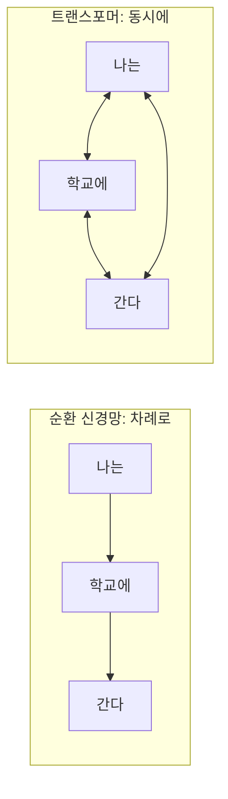

# 트랜스포머의 진짜 발명은 어텐션이 아니라 '기다리지 않기'였다…2014년부터 있던 어텐션에서 순서를 걷어내자 GPU가 일했고, 그 대가가 긴 문맥의 제곱 비용이다

## 한눈에 보기

챗GPT, 클로드, 제미나이 같은 대형 언어 모델의 뼈대는 2017년 6월 구글 연구진이 발표한 트랜스포머다. 논문 제목 「Attention Is All You Need(어텐션만 있으면 된다)」 때문에 트랜스포머는 흔히 '어텐션을 발명한 모델'로 소개된다. 사실이 아니다. 어텐션은 2014년 9월 드미트리 바다나우, 조경현, 요슈아 벤지오의 번역 논문에 이미 있었다.

트랜스포머가 실제로 바꾼 것은 제목의 뒷부분, '만(all)'이다. 그전의 언어 모델은 문장을 첫 단어부터 하나씩 차례로 읽었고, 어텐션은 그 위에 얹는 보조 장치였다. 트랜스포머는 차례로 읽는 부분을 통째로 버리고 어텐션만 남겼다. 그러자 문장의 모든 단어를 동시에 계산할 수 있게 됐고, 수천 개의 계산을 한꺼번에 처리하는 GPU가 비로소 제 능력을 냈다. 내가 보기에 트랜스포머의 발명은 '주의 기울이기'가 아니라 '앞 단어를 기다리지 않기'다.

그 선택에는 값이 붙어 있었다. 모든 단어가 모든 단어를 살피므로 문장이 10배 길어지면 계산은 100배가 된다. 100만 토큰 문맥이 비싼 이유, 9년째 '어텐션을 대신할 구조'를 찾는 연구가 이어지는 이유가 여기 있다. 어려운 대목마다 숫자로 따라 해 볼 수 있는 예제를 붙였고, 용어는 글 끝의 용어집에 모았다. 예제의 숫자는 이해를 돕기 위해 만든 가상의 값이다.

## 어텐션은 번역의 병목에서 나왔다

2014년의 신경망 번역기는 인코더가 원문 문장 전체를 고정된 길이의 숫자 묶음(벡터) 하나로 압축하고, 디코더가 그 묶음 하나만 보고 번역문을 만들었다. 다섯 단어짜리 문장이든 쉰 단어짜리 문장이든 같은 크기의 상자에 욱여넣은 셈이다. 바다나우, 조경현, 벤지오는 이 고정 길이 벡터가 성능을 막는 병목이라고 보고, 번역문의 단어를 하나 만들 때마다 원문에서 관련 있는 부분을 "부드럽게 찾아보게(soft-search)" 하는 방법을 제안했다([arXiv](https://arxiv.org/abs/1409.0473)). 이것이 어텐션이다. 논문은 2014년 9월 1일 처음 공개됐고 이듬해 ICLR에서 구두 발표됐다.

트랜스포머 논문은 어텐션을 이렇게 정의한다. "어텐션 함수는 질의(query) 하나와 키-값(key-value) 쌍들의 집합을 출력으로 대응시키는 것이며, 질의, 키, 값, 출력은 모두 벡터다."([트랜스포머 논문](https://ar5iv.labs.arxiv.org/html/1706.03762)) 도서관에 비유하면 질의는 내가 찾는 주제, 키는 책 등에 붙은 분류표, 값은 책의 내용이다. 내 주제와 분류표가 잘 맞는 책일수록 내용을 많이 가져온다.

### 예제 1. 어텐션 한 번을 손으로 계산하기

"고양이가 매트 위에서 잤다. 그것은 피곤했다"에서 모델이 "그것"이 무엇을 가리키는지 알아내는 장면을 숫자 두 개짜리 벡터로 줄여 보자. 단어는 셋만 남긴다.

1. "그것"의 질의를 (1, 0)으로 둔다. 세 단어의 키는 고양이 (2, 0), 매트 (0, 1), 그것 (0.5, 0.5)다.
2. 질의와 각 키의 내적(같은 자리끼리 곱해 더한 값)을 구한다. 고양이는 1×2 + 0×0 = 2, 매트는 1×0 + 0×1 = 0, 그것은 1×0.5 + 0×0.5 = 0.5다. 값이 클수록 관련이 깊다는 뜻이다.
3. 벡터의 길이(여기서는 2)의 제곱근 √2 ≈ 1.414로 나눈다. 점수는 1.414, 0, 0.354가 된다. 왜 나누는지는 예제 2에서 본다.
4. 소프트맥스로 점수를 합이 1인 비율로 바꾼다. 각 점수에 지수함수를 씌우면 4.113, 1.000, 1.424이고 합은 6.537이다. 각각을 합으로 나누면 고양이 0.629, 매트 0.153, 그것 0.218이다. "그것"은 주의의 63%를 "고양이"에 쏟는다.
5. 이 비율대로 각 단어의 값을 섞는다. 값이 고양이 (1, 0), 매트 (0, 1), 그것 (0.5, 0.5)라면 결과는 0.629×(1, 0) + 0.153×(0, 1) + 0.218×(0.5, 0.5) = (0.738, 0.262)다. "그것"의 새 표현이 "고양이" 쪽으로 크게 기울었다.

실제 모델에서 질의, 키, 값은 사람이 정하지 않는다. 각 단어의 벡터에 학습된 가중치 행렬 세 개를 곱해 만들고, 그 가중치는 학습으로 정해진다. 논문의 식으로 쓰면 Attention(Q, K, V) = softmax(QKᵀ/√dₖ)V이고, 위의 다섯 단계가 이 식 한 줄이다.

### 예제 2. 왜 √dₖ로 나누나

내적은 벡터가 길수록 커진다. 논문 각주에 따르면 평균 0, 분산 1인 숫자들로 이뤄진 벡터 두 개의 내적은 평균 0, 분산 dₖ다. 트랜스포머 기본형의 dₖ는 64이므로 점수의 표준편차가 √64 = 8이 된다. 점수 하나가 다른 점수보다 8, 16씩 크면 소프트맥스는 거의 모든 비율을 한 단어에 몰아주고 나머지는 0에 가깝게 만든다. 논문은 이렇게 되면 소프트맥스가 "기울기가 극히 작은 영역"으로 밀려 학습이 잘 안 된다고 보고 점수를 √dₖ, 곧 8로 나눴다. 표준편차를 다시 1로 되돌리는 셈이다. 예제 1에서 √2로 나눈 것도 같은 이유다.

## 2017년의 진짜 변화: 앞 단어를 기다리지 않는다

트랜스포머 이전의 주력은 순환 신경망(RNN)이었다. 문장을 첫 단어부터 하나씩 읽으며, 앞 단어까지의 요약을 다음 단어 계산에 넘긴다. 바다나우의 어텐션도 이 순환 신경망 위에 얹혀 있었다. 트랜스포머 논문은 문제를 이렇게 짚었다. "이 본질적으로 순차적인 성질이 학습 예시 안에서의 병렬화를 막으며, 이는 문장이 길수록 결정적인 문제가 된다."

그래서 아시시 바스와니 등 구글 브레인과 구글 리서치에서 일하던 연구진 8명은 순환을 버렸다. 논문 초록의 표현으로 트랜스포머는 "순환과 합성곱을 완전히 걷어내고 오직 어텐션 메커니즘에만 기반한" 구조다. 결과는 번역 성능과 학습 비용 양쪽에서 나왔다. WMT 2014 영어-독일어 번역에서 BLEU 28.4로 앙상블을 포함한 기존 최고 기록을 2점 넘게 앞섰고, 영어-프랑스어에서는 GPU 8장으로 3.5일 학습해 단일 모델 최고인 41.8을 냈다. 논문은 이것이 기존 최고 모델들의 학습 비용의 "작은 일부"라고 적었다([트랜스포머 논문](https://ar5iv.labs.arxiv.org/html/1706.03762)).

### 예제 3. 차례로 계산과 동시에 계산

100단어짜리 문장을 처리한다고 하자.

- 순환 신경망: 2번째 단어는 1번째 단어의 계산 결과가 나와야 시작할 수 있다. 100번째 단어는 앞의 99단계를 모두 기다린다. 계산 장치가 1만 개 있어도 이 줄은 100단계 아래로 줄지 않는다. 논문 표 1의 표현으로 순차 연산 수가 문장 길이 n에 비례한다.
- 트랜스포머: 100개 단어 각각이 나머지 단어를 살피는 계산은 서로를 기다릴 필요가 없다. 1만 개의 계산 장치에 나눠 주면 한 층의 계산이 사실상 한 단계에 끝난다. 표 1에서 순차 연산 수는 문장 길이와 상관없는 상수다.

학습 데이터가 수조 단어로 늘어날 때 이 차이가 결정적이 된다. 순환 신경망은 GPU를 더 사도 빨라지는 데 한계가 있었고, 트랜스포머는 GPU를 사는 만큼 빨라졌다. [앞선 기사](https://now.zeta4.net/a/2026-11-14-ml-neural-networks-deep-learning-who-designs-features)에서 다룬 리처드 서튼의 '쓰라린 교훈', 곧 연산을 활용하는 범용 방법이 결국 이긴다는 원칙에 비춰 보면, 트랜스포머는 성능이 좋은 모델이라기보다 연산을 가장 잘 받아먹는 모델이었다.

## 남은 장치 셋: 여러 개의 머리, 위치 표시, 그리고 쌓기

순서를 버리자 생긴 빈자리를 트랜스포머는 두 가지 장치로 메웠다. 하나는 어텐션을 여러 벌 동시에 돌리는 멀티헤드 어텐션이다. 논문은 이것이 "모델이 서로 다른 표현 공간의 정보에, 서로 다른 위치에서 함께 주의를 기울이게 한다"고 설명한다. 기본형은 512차원 벡터를 64차원씩 8개의 머리(head)로 나눠 쓴다.

### 예제 4. 머리가 여러 개인 이유

"어제 산 책을 동생이 찢었다"를 읽을 때 사람은 여러 관계를 동시에 본다. "찢었다"의 주어는 "동생"이고, 대상은 "책"이며, "어제 산"은 "책"을 꾸민다. 어텐션 하나는 단어마다 비율 한 벌만 내므로 이 관계들을 한꺼번에 담기 어렵다. 머리가 8개면 8가지 서로 다른 비율을 따로 계산한 뒤 합친다. 어떤 머리가 어떤 관계를 맡을지는 사람이 정하지 않고 학습으로 정해지며, 실제로 머리마다 문법 관계처럼 깔끔하게 나뉜다는 보장은 없다. 위의 관계 나눔은 이해를 돕기 위한 비유다.

다른 하나는 위치 인코딩이다. 어텐션은 단어들의 집합을 볼 뿐 순서를 모른다. 논문은 "모델에 순환도 합성곱도 없으므로 순서를 활용하려면 토큰의 상대적 또는 절대적 위치 정보를 넣어 줘야 한다"고 적고, 각 단어의 벡터에 위치마다 다른 값을 더했다.

### 예제 5. 위치를 모르면 생기는 일

"5 빼기 3"과 "3 빼기 5"는 같은 낱말 세 개로 이뤄져 있다. 위치 정보가 없는 어텐션에는 두 식이 똑같은 재료 묶음으로 보이고, 답 2와 −2를 구분할 근거가 없다. 위치 인코딩은 "5"에 '첫 번째 자리'라는 표시를, "3"에 '세 번째 자리'라는 표시를 숫자로 더해 둔다. 순서를 차례로 읽어서 아는 대신 이름표로 붙여 두는 방식이다.

이렇게 만든 어텐션 층을 여러 겹 쌓은 것이 트랜스포머다. 원 논문의 기본형은 인코더와 디코더를 각각 6층씩 쌓았다. 지금의 대형 언어 모델은 대부분 이 가운데 디코더 쪽을 훨씬 깊고 넓게 키운 형태로 알려져 있지만, 주요 기업들은 최신 모델의 세부 구조를 공개하지 않는다.

## 대가: 모든 단어가 모든 단어를 본다

트랜스포머가 기다림을 없앤 방법, 곧 모든 단어가 모든 단어를 한꺼번에 살피는 구조는 그대로 비용이 된다. 논문 표 1은 셀프 어텐션 한 층의 계산량을 O(n²·d), 순환 신경망을 O(n·d²)로 적었다. n은 문장 길이, d는 벡터 차원이다. 논문은 문장 길이가 벡터 차원보다 짧을 때 셀프 어텐션이 더 빠르다고 했다. 2017년의 번역 문장은 대개 수십 단어였고 d는 512였으니 이 조건이 쉽게 맞았다. 2026년의 모델은 책 몇 권 분량을 한 번에 넣는다.

### 예제 6. 문맥이 10배 길어지면 계산은 100배

어텐션은 단어(토큰) 쌍마다 점수를 하나씩 계산한다.

- 1,000토큰이면 1,000 × 1,000 = 100만 쌍이다.
- 10만 토큰이면 100억 쌍이다. 길이는 100배인데 쌍은 1만 배다.
- 100만 토큰이면 1조 쌍이다.

이것이 층 하나, 머리 하나의 계산이다. 층과 머리 수만큼 다시 곱해진다. 긴 문서를 통째로 넣는 일이 짧은 질문 여러 개보다 훨씬 비싸고 느린 구조적 이유가 여기 있다. 이 사이트의 [기억과 스킬 편](https://now.zeta4.net/a/2026-11-01-building-ai-agents-memory-context-skills)에서 100만 토큰 컨텍스트는 기억이 아니라고 쓴 것도, 에이전트를 만들 때 필요한 것만 골라 넣으라고 권한 것도 이 계산과 맞닿아 있다.

이 제곱 비용을 피하려는 시도는 트랜스포머만큼 오래됐다. 2023년 12월 앨버트 구와 트리 다오가 낸 맘바(Mamba)는 문장 길이에 비례하는 선형 계산량을 내세웠다. 논문 초록은 그전의 선형 어텐션, 순환 모델, 상태 공간 모델 같은 대안들이 "언어처럼 중요한 분야에서 어텐션만큼 성능을 내지 못했다"고 인정한 뒤, 맘바가 트랜스포머보다 5배 높은 추론 처리량을 내고 30억 파라미터 모델이 두 배 크기의 트랜스포머와 맞먹었다고 주장했다([arXiv](https://arxiv.org/abs/2312.00752)).

내 판단은 이렇다. 트랜스포머를 이기려는 구조는 계속 나오겠지만, 승부처는 정확도가 아니라 트랜스포머가 2017년에 이긴 바로 그 지점, 곧 연산을 얼마나 잘 받아먹느냐다. 어텐션이 9년째 버티는 것은 가장 똑똑한 구조여서가 아니라 GPU와 가장 잘 맞는 구조여서다. 그러니 대안이 이기는 날은 더 나은 수식이 나온 날이 아니라, 그 수식을 위한 하드웨어와 소프트웨어가 트랜스포머만큼 쌓인 날일 것이다. 사용자 입장에서 당장 기억할 것은 하나다. 문맥 창이 크다는 것은 넣을 수 있다는 뜻이지, 넣는 것이 공짜라는 뜻이 아니다.

## 용어집

| 용어 | 뜻 |
|---|---|
| 트랜스포머 | 2017년 구글 연구진이 발표한, 순환 없이 어텐션만으로 문장을 처리하는 신경망 구조. 대형 언어 모델의 뼈대 |
| 어텐션 | 한 단어를 처리할 때 다른 단어들을 얼마나 참고할지 비율을 계산해, 그 비율대로 정보를 섞는 방법 |
| 셀프 어텐션 | 같은 문장 안의 단어들끼리 서로를 살피는 어텐션. 트랜스포머의 핵심 |
| 질의·키·값(Q·K·V) | 어텐션의 세 재료. 질의는 찾는 것, 키는 각 단어의 색인표, 값은 각 단어가 내주는 내용 |
| 벡터 | 숫자 여러 개를 한 줄로 묶은 것. 신경망에서 단어는 수백에서 수천 개 숫자의 벡터로 표현된다 |
| 내적 | 두 벡터의 같은 자리 숫자끼리 곱해 모두 더한 값. 두 벡터가 비슷한 방향일수록 크다 |
| 소프트맥스 | 점수 여러 개를 0과 1 사이의 비율로, 합이 1이 되게 바꾸는 함수. 큰 점수일수록 비율이 커진다 |
| dₖ | 키 벡터의 차원(숫자 개수). 트랜스포머 기본형은 64 |
| 멀티헤드 어텐션 | 어텐션을 여러 벌(머리) 동시에 계산해 합치는 방법. 기본형은 8개 |
| 위치 인코딩 | 순서를 모르는 어텐션을 위해 각 단어 벡터에 위치마다 다른 값을 더해 두는 장치 |
| 순환 신경망(RNN) | 문장을 한 단어씩 차례로 읽으며 앞의 요약을 다음 계산에 넘기는 신경망. 트랜스포머 이전의 주력 |
| 인코더·디코더 | 입력을 읽어 표현으로 바꾸는 부분과, 그 표현에서 출력을 만들어 내는 부분 |
| 병렬화 | 계산을 여러 장치에 나눠 동시에 처리하는 것. GPU는 수천 개의 계산을 동시에 한다 |
| 토큰 | 언어 모델이 글을 처리하는 단위. 단어 하나이거나 단어의 일부 |
| 문맥 창(컨텍스트) | 모델이 한 번에 받아 볼 수 있는 토큰의 최대 길이 |
| O(n²) | 입력 길이 n이 늘 때 계산량이 n의 제곱에 비례해 는다는 표기. 길이가 10배면 계산은 100배 |
| BLEU | 기계 번역 결과가 사람 번역과 얼마나 겹치는지 재는 점수. 높을수록 좋다 |
| 앙상블 | 여러 모델의 예측을 합쳐 하나의 답을 내는 방법 |
| 상태 공간 모델·맘바 | 어텐션 대신 고정 크기의 상태를 갱신하며 문장을 처리해 계산량을 길이에 비례하게 줄이려는 구조와 그 대표 모델 |

## 출처

- [Attention Is All You Need (Vaswani 외, arXiv 2017-06-12, ar5iv 판)](https://ar5iv.labs.arxiv.org/html/1706.03762)
- [Neural Machine Translation by Jointly Learning to Align and Translate (Bahdanau·Cho·Bengio, arXiv 2014-09-01)](https://arxiv.org/abs/1409.0473)
- [Mamba: Linear-Time Sequence Modeling with Selective State Spaces (Gu·Dao, arXiv 2023-12-01)](https://arxiv.org/abs/2312.00752)
- [머신러닝, 신경망, 딥러닝을 가르는 것은 '특징을 누가 만드나'다 (Zeta4 Now, 2026-11-14)](https://now.zeta4.net/a/2026-11-14-ml-neural-networks-deep-learning-who-designs-features)
- [100만 토큰 컨텍스트는 기억이 아니다 (Zeta4 Now, 2026-11-01)](https://now.zeta4.net/a/2026-11-01-building-ai-agents-memory-context-skills)

---

이 글은 공개 출처를 바탕으로 AI가 자동 생성한 초안을 검토해 발행했으며, 중요한 판단 전에는 연결된 원문을 확인해야 합니다.
