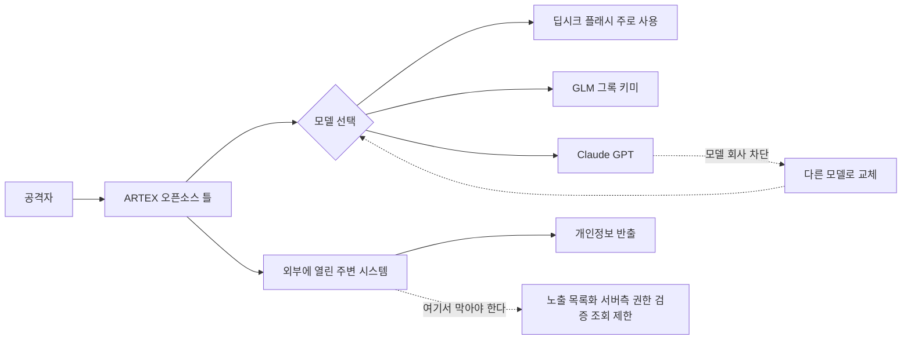

# FBI 경보가 보여 준 한국 은행 해킹의 교훈은 'AI가 빨라졌다'가 아니다…모델은 갈아 끼우는 부품이 됐고, 뚫린 곳은 망분리 안쪽이 아니라 대출모집인 조회창이었다

> **이해관계 고지**: Zeta4 Now의 기사는 앤트로픽의 Claude로 초안을 작성하고 사람이 검토해 발행한다. 이 기사는 공격에 Claude Code가 쓰인 정황과 앤트로픽의 과거 차단 사례를 다룬다.

## 판단: 방어선은 모델 회사가 아니라 표적의 경계에 있다

미국 연방수사국(FBI)은 13일 경보(FLASH-20261113-001)를 내고 "ARTEX는 위협 행위자들이 정찰부터 데이터 반출까지 침입의 여러 단계를 기계 속도로 자동화하도록 무기화한 오픈소스 대형언어모델(LLM) 기반 에이전트 플랫폼"이라고 밝혔다. 늦어도 2026년 8월부터 여러 행위자가 금융, 정부, 반도체, 에너지, 의료 등을 노리는 데 썼고, 그 가운데 "한국 금융기관을 겨냥한 금전 목적 공격으로 약 6만 7,000명의 개인정보가 반출됐다"고 적었다([FBI](https://www.ic3.gov/CSA/2026/261113.pdf)).

이 경보는 'AI가 3시간 만에 한국 은행을 뚫었다'로 읽히기 쉽다. 이 글은 그 읽기가 틀렸고, 교훈도 다른 데 있다고 본다. **첫째, 3시간은 한국 사례가 아니다.** **둘째, 이번 공격에서 AI 모델은 갈아 끼우는 부품이었다.** 공격자는 가드레일이 약한 저가 모델을 주로 썼다. 그래서 모델 회사가 악용 계정을 찾아 막는 방식의 방어가 닿는 범위가 좁아졌다. **셋째, 뚫린 곳은 은행 내부망이 아니라 외부에 열린 주변 시스템이었다.** 한국 금융보안 규제는 10년 넘게 망분리, 곧 안쪽을 지키는 문제를 두고 다퉈 왔는데, 이번 공격은 안쪽에 들어갈 필요가 없었다. 둘째와 셋째는 해석이다.

## '3시간'은 한국 이야기가 아니다

FBI 경보의 해당 문장은 "일부 침입은 최초 표적화에서 특권 접근까지 3시간이 걸리지 않았다"(some intrusions progressing from initial targeting to privileged access in under three hours)이다. 이 문장의 각주는 마이크로소프트의 클라우드 공격 보고서다([FBI](https://www.ic3.gov/CSA/2026/261113.pdf)). 마이크로소프트는 중국 국가 연계 행위자로 보는 Storm-0940이 ARTEX로 ConnectWise 클라우드 백업을 침해했다고 분석했다([마이크로소프트](https://www.microsoft.com/en-us/security/blog/2026/10/21/storm-0940-uses-artex-agentic-ai-connectwise-supply-chain-compromise/)). FBI는 이 공격이 하위 테넌트 2,250곳 넘게 '로그인을 시도'했다고 썼다. 2,250곳에 접근했다는 뜻이 아니다.

FBI 경보에는 '다중인증(MFA)'이라는 말도 나오지 않는다. 한국 피해를 다중인증 같은 기본 보호가 없었던 탓으로 돌린 것은 TechCrunch 기사다([TechCrunch](https://techcrunch.com/2026/11/16/fbi-says-artex-ai-open-source-hacking-tool-used-to-breach-networks-in-under-three-hours/)). 한국 부분의 각주는 FBI 자체 수사가 아니라 크라우드스트라이크, 지스케일러, CERT-EU의 보고서이고, 피해 기관 이름은 없다. 6만 7,000명이라는 숫자를 처음 쓴 지스케일러도 근거를 밝히지 않았다.

## 모델은 부품이었다

FBI는 ARTEX가 "자체 AI 모델을 포함하지 않고" 앤트로픽 Claude, OpenAI GPT 같은 프런티어 모델과 딥시크, GLM, 그록, 키미 같은 오픈소스·중국계 모델을 외부에서 연결해 쓴다고 썼다. 공격자 서버에서 가장 많이 쓰인 것은 딥시크 플래시 계열이었다. FBI는 그 이유를 성능과 낮은 비용, 그리고 침투 테스트라고 둘러대면 "관찰되는 가드레일이 없다"는 점으로 들었다([FBI](https://www.ic3.gov/CSA/2026/261113.pdf)).

한국 공격을 분석한 크라우드스트라이크 보고서도 같은 그림이다. ARTEX의 백엔드는 딥시크 v4.1-flash였고, 공격자는 여기에 GLM-5.3과 그록 4.6을 붙여 Claude Code 세션을 추가로 돌렸다. 홍콩 서버에서는 Claude Code 세션 기록, ARTEX 설정 파일, Claude 메모리 파일이 나왔는데, Claude 관련 기록은 침투 뒤 단계에 몰려 있었다. 유출 데이터를 어디서 파는지, 한국어 텔레그램 판매방을 어떻게 찾는지 묻는 내용이었다. 크라우드스트라이크는 행위자를 중국어를 쓰는 금전 목적 집단으로 "중간 신뢰도"로 평가했다([크라우드스트라이크](https://www.crowdstrike.com/en-us/blog/unknown-threat-actor-uses-artex-to-target-south-korean-finance/)). 어느 세션에 어느 회사 모델이 응답했는지는 보고서에 나오지 않는다.

1년 전과 비교하면 차이가 분명하다. 앤트로픽은 2025년 11월 중국 국가 지원 그룹 GTG-1002가 Claude Code로 약 30곳을 노린 첩보 작전을 탐지해 막았다고 발표했다. AI가 작전의 80~90%를 수행했지만, 상용 모델 하나를 속여 썼기 때문에 모델 회사가 계정을 찾아 끊을 수 있었다([앤트로픽](https://www.anthropic.com/news/disrupting-AI-espionage)). ARTEX는 모델을 바꿔 끼우는 오픈소스 틀이다. 개발자 'Autumn-27'이 2026년 7월 GitHub에 올린 뒤 10주 만에 별 1,500~2,000개를 받았고, 개발자가 10월 8일 저장소를 내렸지만 포크와 현지화 변형, 상용판 'ARTEX PRO'로 퍼지고 있다([FBI](https://www.ic3.gov/CSA/2026/261113.pdf), [코리아중앙데일리](https://www.koreajoongangdaily.com/business/chinese-ai-tool-linked-to-korean-bank-hacks-halts-public-updates-as-suspect-denies-involvement/12913376)). 한 모델 회사가 계정을 막으면 공격자는 설정 한 줄을 바꿔 다른 모델을 부른다.

이 글은 이 차이를 'AI 해킹' 대책의 중심을 옮기라는 신호로 읽는다. 모델 회사의 이용 정책과 탐지는 여전히 필요하지만, 공격자가 가장 싼 모델을 고르는 시장에서 그것은 방어의 한 겹일 뿐이다. 남는 방어선은 표적 쪽이다. 이는 해석이다.

## 뚫린 곳: 은행 안쪽이 아니라 바깥 창구

크라우드스트라이크에 따르면 공격은 9월 말부터 10월 초까지 이어졌고, 표적은 한 은행의 "대출모집인이 쓰는 대출 진행 조회 서비스"와 다른 은행의 "직원용 모바일 업무지원 시스템"이었다([크라우드스트라이크](https://www.crowdstrike.com/en-us/blog/unknown-threat-actor-uses-artex-to-target-south-korean-finance/)). 지스케일러는 초기 침투가 고객 조회 포털과 직원 모바일 앱 백엔드처럼 외부에 노출된 주변 웹앱에 대한 SQL 인젝션과 인증 우회였다고 썼다. ARTEX에는 정부·대학을 공격 대상에서 빼는 기본 차단 목록이 있었지만 "금융기관에는 적용되지 않았다"([지스케일러](https://www.zscaler.com/blogs/security-research/threat-actor-abuses-agentic-ai-pentesting-framework-target-south-korean)).

두 보고서는 은행 이름을 쓰지 않았다. 다만 한국 은행들이 밝힌 유출 경로와 겹친다. 신한은행은 대출모집인 전용 조회 서비스에서 약 2만 5,700명, KB국민은행은 직원용 모바일 업무지원 시스템에서 119건의 정보가 빠져나갔다고 밝혔고, 하나은행 유출은 89건이었다([관련 기사](https://now.zeta4.net/a/2026-10-19-five-bank-ceos-audit-ai-hacking-fss), [SBS Biz](https://biz.sbs.co.kr/amp/article/20000338113)). 보고서 속 두 은행이 신한과 국민이라는 것은 강한 추론이지 확인된 사실이 아니다.

FBI의 권고도 이 길목을 가리킨다. 권고 첫머리는 협력사·공급사 포털, 모바일 백엔드, 직원용 앱, 영업지원·레거시 시스템처럼 외부에 노출된 주변 시스템을 빠짐없이 목록화하라는 것이다. 관리 화면은 신뢰할 수 있는 망에서만 열고, 업무 API에 처리량과 거래 한도를 걸고, 포털의 순차 조회와 세션당 대량 조회를 탐지하고, 권한은 서버에서 검증하라고 했다([FBI](https://www.ic3.gov/CSA/2026/261113.pdf)). 조회창이 순서대로 남의 정보를 내주는지를 서버가 확인하지 않으면, AI가 아니어도 뚫린다. AI는 그 확인을 하지 않는 창구를 찾는 속도를 높였을 뿐이다.

한국 금융당국은 이 위험을 알고 있었다. 10월 국정감사에서 한창민 의원은 당국이 7월과 9월에 대출모집인 전용 서비스처럼 개인정보 노출 위험이 있는 자산을 관리하라고 거듭 경고했는데 신한은행이 바로 그 서비스에서 뚫렸다고 지적했다. 이찬진 금융감독원장은 피해를 피한 우리은행은 다중인증을 갖췄고 농협은행은 외부에 노출된 접점이 없었다며 "기본에 충실했기 때문"이라고 했다. 신한은행은 정보보호 평가에서 여러 해 연속 S등급을 받은 은행이었다([관련 기사](https://now.zeta4.net/a/2026-10-19-five-bank-ceos-audit-ai-hacking-fss)).

## 한국의 규제 논쟁은 이 길목을 비켜 간다

금융위원회는 11월 5일 9월 30일부터 11월 3일까지 37개사에서 40건의 침해가 신고됐고 유출 정보가 모두 47만 3,000건이라고 밝혔다. 사람 수가 아니라 건수다([SBS Biz](https://biz.sbs.co.kr/amp/article/20000344436)). 같은 날 내놓은 대책은 약 580개사 전수점검(외부 접점은 11월 30일, 내부통제는 12월 31일까지), 11월 '망분리 규제 전면해제 TF' 출범, 2027년 1분기 디지털금융 안전법 발의, 매출 3%까지의 징벌적 과징금 등이다([법률신문](https://www.lawtimes.co.kr/news/articleViewAmp.html?idxno=229265)).

이 글은 이 가운데 외부 접점 전수점검이 이번 공격에 맞는 처방이라고 본다. 반면 정책의 이름표는 여전히 망분리다. 망분리는 내부 업무망을 인터넷에서 떼어 안쪽을 지키는 장치이고, 지난 몇 년의 논쟁은 그 벽을 얼마나 낮출지였다. 이번 공격자는 벽 안으로 들어가지 않았다. 대출모집인과 직원이 바깥에서 쓰도록 열어 둔 창구가 이미 안쪽 데이터를 내주고 있었다. 망분리를 풀든 지키든, 바깥 창구의 목록과 권한 검증이 없으면 같은 일이 반복된다. 평가 제도도 같은 질문을 받는다. 연합뉴스 보도에 따르면 금융사가 평가 자료를 제출하는 금융보안원의 정보보호 상시평가 사이트도 11월 9일 허위 계정으로 뚫려 48개사 파일 130여 개가 유출된 것으로 추정된다([연합뉴스 재게재](https://www.koreancenter.or.kr/news/articleView.html?idxno=1437869)). 신한에 S등급을 준 그 평가 체계다. 이는 해석이다.

속도의 문제는 남는다. FBI가 말한 '3시간'은 한국 사례가 아니지만, 공격 쪽 시간이 시간 단위로 내려왔다는 신호다. 반면 10월 국감 자료에서 신한은행이 해킹을 인지하기까지 15시간 26분이 걸렸고, 국민은행은 이상 징후 인지부터 은행장 보고까지 81시간 41분이 걸렸다([관련 기사](https://now.zeta4.net/a/2026-10-19-five-bank-ceos-audit-ai-hacking-fss)). FBI가 피해 기관에 신고해 달라고 요청한 항목에 "최초 의심 활동부터 탐지까지, 탐지부터 차단까지 걸린 시간"이 들어 있는 것은 우연이 아니다. 보고 체계를 고치는 것보다 바깥 창구의 이상 조회를 기계로 끊는 것이 먼저다. 이는 해석이다.

## 피해국이 자기 사건을 남의 보고서로 배우고 있다

이번 경보에서 가장 불편한 점은 한국 사건의 기술적 실체가 한국이 아니라 미국 기관과 미국 보안업체 문서로 정리됐다는 것이다. 크라우드스트라이크는 10월 7일, 지스케일러는 10월 14일 보고서를 냈고, 센시스는 11월 5일 인터넷에 노출된 ARTEX 관리 화면 1,465개(한국 21개)를 집계했다. 센시스에 따르면 한국 공격 서버의 공개 디렉터리는 8월 18일부터 관측됐다. 크라우드스트라이크 보고서보다 약 7주 앞선다([센시스](https://censys.com/blog/artex-agentic-asbestos)). FBI 경보는 한국 공격 서버의 IP와 프록시, 모델 API 재판매 도메인까지 침해지표로 공개했다.

한국 금융당국이 ARTEX라는 이름으로 낸 공식 문서는 찾지 못했다. 금융보안원이 공격 흔적에서 ARTEX를 확인했다는 보도는 있었지만 관계자 발언 수준이었다. FBI 경보가 나온 13일부터 18일까지 금융위, 금감원, 금융보안원, 한국인터넷진흥원, 개인정보보호위원회의 공식 반응도 찾지 못했다. FBI의 6만 7,000명은 금융위의 47만 3,000건과도, 세 은행이 밝힌 약 2만 6,000명과도 맞춰지지 않는다. 피해 규모를 셀 공식 기준이 한국에 없다는 뜻이다.

이 글은 금융보안원이 이 사건의 기술 보고서를 공개해야 한다고 본다. 어떤 창구가 어떤 방식으로 뚫렸는지, 침해지표가 무엇인지, 다른 금융사가 무엇을 점검해야 하는지를 이름을 가린 채라도 공개하는 것이다. 미국 사이버보안·인프라보안청(CISA)과 FBI가 사건마다 하는 일이다. 11월 30일 외부 접점 점검 결과가 '점검 완료'라는 숫자로만 나온다면, 다음 공격자도 한국 은행의 약점을 한국 당국보다 미국 보안업체 블로그에서 먼저 읽게 된다.

## 확인하지 못한 것

- 6만 7,000명이 어느 기관들을 합친 수치인지는 FBI와 지스케일러 모두 밝히지 않았다. TechCrunch 등이 쓴 6만 8,000명은 10월 초 언론 보도 수치다.
- 크라우드스트라이크·지스케일러 보고서 속 두 은행을 신한·국민으로 확인한 공식 자료는 없다.
- 금융보안원의 ARTEX 확인 보도 원문(헤럴드경제)은 열지 못했고, 같은 내용을 전한 다른 보도로 확인했다. 금융위 11월 5일 보도자료 원문도 찾지 못해 보도로 확인했다.
- 금융보안원 상시평가 사이트 침해는 연합뉴스 기사를 재게재한 페이지로 확인했다. ARTEX와의 관련은 보도되지 않았다.
- 마이크로소프트의 Storm-0940 귀속은 마이크로소프트의 판단이며, FBI 경보는 이 이름을 직접 쓰지 않았다.
- 앤트로픽과 OpenAI가 ARTEX 악용에 대응했다는 발표는 찾지 못했다.

## 출처

- [Threat Overview of ARTEX Autonomous Penetration Testing Framework, FLASH-20261113-001 — FBI (2026-11-13)](https://www.ic3.gov/CSA/2026/261113.pdf)
- [FBI says ARTEX AI open-source hacking tool used to breach networks in under three hours — TechCrunch (2026-11-16)](https://techcrunch.com/2026/11/16/fbi-says-artex-ai-open-source-hacking-tool-used-to-breach-networks-in-under-three-hours/)
- [Unknown Threat Actor Uses AI-Driven ARTEX to Target South Korean Finance — 크라우드스트라이크 (2026-10-07)](https://www.crowdstrike.com/en-us/blog/unknown-threat-actor-uses-artex-to-target-south-korean-finance/)
- [Threat actor abuses agentic AI pentesting framework to target South Korean finance — 지스케일러 (2026-10-14)](https://www.zscaler.com/blogs/security-research/threat-actor-abuses-agentic-ai-pentesting-framework-target-south-korean)
- [Storm-0940 uses ARTEX agentic AI in ConnectWise supply chain compromise — 마이크로소프트 (2026-10-21)](https://www.microsoft.com/en-us/security/blog/2026/10/21/storm-0940-uses-artex-agentic-ai-connectwise-supply-chain-compromise/)
- [ARTEX: Agentic Asbestos — 센시스 (2026-11-05)](https://censys.com/blog/artex-agentic-asbestos)
- [Disrupting the first reported AI-orchestrated cyber espionage campaign — 앤트로픽 (2025-11-13)](https://www.anthropic.com/news/disrupting-AI-espionage)
- [Chinese AI tool linked to Korean bank hacks halts public updates — 코리아중앙데일리 (2026-10-10)](https://www.koreajoongangdaily.com/business/chinese-ai-tool-linked-to-korean-bank-hacks-halts-public-updates-as-suspect-denies-involvement/12913376)
- [국민은행 유출 경로는 직원 모바일 업무지원 시스템 — SBS Biz](https://biz.sbs.co.kr/amp/article/20000338113)
- [금융권 침해 37개사 40건, 47만 3천 건 — SBS Biz (2026-11-05)](https://biz.sbs.co.kr/amp/article/20000344436)
- [금융권 보안 혁신방안 정리 — 법률신문](https://www.lawtimes.co.kr/news/articleViewAmp.html?idxno=229265)
- [금융보안원 정보보호 상시평가 사이트 침해 — 연합뉴스(재게재) (2026-11-11)](https://www.koreancenter.or.kr/news/articleView.html?idxno=1437869)
- [5대 은행장 4년 만에 국감 줄사과 — Zeta4 Now (2026-10-19)](https://now.zeta4.net/a/2026-10-19-five-bank-ceos-audit-ai-hacking-fss)

---

이 글은 공개 출처를 바탕으로 AI가 자동 생성한 초안을 검토해 발행했으며, 중요한 판단 전에는 연결된 원문을 확인해야 합니다.
