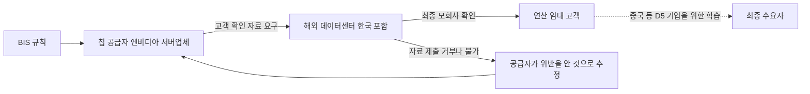

# 미국은 칩이 어디 있는지 대신 연산을 누가 쓰는지를 통제하기 시작했다…규칙에 '한국'은 한 번도 나오지 않지만, 고객 확인 의무는 한국 데이터센터까지 내려온다

## 판단: 통제 대상이 칩에서 고객 명부로 바뀌었다

미국 상무부 산업안보국(BIS)은 16일(현지시각) 제3국 데이터센터를 통한 원격 연산으로 기존 수출통제를 우회하지 못하게 하는 잠정최종규칙(IFR)을 냈다. BIS는 보도자료에서 이 규칙을 "재무부와 국가안보회의(NSC)가 작성하고 지시했다"(written by and at the direction of the Department of Treasury and the National Security Council)고 밝혔다([BIS](https://www.bis.gov/press-release/bis-issues-rule-addressing-remote-access-american-super-intelligence-technology)). 규칙은 19일 연방관보에 실리는 날 시행된다([연방관보](https://www.federalregister.gov/public-inspection/2026-23529/addressing-remote-access-to-advanced-semiconductors)).

이 글의 판단은 세 가지다. **첫째, 이 규칙의 핵심은 허가 요건이 아니라 '추정' 장치다.** 데이터센터가 고객 정보를 내놓지 못하면 칩을 판 쪽이 위반을 알았다고 추정된다. 그 결과 엔비디아와 서버 공급사가 세계 데이터센터의 고객 명부를 들여다보는 사실상의 감독자가 된다. 은행이 의심 거래를 걸러 내게 만든 자금세탁방지의 고객 확인(KYC) 방식이 연산 시장에 들어온 것이다. **둘째, 규칙 원문에 '한국(Korea)'은 한 번도 나오지 않는다. 그렇다고 한국과 무관한 규칙이 아니다.** 국가 단위 허가를 새로 받는 5개국에 한국은 없지만, 고객 확인 조항은 "세계 어느 목적지든" 적용된다. **셋째, 의무와 혜택이 비대칭이다.** 국가 단위 허가 면제는 미국 본사 기업에만 열렸고, 같은 날 미국 AI 기업을 '국가대표'로 우대한다는 보도가 나왔다. 한국 데이터센터는 비용을 지고, 면제는 미국 하이퍼스케일러가 받는다. 둘째와 셋째는 해석이다.

## 규칙은 어떻게 작동하나

규칙 원문은 132쪽이고, 내용은 네 가지다([BIS 규칙 원문](https://www.bis.gov/media/documents/rin-0694-ak50.pdf)).

| 항목 | 내용 |
|---|---|
| 데이터센터 최종 용도 통제(신설 §744.24) | 중국 등 국가그룹 D:5나 마카오에 본사나 최종 모회사가 있는 기업에 총 처리 성능(TPP) 1,200만을 넘는 연산을 제공하거나 제공할 데이터센터로 첨단 칩을 보내려면 허가가 필요하다. 목적지는 "세계 어디든"(any destination worldwide)이다 |
| 5개국 국가 단위 허가 | 인도네시아, 말레이시아, 싱가포르, 태국, 브라질을 "전용 위험이 평균보다 높은 나라"로 지정했다. 미국 본사 기업으로 가는 물량은 월간 보고를 조건으로 면제된다 |
| 파운드리·후공정 규정 강화 | 제3국 생산 능력을 통한 우회를 막는다 |
| AI 확산 규칙 폐지 | 2025년 1월 바이든 정부 규칙을 공식 삭제했다. 원문은 이 규칙이 "한 번도 집행되지 않았다"고 적었다 |

TPP 1,200만은 TechCrunch 계산으로 엔비디아 H100이나 H200 약 750개 규모다([TechCrunch](https://techcrunch.com/2026/11/16/us-tightens-ai-chip-export-controls-to-deter-chinese-companies-from-accessing-compute-remotely/)). 기준은 한 시설이 아니라 디지털로 연결된 시설을 합쳐 센다. 원문은 연결된 데이터센터를 "물리적으로 연결된 시설만이 아니라 디지털로 연결된 시설을 포함한다"고 정의했다. 시설을 쪼개 기준 아래로 내려가는 길을 막은 것이다.

중개도 막았다. 원문은 데이터센터가 중국 기업이 아닌 고객에게 연산을 빌려주더라도, 그 고객이 중국 기업을 위해 모델을 학습시키거나 모델을 제공한다는 것을 알면 같은 통제를 받는다고 썼다. 처음 수출할 때는 중국 고객이 없었더라도 나중에 중국 기업에 대량 연산을 주기 시작하면 데이터센터 소유자나 운영자가 허가를 받아야 한다. 이미 중국계 고객에게 대량 연산을 제공하던 데이터센터는 시행일부터 90일 안에 허가를 받지 않으면 "향후 수출 제한"을 받는다. 상품 추천처럼 생성 기능이 없는 '상업용 추천 시스템'은 BIS에 고객 이름과 연산 규모, 실사 내용을 신고하면 예외로 인정된다.

## 핵심은 '추정' 장치다

규칙에서 가장 멀리 가는 문장은 주석에 있다. 수출자는 해외 데이터센터의 고객 확인 실사 정보를 받아 제시할 수 있어야 하고, "해외 데이터센터가 이 최종 용도 통제의 준수를 검증할 정보를 거부하거나 제공하지 못하면, 이는 수출자에게 '인지'가 있다고 추정하는 위험 신호로 간주된다"(shall be considered a red flag that presumptively provides you with "knowledge")([BIS 규칙 원문](https://www.bis.gov/media/documents/rin-0694-ak50.pdf)). 원문은 이 실사가 "기업 구조조정이나 분사로 새 통제를 피하지 못하게" 하려는 것이라고 썼다.

이 장치 덕분에 BIS는 원격 접근 자체를 '수출'로 새로 정의하지 않았다. 원격 접근 통제에 BIS의 법적 권한이 있는지는 논란이었고, 원격 접근을 직접 규제하는 원격접근보안법(RASA)은 하원을 통과했지만 상원에 묶여 있다. 그래서 BIS는 이미 권한이 있는 칩 수출에 조건을 거는 방식을 택했다. 칩을 받는 순간부터 데이터센터는 칩을 판 쪽에 고객 명부를 설명해야 하는 처지가 된다. 감독은 정부가 아니라 공급망이 맡고, 위반 책임은 칩 공급자에게 걸린다. 이는 해석이다.

은행에 비유하면 구조가 분명해진다. 자금세탁방지 제도는 정부가 모든 송금을 직접 보지 않는다. 은행이 고객을 확인하고, 확인하지 못한 거래를 은행의 책임으로 만든다. 이번 규칙은 연산을 송금처럼, 데이터센터를 은행처럼 다룬다. 다른 점은 이 '은행'들이 미국 밖에 있고, 감독 권한이 그 나라 정부가 아니라 미국 칩 공급자의 계약서에서 나온다는 것이다.

## 한국: 명단에 없다고 무관한 것은 아니다

규칙 원문(BIS 게시본과 관보 원문)에는 'Korea'도 'Japan'도 나오지 않는다. 한국은 원래 D그룹에 들지 않아 국가 단위 허가 요건이 없고, 2025년 AI 확산 규칙에서도 미국과 동맹·파트너 18개국으로 이뤄진 1등급이었다([연방관보, 2025년 AI 확산 규칙](https://www.govinfo.gov/content/pkg/FR-2025-01-15/html/2025-00636.htm)). 국내 반응도 이 점에 기대고 있다. 아시아경제가 인용한 업계 관계자는 "삼성전자 등 반도체 업체들이 기존에도 중국 업체들과 거래를 하지 않고 있어 당장 영향은 없을 것"이라고 했다([아시아경제](https://view.asiae.co.kr/article/2026111709425298173)).

그러나 §744.24는 목적지를 가리지 않는다. 한국에 있는 데이터센터가 중국에 최종 모회사를 둔 고객에게, 직접이든 제3국 법인을 거쳐서든 대량 연산을 빌려주면 칩 공급자는 그 데이터센터로 칩을 보낼 때 허가를 받아야 한다. 데이터센터가 고객의 최종 모회사를 설명하지 못하면 공급자는 위반을 안 것으로 추정된다. 신원규 한국경제연구원 글로벌경제팀장은 서울신문에 "국내 AI 데이터센터와 파운드리도 고객사의 최종 모회사와 연산 자원의 사용 목적을 확인하는 등 관리 체계를 강화하라는 요구를 받을 수 있다"고 했다([서울신문](https://www.seoul.co.kr/news/economy/industry/2026/11/17/20261117500332)). 법무법인 태평양은 규칙 발표 전부터 국내 사업자에게 고객 확인, 접속 지역과 IP 식별, 감사 로그를 권고했다([ZDNet Korea](https://zdnet.co.kr/view?no=20261109134146)).

이 글은 이 부담이 한국에서 가장 크게 걸리는 곳이 GPU를 들여오는 클라우드·데이터센터라고 본다. 한국 정부는 엔비디아에서 GPU 26만 장을 들여오겠다는 계획을 세웠고, 그 가운데 상당 부분은 네이버클라우드 같은 민간 사업자 몫이다. 이 사업자들이 앞으로 엔비디아에서 칩을 받을 때는 고객 명부에 대한 질문이 따라온다. 중국계 고객이 거의 없더라도, 그것을 증명하는 체계가 없으면 공급이 늦어진다. 산업통상부와 과기정통부의 공식 입장, 국내 클라우드 사업자의 반응은 찾지 못했다. 이는 해석이다.

규칙에는 경고도 있다. 상무부는 이 규칙의 우회를 "묵인하는 나라"를 감시하고, 수입 제한, 새 허가 요건, 수출통제 체계상 국가 등급 강등, 거래제한 목록 지정 같은 결과를 검토하겠다고 썼다([BIS 규칙 원문](https://www.bis.gov/media/documents/rin-0694-ak50.pdf)). 지금 한국이 5개국 명단에 없는 것은 확정된 지위가 아니다. 한국 데이터센터가 우회 경로로 보도되는 순간 바뀔 수 있는 지위다. 카네기국제평화재단은 텐센트가 일본 클라우드 사업자와 B200 1만 5,000개 접근 계약을 맺은 사례를 들었는데([카네기](https://carnegieendowment.org/research/2026/05/the-geopolitical-debates-over-controlling-cloud-compute)), 이번에 일본도 명단에 들지 않았다. 동맹국은 국가 단위 허가 대신 서류로 신뢰를 증명하라는 요구를 받은 셈이다. 이는 해석이다.

## 혜택은 미국 기업에, 비용은 해외 데이터센터에

5개국 허가 요건은 미국에 본사나 최종 모회사가 있는 기업으로 가는 물량에는 적용되지 않는다. 월간 보고만 하면 된다. 말레이시아에 데이터센터를 짓는 미국 하이퍼스케일러는 면제되고, 같은 나라의 현지 사업자는 허가를 받아야 한다. 카네기 분석은 해외 데이터센터 임대만 막으면 중국 기업이 "미국 내 데이터센터에서 직접 클라우드 연산을 빌리는" 다른 허점으로 옮겨 갈 수 있다고 지적했다([카네기](https://carnegieendowment.org/research/2026/05/the-geopolitical-debates-over-controlling-cloud-compute)). 이번 규칙은 칩의 수출·재수출·이전에 조건을 거는 구조여서 미국 안의 데이터센터를 직접 다루는 문구가 없다. 통제는 미국 밖에서 더 엄격하다. 이는 해석이다.

같은 날 월스트리트저널은 트럼프 정부가 엔비디아, 아마존, 마이크로소프트, OpenAI, 앤트로픽 등 20곳 넘는 기업을 'AI 국가대표'로 지정해 수출 허가를 빨리 처리하고 해외 사업과 연방 금융을 지원할 계획이라고 보도했다. 이 보도는 2차 보도로만 확인했고, 러트닉 상무장관의 발표 날짜는 밀릴 수 있다고 전해졌다. 정부의 공식 확인은 없다([브라이트바트](https://www.breitbart.com/tech/2026/11/16/trump-administration-to-name-companies-ai-national-champions-including-nvidia-microsoft/), [코인센트럴](https://coincentral.com/what-the-ai-national-champion-label-offers-nvidia-microsoft-amazon-openai-and-anthropic)).

여기에는 한국이 볼 대목이 하나 있다. 보도의 근거로 거론되는 행정명령 14320은 미국 AI 기술 스택의 수출을 지원하는 명령이다([백악관](https://www.whitehouse.gov/presidential-actions/2025/07/promoting-the-export-of-the-american-ai-technology-stack/)). 그런데 이를 시행하는 상무부의 4월 공모 공고에서 '국가대표 기업'(National Champion Enterprises)은 미국 기업이 아니라 각 나라용 패키지에서 하드웨어나 모델을 가장 많이 공급하는 **외국 기업**을 가리킨다. 공고는 외국 기업을 낀 컨소시엄은 "자국용 패키지에서만" 국가대표로 지정될 수 있다고 썼다([연방관보](https://www.federalregister.gov/documents/2026/04/10/2026-06952/american-ai-exports-program-call-for-proposals-for-pre-set-consortia)). 보도의 용어와 공식 용어가 어긋난다. 공고 구조대로라면 한국 기업이 미국 기술 스택을 한국에 들여오는 패키지에서 국가대표 자리를 노릴 수 있다. 이는 공고문 구조에서 끌어낸 추론이다.

## 발행 뒤(11월 23~25일): 명부를 거르는 손이 늘었다

규칙이 나온 지 일주일 만에 이 글이 말한 '고객 확인'이 세 방향으로 퍼졌다. 첫째, 미국 상무부는 23일부터 말레이시아·싱가포르·태국의 7개 법인을 거래제한 명단에 올렸다. 첨단 연산 품목을 허가받지 않은 용도나 사용자에게 빼돌릴 "상당한 위험"이 이유이고, 허가 심사는 거부를 전제로 한다. 싱가포르의 'Apex Enterprise Solutions'와 엔비디아 사태에 등장한 메가스피드 계열 법인들이 들어 있다([연방관보](https://www.federalregister.gov/documents/2026/11/25/2026-23999/additions-to-the-entity-list)). Apex가 알리바바 계열이라는 보도와 알리바바의 "잘못된 지정" 반발이 나왔지만 관보 원문에는 알리바바라는 이름이 없다. 둘째, 말레이시아 투자통상산업부는 24일 데이터센터 사업자에게 이 법인들을 입주시키거나 서비스를 제공하지 말라고 권고하겠다며 "말레이시아는 수출통제를 우회하는 통로로 쓰이지 않을 것"이라고 했다([FMT](https://www.freemalaysiatoday.com/category/nation/2026/11/24/miti-to-advise-data-centres-against-hosting-us-blacklisted-firms)). 셋째, 블룸버그를 인용한 보도에 따르면 씨티와 스탠다드차타드가 싱가포르·말레이시아 등의 데이터센터 고객을 점검하기 시작했고, 싱가포르 은행들도 고객과 새 규정을 논의하거나 추가 공개를 요구하고 있다. 규칙이 은행에 고객 심사를 직접 명령하지는 않는다([토큰포스트](https://www.tokenpost.kr/news/policy/444368)).

시장도 움직였다. 블룸버그를 인용한 TNW에 따르면 중국 수요를 잃은 아시아 데이터센터들이 남는 B300 연산을 미국 고객에게 팔려 하고 있고, 리퀴드컴퓨트가 내는 B300 임대료 지수는 10월 말 GPU 시간당 7.72달러에서 24일 7.19달러로 7% 내렸다([TNW](https://thenextweb.com/news/asia-data-centres-b300-prices-us-buyers-chip-rules)). 지수를 내는 회사가 재판매 중개로 이익을 보는 곳이라는 점은 감안해야 한다.

이 글은 이 일주일이 위 판단을 앞당겨 확인했다고 본다. 이 글은 고객 명부를 감독하는 권한이 그 나라 정부가 아니라 미국 규칙과 칩 공급 계약에 있다고 썼는데, 말레이시아는 그 규칙을 스스로 집행하는 쪽을 택했다. 명부를 거르는 손은 칩 공급자와 데이터센터에서 주재국 정부와 대출 은행으로 늘었다. 자금세탁방지 체계가 은행에서 출발해 결국 거래 사슬 전체를 감시하게 된 것과 같은 경로다. 국내에서는 법무법인 태평양이 고객 확인 부담이 "반도체 수출자뿐 아니라 데이터센터에도 직접 미친다"고 분석했고([한국경제](https://www.hankyung.com/article/202611197500g)), 업계에서는 칩 공급사의 고객 확인 요청에 답할 수 있느냐가 추가 GPU 조달에 영향을 줄 수 있다는 말이 나왔다([아이티데일리](https://www.itdaily.kr/news/articleView.html?idxno=243003)). 정부와 국내 클라우드 사업자의 공식 입장은 25일까지도 찾지 못했다. 이는 해석이다.

## 한국이 해야 할 일

1. **고객 확인 기준을 정부가 먼저 만든다.** 사업자마다 엔비디아와 따로 서류를 맞추면 협상력이 없다. 국내 데이터센터가 공통으로 쓰는 최종 모회사 확인과 기록 보존 기준을 만들어 두면, 미국과 '신뢰할 수 있는 데이터센터'를 서로 인정하는 협상의 근거가 된다. 은행이 자금세탁방지 기준을 개별 계약이 아니라 법으로 맞춘 것과 같은 방식이다.
2. **팍스 실리카 '보호 목록' 협상과 묶는다.** 이틀 전 샌프란시스코 선언에서 한국은 무엇을 막을지 적을 목록이 비어 있는 문서에 먼저 서명했다([관련 기사](https://now.zeta4.net/a/2026-11-16-pax-silica-san-francisco-declaration-korea)). 원격 접근 규칙은 그 목록이 실제로 어떤 모양일지 미리 보여 준다. 협상 테이블에서 한국 데이터센터의 지위를 문서로 확정해 두는 것이 등급 강등 위험을 줄이는 길이다.
3. **'국가대표' 자리를 공식 용어로 읽는다.** 미국 기업 우대 보도에만 반응하지 말고, 상무부 공고가 외국 기업에 열어 둔 자국용 패키지 국가대표 자리를 한국 기업 컨소시엄이 노릴 수 있는지 확인해야 한다.

## 중국의 반응

궈자쿤 중국 외교부 대변인은 17일 정례 브리핑에서 이번 조치를 미국이 "국가안보 개념을 과도하게 확대하고 수출통제 조치를 남용해" 중국과 다른 나라의 정상적인 무역·기술 협력에 간섭한 사례라고 했다. 그는 "전형적인 경제적 강압과 롱암 관할(역외 관할)"이 "양국 간 공동 인식"에 어긋난다며 "필요한 조치"를 취하겠다고 했다([중국 외교부](https://www.mfa.gov.cn/eng/xw/fyrbt/lxjzh/202611/t20261117_12061159.html)). '양국 간 공동 인식'이라는 표현은 이번 규칙을 미중 무역휴전 합의 위반으로 보겠다는 뜻으로 읽힌다. 19일 선전에서 열리는 미중 정상회담과 내년 1월 10일 무역휴전 만료가 다음 고비다. 이는 해석이다.

## 확인하지 못한 것

- 의견 제출 마감(게재 후 60일)과 90일 유예 종료일은 원문의 '게재일 기준' 문구에 11월 19일 게재를 넣어 계산한 날짜다. 원문에 날짜가 직접 적혀 있지는 않다.
- 원문 안에서 90일 유예의 대상이 엇갈린다. 서문 일부는 상업용 추천 시스템용 연산을 제공하던 사업자에 대한 것으로 서술하고, 조문은 모든 기존 사업자로 읽힌다.
- 'AI 국가대표' 보도는 월스트리트저널 원문을 열지 못해 2차 보도로 확인했다. 지정 기업 수는 '20곳 이상'과 '24곳 이상'으로 보도마다 다르다.
- 한국 데이터센터가 중국계 고객에게 연산을 제공한 사례는 공개 보도에서 찾지 못했다. 정부와 국내 클라우드 사업자의 입장도 11월 25일까지 찾지 못했다.
- 미국 내 데이터센터가 규칙 밖이라는 판단은 규칙 구조에 따른 이 글의 해석이다. 로펌과 싱크탱크의 규칙 해설은 발표 이틀째인 18일까지 찾지 못했고, 이후 법무법인 태평양의 분석이 보도됐다.
- H100 750개 환산은 TechCrunch의 추정이다.
- (갱신) 블룸버그 원문은 열지 못해 B300 임대료와 은행 점검은 블룸버그를 인용한 TNW와 토큰포스트로 확인했다. Apex의 알리바바 소유관계와 알리바바 성명은 2차 보도이고, 말레이시아 정부 성명은 FMT 보도로 확인했다.
- 원격접근보안법(RASA)의 하원 통과와 상원 계류는 여러 2차 보도로 확인했고, 의회 표결 기록 원문은 보지 못했다.

## 갱신 기록

- 2026-11-26: 미국 거래제한 명단 7개 법인 추가(11월 23일 시행), 말레이시아 정부의 데이터센터 입주 금지 권고, 씨티·스탠다드차타드의 데이터센터 고객 점검, B300 임대료 하락, 국내 법률 해설 반영

## 출처

- [Additions to the Entity List — 미국 연방관보 (2026-11-25 게재, 11-23 시행)](https://www.federalregister.gov/documents/2026/11/25/2026-23999/additions-to-the-entity-list)
- [MITI to advise data centres against hosting US-blacklisted firms — FMT (2026-11-24)](https://www.freemalaysiatoday.com/category/nation/2026/11/24/miti-to-advise-data-centres-against-hosting-us-blacklisted-firms)
- [Asia data centres B300 prices and US buyers — TNW (2026-11-25)](https://thenextweb.com/news/asia-data-centres-b300-prices-us-buyers-chip-rules)
- [은행들, 데이터센터 고객 점검 — 토큰포스트 (2026-11-26)](https://www.tokenpost.kr/news/policy/444368)
- [美 원격접근 규칙, 데이터센터 고객 확인 부담 — 한국경제 (2026-11-19)](https://www.hankyung.com/article/202611197500g)
- [美 규칙과 국내 GPU 조달 — 아이티데일리 (2026-11-18)](https://www.itdaily.kr/news/articleView.html?idxno=243003)
- [BIS Issues Rule Addressing Remote Access to American Super Intelligence Technology — BIS (2026-11-16)](https://www.bis.gov/press-release/bis-issues-rule-addressing-remote-access-american-super-intelligence-technology)
- [Addressing Remote Access to Advanced Semiconductors, 규칙 원문 — BIS](https://www.bis.gov/media/documents/rin-0694-ak50.pdf)
- [Addressing Remote Access to Advanced Semiconductors — 연방관보 사전공개 (FR Doc. 2026-23529)](https://www.federalregister.gov/public-inspection/2026-23529/addressing-remote-access-to-advanced-semiconductors)
- [US tightens AI chip export controls to deter Chinese companies from accessing compute remotely — TechCrunch (2026-11-16)](https://techcrunch.com/2026/11/16/us-tightens-ai-chip-export-controls-to-deter-chinese-companies-from-accessing-compute-remotely/)
- [미, AI 반도체 '원격 이용'까지 통제… 국내 기업, 공급망 관리 부담 커질 듯 — 서울신문 (2026-11-17)](https://www.seoul.co.kr/news/economy/industry/2026/11/17/20261117500332)
- [미국 원격 접근 통제 규칙과 국내 반도체 업계 — 아시아경제 (2026-11-17)](https://view.asiae.co.kr/article/2026111709425298173)
- [원격 접근 통제와 국내 사업자 대응 — ZDNet Korea (2026-11-09)](https://zdnet.co.kr/view?no=20261109134146)
- [Foreign Ministry Spokesperson's Regular Press Conference on November 17, 2026 — 중국 외교부](https://www.mfa.gov.cn/eng/xw/fyrbt/lxjzh/202611/t20261117_12061159.html)
- [The Geopolitical Debates Over Controlling Cloud Compute — 카네기국제평화재단 (2026-05-05)](https://carnegieendowment.org/research/2026/05/the-geopolitical-debates-over-controlling-cloud-compute)
- [Promoting the Export of the American AI Technology Stack, 행정명령 14320 — 백악관 (2025-07-23)](https://www.whitehouse.gov/presidential-actions/2025/07/promoting-the-export-of-the-american-ai-technology-stack/)
- [American AI Exports Program; Call for Proposals for Pre-Set Consortia — 연방관보 (2026-04-10)](https://www.federalregister.gov/documents/2026/04/10/2026-06952/american-ai-exports-program-call-for-proposals-for-pre-set-consortia)
- [Framework for Artificial Intelligence Diffusion — 연방관보 (2025-01-15)](https://www.govinfo.gov/content/pkg/FR-2025-01-15/html/2025-00636.htm)
- [Trump administration to name AI national champions — Breitbart (2026-11-16)](https://www.breitbart.com/tech/2026/11/16/trump-administration-to-name-companies-ai-national-champions-including-nvidia-microsoft/)
- [What the AI national champion label offers — CoinCentral (2026-11-16)](https://coincentral.com/what-the-ai-national-champion-label-offers-nvidia-microsoft-amazon-openai-and-anthropic)

---

이 글은 공개 출처를 바탕으로 AI가 자동 생성한 초안을 검토해 발행했으며, 중요한 판단 전에는 연결된 원문을 확인해야 합니다.
