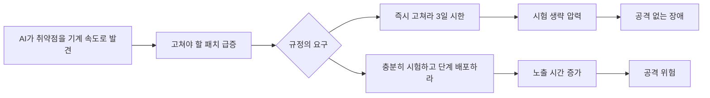

# 미국을 닷새 동안 멈춘 것은 AI가 아니라 '변경'이었다…AI가 취약점을 기계 속도로 찾자 '즉시 고쳐라'와 '충분히 시험하라'가 부딪치기 시작했다

## 판단: 공격은 없었고, 바꾸다가 무너졌다

11월 12일부터 17일까지 미국에서 마이크로소프트 365, 연방항공청(FAA) 관제 통신망, 인사관리 서비스 워크데이, 체이스·웰스파고 은행, 국가안보국(NSA) 기밀망이 차례로 멈췄다. 17일 저녁 워싱턴선은 익명 소식통 3명을 인용해 월가 임원들과 NSA가 의회에 장애 원인을 'AI가 찾은 취약점을 고치려는 패치'로 설명했다고 보도했다. 한 의회 관계자는 "한꺼번에 너무 많은 패치를 밀어 넣고 있다. 시스템이 설계된 한도 이상으로"라고 했다([워싱턴선](https://www.washingtonsun.com/technology/bank-ceos-nsa-tell-congress-ai-driven-patches-behind-outages)).

이 글의 판단은 세 가지다. **첫째, 닷새의 장애를 'AI 패치' 하나로 묶는 것은 틀렸다.** 실명으로 확인되는 AI 패치 사례는 NSA 하나이고, 마이크로소프트·FAA·체이스는 AI와의 관련을 직접 부인했다. **둘째, 그래도 이 장애들에는 공통점이 있다. 공격이 없었는데 시스템을 바꾸는 과정에서 무너졌다는 점이다.** 그리고 AI는 지금 그 '바꿔야 할 양'을 전례 없이 키우고 있다. **셋째, 규정은 패치 속도만 잰다.** 미국과 한국의 규정 모두 '빨리 고쳐라'는 시한은 점점 짧게 적는데, 고친 뒤 시스템이 다시 올라오는지는 따로 묻지 않는다. 둘째와 셋째는 해석이다.

## 닷새, 다섯 개의 원인

| 날짜 | 장애 | 공식 설명 | AI 관련 |
|---|---|---|---|
| 11월 12~13일 | 마이크로소프트 365(아웃룩·팀즈 등) | 7월부터 배포한 네트워킹 게이트웨이 수정본의 잠복 결함, 팀즈 트래픽 이동, 용량 약 14% 감소가 겹침 | 회사가 공격·AI 에이전트 관여 징후 없다고 밝힘 |
| 11월 13일 | FAA 전국 지상정지(약 5시간) | 아칸소 원격 사이트에서 계약업체가 구리선을 광케이블로 바꾸고 새 라우터를 달던 중 낡은 통신망이 과부하 | FAA 청장 "AI 관련 증거 전혀 없다" |
| 11월 13일 | 워크데이 | 회사는 조사 중이라며 사과. 원인은 공식 보고서 없음 | 확인 안 됨 |
| 11월 16일 | 체이스·웰스파고 | 체이스는 "온프레미스 하드웨어 시스템의 소프트웨어 버그", 웰스파고는 원인 미공개 | 체이스는 AI로 찾거나 고친 버그가 아니라고 밝힘 |
| 11월 17일 | NSA 기밀망 | NSA는 "예정된 정기 점검 중 일시적 성능 저하" | 국가정보장이 패치 탓이라고 발언 |

마이크로소프트는 예비 사후 보고서에서 문제의 변경이 7월에 배포돼 자동 롤백이 통하지 않았고, 시험이 저사양 장비 위주여서 코어가 많은 신형 장비에서 생기는 결함을 놓쳤다고 설명했다([사이버시큐리티뉴스](https://cybersecuritynews.com/microsoft-outage-incident-report/)). FAA는 낡은 시분할(TDM) 통신망이 불안정해졌다고 했고, 브라이언 베드퍼드 청장은 "악의적인 것의 증거도, AI와 관련된 것의 증거도 전혀 없다"고 했다. 더피 교통장관은 "아주 외딴 곳에서 한 꽤 단순한 작업"이었다고 했다([테크크런치](https://techcrunch.com/2026/11/14/transportation-secretary-blames-routine-equipment-upgrade-for-grounding-flights-nationwide/), [더스택](https://www.thestack.technology/faa-blames-legacy-tdm-network-for-nationwide-flight-grounding)). 체이스는 포춘에 이번 버그가 AI로 찾거나 고친 것이 아니라고 밝혔다([포춘](https://fortune.com/2026/11/18/ai-played-a-major-role-in-the-nsa-banking-outages-but-not-in-the-way-you-may-think)).

NSA만 다르다. 제이 클레이턴 국가정보장은 17일 폭스비즈니스 인터뷰에서 "이 취약점들이 확인됐기 때문에 많은 기관이 패치하고 있다"며 "그 뒤 진행된 패치 때문에 일부 시스템이 패치 후 예상대로 다시 올라오지 않았다. 오늘 NSA에서 일어난 일이 그것"이라고 했다. 그는 "조직적 사이버공격의 징후는 보이지 않는다"고 덧붙였다([폭스비즈니스](https://www.foxbusiness.com/technology/jay-clayton-addresses-concerns-amid-widespread-tech-outages)). 더레코드는 이 패치가 연구자들이 AI 도구의 도움으로 찾은 PHP 취약점을 막기 위한 것이라고 전했다([더레코드](https://therecord.media/nsa-net-disruptions)). 클레이턴은 다음 날 하원 국토안보위원회에서 장애들을 "유지보수와 기술 변경과 관련된 별개의 서비스 장애"라고 정리했다([PBS](https://www.pbs.org/newshour/politics/watch-intelligence-official-pressed-to-explain-cause-of-national-security-agency-outage)).

워싱턴선 보도는 제목에 '은행 CEO들'을 넣었지만 본문은 '월가 임원들'이고 실명 인용은 없다. 독일 IT 매체 하이제는 의원들이 말한 범위가 NSA와 JP모건 장애였고 마이크로소프트와 FAA는 포함되지 않았다고 짚었다. 마크 워너 상원의원실은 포춘에 "엉성한 패치 적용"이 NSA와 은행 장애에 연결돼 있다고 했지만, 체이스의 부인과 맞지 않는다([포춘](https://fortune.com/2026/11/18/ai-played-a-major-role-in-the-nsa-banking-outages-but-not-in-the-way-you-may-think)). 지금 확인된 것은 여기까지다.

## 그래도 압력은 실재한다

장애 하나하나를 AI 탓으로 돌릴 수는 없지만, AI가 방어자에게 지운 짐은 숫자로 보인다. 마이크로소프트는 10월 정기 보안 업데이트에서 1,400건이 넘는 취약점을 고쳐 9월의 종전 최대 기록(964건)을 46% 넘었다([비카리우스](https://www.vicarius.io/articles/microsoft-october-2026-patch-tuesday), [PC월드](https://www.pcworld.com/article/3260668/microsoft-breaks-record-fixing-1416-security-flaws-update-windows-now.html)). 더스택은 9월에 이미 마이크로소프트가 2026년 들어 낸 패치가 2024년과 2025년을 합친 것보다 많다고 썼다([더스택](https://www.thestack.technology/runtime-the-smallest-patch-tuesday-of-the-rest-of-your-life/)). 공개 취약점(CVE) 발행 건수는 10월 말까지 약 9만 건으로, 2025년 한 해(약 5만 건)를 크게 넘었다([NVD 월별 집계](https://github.com/jgamblin/monthlyCVEStats)).

10월에는 AI 모델의 도움으로 찾은 PHP 인터프리터 원격 코드 실행 취약점이 공개됐다. 크리스 크렙스 전 미국 사이버보안·인프라보안청(CISA) 국장은 CNBC에 "지금까지 발견된 치명적 취약점 전체의 3%가 지난 한 달 사이에 나왔다"고 했다([CNBC](https://www.cnbc.com/2026/10/23/php-vulnerabilities-ai-cybersecurity.html)). 뱅크오브아메리카의 브라이언 모이니핸 CEO는 10월 AI 모델이 드러낸 결함을 고치려고 외부 계약직 약 1,000명을 추가했다고 밝혔다([IT프로](https://www.itpro.com/technology/artificial-intelligence/bank-of-america-hired-1-000-security-consultants-to-address-mythos-spotted-flaws)). 한 보안업체 CEO는 포춘에 "AI는 이제 기계 속도로 취약점을 찾는데, 우리의 시험·배포 안전장치는 여전히 사람 속도에 묶여 있다"고 했다. 반대 의견도 있다. 래피드7의 크리스티안 베크는 복잡한 시스템은 적대 세력보다 "지루한 이유로" 훨씬 자주 실패한다며, 서두른 보안 업데이트가 이번 장애를 일으켰다는 공개 증거는 없다고 했다([TNW](https://thenextweb.com/news/us-outages-patches-ai-found-flaws-nsa-banks-washington-sun)).

이 글은 두 말이 모두 맞다고 본다. 이번 장애 대부분은 지루한 이유로 일어났다. 그러나 지루한 실패의 확률은 바꾸는 횟수에 비례한다. 1년 사이 고쳐야 할 취약점이 두 배가 되면, 시험과 배포를 사람 속도로 하는 조직에서는 같은 확률의 실수가 두 배로 일어난다. 이는 해석이다.

## 2년 전의 교훈과 지금의 시한이 부딪친다

2024년 7월 19일 크라우드스트라이크의 보안 업데이트 하나가 윈도 기기 약 850만 대를 멈췄다([마이크로소프트](https://blogs.microsoft.com/blog/2024/07/20/helping-our-customers-through-the-crowdstrike-outage/)). 크라우드스트라이크가 내놓은 재발 방지책은 소수 기기에 먼저 배포한 뒤 문제가 없을 때만 배포 범위를 차례로 넓히고 문제가 생기면 되돌리는 단계 배포였다([크라우드스트라이크](https://www.crowdstrike.com/blog/falcon-content-update-preliminary-post-incident-report/)). 업계가 그 사고에서 배운 것은 보안 업데이트일수록 천천히 넓히라는 것이었다.

2년 뒤의 규정은 반대 방향을 가리킨다. CISA는 6월 구속력 있는 운영지침(BOD 26-04)으로 외부에 노출돼 있고, 완전 자동화 공격이 가능하며, 시스템 장악이 가능하고, 실제 악용 증거가 있는 취약점을 3일 안에 조치하라고 연방기관에 요구했다. CISA는 AI가 새 취약점 발견 속도를 "크게 높이고" 있고 방어자들이 "이미 따라가기 벅차다"고 설명했다([사이버스쿱](https://cyberscoop.com/cisa-vulnerability-remediation-directive-bod-26-04/)). 지침은 패치의 시한을 정하지만, 패치가 시스템을 멈출 위험을 어떻게 관리할지는 다루지 않는다. 클레이턴 국가정보장의 말로는 FBI와 NSA가 "내리고, 패치를 넣으라"고 말해 왔다. 단계 배포는 시간을 들이는 방식이고, 3일 시한은 그 시간을 줄이라는 압력이다.

## 한국의 규정은 한 문서 안에서 부딪친다

한국 금융권 규정은 이 충돌을 한 고시 안에 담고 있다. 전자금융감독규정 제14조는 금융회사가 "정보처리시스템의 긴급하고 중요한 보정(patch)사항에 대하여는 즉시 보정 작업을 할 것"을, 제15조는 해킹에 대비한 긴급하고 중요한 보정사항에 대해 "즉시 보정작업 실시"를 요구한다. 같은 규정 제29조는 프로그램의 등록·변경·폐기 절차를 세우라고 하고, 개정 전 조문은 운영시스템 적용은 "충분한 테스트 및 관련 책임자 승인 후 실시할 것"이라고 적었다([전자금융감독규정 제2025-4호](https://ko.wikisource.org/wiki/%EC%A0%84%EC%9E%90%EA%B8%88%EC%9C%B5%EA%B0%90%EB%8F%85%EA%B7%9C%EC%A0%95_%28%EC%A0%9C2025-4%ED%98%B8%29)). 패치가 1년에 몇 번이던 시절에는 '즉시'와 '충분한 시험'이 함께 지켜질 수 있었다. 한 회사의 패치가 한 달에 1,000건을 넘기 시작한 지금은 둘 중 하나를 고르게 된다.

정부도 같은 말을 한다. 과기정통부와 한국인터넷진흥원(KISA)은 10월 22일 PHP 취약점에 대해 사이버위기 경보를 '주의'로 올리며 "최신 버전으로 즉시 업데이트해야 한다"고 당부했다([정책브리핑](https://www.korea.kr/news/policyNewsView.do?newsId=148974113)). KISA에 들어온 취약점 신고는 2025년 2,525건으로 제도 시행 이후 가장 많았고 10년 새 3.6배가 됐다([국민일보](https://v.daum.net/v/20260616185248854)). 한국은 유지보수 작업 하나가 국가 전산망을 멈춘 경험도 이미 했다. 2025년 9월 국가정보자원관리원 대전센터에서 배터리 이설 작업 중 불이 나 정부 시스템 709개가 멈췄고, 전면 복구까지 약 95일이 걸렸다([경향신문](https://www.khan.co.kr/article/202512301118001)). FAA의 이번 장애도 '꽤 단순한' 정기 작업에서 시작됐다.

전날 이 사이트는 한국 은행을 뚫은 AI 침투 도구가 외부에 열린 주변 시스템을 노렸다고 썼다([관련 기사](https://now.zeta4.net/a/2026-11-18-fbi-artex-flash-korean-banks-perimeter)). 공격 쪽은 AI로 빨라졌고, 방어 쪽은 AI가 찾은 구멍을 메우느라 스스로 넘어지고 있다. 둘은 같은 현상의 양면이다. 이는 해석이다.

## 발행 뒤(11월 18~20일): 단계 배포로도 잡히지 않은 결함, 그리고 NSA를 빼고 만드는 조사위원회

마이크로소프트의 예비 사후 보고서 원문을 보면 이 글의 처방 하나를 다듬어야 한다. 보고서는 문제의 수정본이 "안전 배포 절차를 거쳐 몇 주에 걸쳐 전 세계로 퍼졌고 그동안 문제가 없었다"며 "3개월 넘게 전 세계에서 영향 없이 운영됐다"고 적었다. 결함은 코어가 많은 신형 장비에서 특정 부하가 걸릴 때만 드러났고, 회사의 부하 시험은 코어가 적은 장비 위주였다. 장애가 커진 데는 구획 사이의 격벽이 "별도 문제" 때문에 연쇄 장애를 막지 못한 것도 있었다([마이크로소프트 예비 사후 보고서(넥스트 게재)](https://next.ink/wp-content/uploads/2026/11/PostIncidentReport.pdf)). 보고서에는 이 수정본이 보안 패치였다는 서술도, AI에 관한 언급도 없다. 최종 보고서는 20일까지 고객 관리자에게 제공하기로 돼 있었지만 공개된 내용은 찾지 못했다.

NSA는 20일 직원 안내에서 "일부 예외를 두고 정상 운영 중"이라고 알렸다([내셔널데스크](https://thenationaldesk.com/news/americas-news-now/nsa-national-security-agency-internal-network-outage-resolved-after-3-days-sources-say-maryland-headquarters-employees-staggered-start-time-classified-information-scheduled-maintenance-foreign-intelligence-military-policymakers)). CBS는 소식통을 인용해 장애가 AI의 도움으로 찾은 PHP 결함 2건의 긴급 패치와 관련 있다고 보도했다([CBS](https://www.cbsnews.com/news/national-security-agency-network-outage-software-vulnerability/)). 클레이턴 국가정보장은 18일 하원 청문회에서 "패치 속도와 시스템 업그레이드 속도가 빨라지는 환경에 있다"고 했고, 멀린 국토안보부 장관은 대규모 패치 전에 고객에게 미리 알리자며 업계와 대화를 시작하겠다고 했다([넥스트고브](https://www.nextgov.com/cybersecurity/2026/11/security-officials-tell-congress-tech-outages-are-not-malicious/417312/)). 체이스는 자사 버그가 거래 상대 은행들에도 영향을 줬을 수 있다고 밝혀, 웰스파고 장애의 상당 부분이 체이스 버그의 파급일 가능성이 생겼다([TNW](https://thenextweb.com/news/chase-software-bug-bank-outages-zelle)).

의회에서는 18일 공격 증거가 없어도 잘못된 업데이트, 설정 오류, AI 실패로 생긴 대형 장애를 조사하는 위원회를 미국 사이버보안·인프라보안청(CISA) 안에 두는 '루트 코즈 법안'이 초당적으로 발의됐다. 그러나 NSA망 같은 국가안보 시스템은 조사 대상에서 빠진다([하원 국토안보위](https://homeland.house.gov/2026/11/18/homeland-republicans-lead-legislation-to-strengthen-modernize-dhss-cybersecurity-mission-as-ai-reshapes-the-threat-landscape/), [넥스트고브](https://www.nextgov.com/policy/2026/11/bipartisan-bill-would-create-cyber-and-ai-review-board-amid-series-tech-outages/417299/)). 한국 금융위원회는 같은 날 대형 금융사의 보안 취약점 점검을 연 2회로 늘리는 전자금융감독규정 개정을 예고하며 "AI를 통한 침해위협이 빠르게 진화·발전하고 있으며, 전산자원의 취약점도 과거와 비교할 수 없이 자주 나타나고 있다"고 했다. 개정 예고문에 패치 뒤 장애나 시험에 관한 내용은 없다([정책브리핑](https://www.korea.kr/news/policyNewsView.do?newsId=148975994)).

이 글은 마이크로소프트 사례가 단계 배포가 필요 없다는 뜻이 아니라, 단계 배포만으로는 부족하다는 뜻이라고 본다. 몇 주에 걸친 단계 배포와 석 달의 무사고를 통과한 결함이 트래픽 이동과 용량 감소가 겹친 날 터졌다. 그렇다면 처방은 배포 속도보다 시험 장비가 실제 운영 장비를 닮았는지, 그리고 몇 달 전 변경까지 되돌릴 경로가 있는지로 옮겨 가야 한다. 미국 의회가 만들려는 조사위원회가 실명으로 확인된 유일한 'AI 패치' 장애인 NSA를 조사할 수 없고, 한국의 개정안이 점검 횟수만 늘리는 것은 두 나라 모두 아직 '빨리 찾고 빨리 고치는' 쪽만 제도로 만들고 있다는 뜻이다. 이는 해석이다.

## 발행 뒤(11월 20~25일): '1시간 안에 전 세계로'와 하루 만에 악용된 드루팔 결함

로이터가 24일 보도한 마이크로소프트 내부 메모에서 이 글이 짚은 충돌이 한 회사 안에 그대로 드러났다. 제이슨 헨더슨 M365 코어 사장은 이번 장애를 Exchange Online 역사상 고객 영향이 가장 큰 사고로 규정하고 '코드 레드'를 선언했다. 그는 "수년간 해 온 모든 일이 목요일에 우리를 지키기에 충분하지 않았다"고 썼다. 대책은 부하 차단, 지역별 트래픽 분할, 더 빠른 복구 장치 등 다섯 갈래이고, 앞으로 장애를 전 세계에서 1시간 안에 해소하는 것이 목표다. 헨더슨은 이달 초 앞선 메모에서 다른 사고의 긴급 수정본이 전 세계에 퍼지는 데 5~6일 걸렸다며 "가장 긴급한 보안 문제는 탐지에서 안전한 전 세계 배포까지 1시간 안에 가야 한다. 말할 필요도 없이 아직 거기에 이르지 못했다"고 했다([로이터(클레임스저널 게재)](https://www.claimsjournal.com/news/national/2026/11/24/341515.htm)). 몇 주의 단계 배포를 거친 변경이 장애를 낸 회사가, 같은 달 보안 수정은 1시간 안에 전 세계로 보내야 한다고 쓴 것이다. 메모가 전한 대책에 변경 동결이나 배포 제한은 없고, 중심은 격리와 복구 속도다.

같은 주 '빨리 고쳐야 하는 이유'도 실명으로 나왔다. 드루팔은 18일 앤트로픽의 오픈소스 스캐너가 찾은 설치기 원격 코드 실행 결함(CVE-2026-132165)을 '매우 심각' 등급으로 고쳤고, 이틀 전 사전 공지에서 "몇 시간이나 며칠 안에" 공격 코드가 나올 수 있다고 경고했다. 실제 공격은 19일 19시(세계협정시)에 보고됐다. 패치가 나온 지 하루 남짓이다([드루팔](https://www.drupal.org/sa-core-2026-017), [드루팔 사전 공지](https://www.drupal.org/psa-2026-11-16)). CISA는 24일 이 결함을 '알려진 악용 취약점' 목록에 올리고 연방기관에 27일까지, 사흘 안에 조치하라고 했다. 목록 항목은 BOD 26-04 준수와 포렌식 분류를 요구한다([CISA](https://www.cisa.gov/known-exploited-vulnerabilities-catalog?search_api_fulltext=CVE-2026-132165), [시큐리티위크](https://www.securityweek.com/drupal-flaw-found-by-anthropic-scanner-exploited-in-attacks/)).

이 글은 두 사건을 함께 읽어야 한다고 본다. AI가 찾은 결함은 패치 하루 만에 공격으로 이어졌고, 그래서 '1시간 배포'라는 목표는 과장이 아니다. 그러나 그 목표를 내건 회사는 동시에 몇 달 전 변경 하나로 하루를 멈췄다. 마이크로소프트의 답은 속도를 늦추는 것이 아니라 터져도 작게 터지고 빨리 돌아오게 하는 것이고, 이는 이 글이 처방으로 든 되돌릴 경로와 같은 방향이다. 한국 금융당국의 개정 예고에는 아직 이 두 번째 절반이 없다. 이는 해석이다.

## 무엇을 바꿔야 하나

1. **패치 속도와 장애율을 함께 보고하게 한다.** 지금 규정과 평가는 '얼마나 빨리 고쳤나'를 잰다. 같은 보고서에 '고친 뒤 몇 번 시스템이 멈췄나'(변경 실패율)를 넣지 않으면, 기관은 시한을 지키려고 시험을 줄인다.
2. **'즉시'의 범위를 좁히고 순서를 정한다.** CISA 지침이 외부 노출과 실제 악용 같은 기준을 둔 것처럼, 전자금융감독규정의 '긴급하고 중요한'을 구체적 기준으로 바꾸고 그 밖의 패치는 단계 배포를 의무로 해야 한다. 외부에 노출된 시스템부터 고치는 것이 공격 쪽 교훈과도 맞는다.
3. **되돌리기를 먼저 확인한다.** 마이크로소프트의 이번 장애가 길어진 이유 하나는 몇 달 전 배포한 변경이라 자동 롤백이 안 됐다는 점이다. 패치 계획에 '어떻게 되돌릴지'가 없으면 즉시 패치는 즉시 장애가 될 수 있다.

## 확인하지 못한 것

- 'AI가 찾은 취약점 패치가 장애 원인'이라는 워싱턴선 보도는 익명 소식통 3명에 기댄다. NSA는 워싱턴선 질의에 답하지 않았고, 공식 성명은 '정기 점검'이라고만 했다. NSA 장애를 처음 보도한 CNN 기사는 열지 못했다.
- 웰스파고와 워크데이는 공식 원인을 밝히지 않았다. 워크데이의 재해복구 시험 관련 설명은 2차 보도뿐이다.
- FAA 장애로 인한 결항은 금요일 하루 약 9,000~1만 2,000편, 주말 포함 1만 7,000편 안팎으로 집계마다 다르다. 일부 보도의 '2만 편 이상'은 원문을 확인하지 못했다.
- 마이크로소프트 10월 패치 건수는 업체마다 1,407~1,416건으로 다르다. CVE 연간 건수도 집계 방식에 따라 차이가 있다.
- 전자금융감독규정은 2025년 2월 시행본으로 확인했고, 2026년 7월 개정 고시와 시행세칙 원문은 대조하지 못했다. '충분한 테스트' 문구는 개정 전 조문이며 현재는 세칙으로 옮겨진 것으로 보인다.
- 2026년 국내 금융권에서 보안 패치가 직접 원인이 된 전산장애 사례는 찾지 못했다.
- (갱신) 마이크로소프트 예비 사후 보고서는 회사가 아니라 프랑스 매체 넥스트가 게재한 사본으로 확인했다. 최종 보고서는 고객 관리자에게만 제공되는 것으로 보이며 공개된 내용은 찾지 못했다. NSA 복구와 PHP 패치 관련성은 소식통 보도이고 NSA 공식 입장은 17일 성명 그대로다.
- (갱신) 마이크로소프트 '코드 레드' 메모는 로이터 원문이 아니라 클레임스저널 재게재본으로 확인했고, 메모의 정확한 날짜는 기사에 없다. 7월 결함이 보안 패치였는지는 여전히 확인되지 않았다. 드루팔 결함의 공격 규모는 공개되지 않았고, 이 패치로 장애가 났다는 보고는 찾지 못했다.

## 갱신 기록

- 2026-11-21: 마이크로소프트 예비 사후 보고서 원문의 '단계 배포를 거친 결함' 내용, NSA 복구와 의회 청문회 발언, 체이스 버그의 타 은행 파급, 루트 코즈 법안 발의(NSA 제외), 금융위 전자금융감독규정 개정 예고 반영. 최종 보고서가 공개되지 않아 확인 일정을 지우고 추적 종료
- 2026-11-26: 마이크로소프트 내부 '코드 레드' 메모(1시간 복구·배포 목표)와 앤트로픽 스캐너가 찾은 드루팔 결함의 패치 하루 뒤 악용, CISA 3일 조치 기한 반영

## 출처

- [Microsoft Declares 'Code Red' After Historic Outage, Internal Memos Show — 로이터(클레임스저널 게재, 2026-11-24)](https://www.claimsjournal.com/news/national/2026/11/24/341515.htm)
- [SA-CORE-2026-017: Drupal core - Highly critical - Remote code execution — 드루팔 (2026-11-18)](https://www.drupal.org/sa-core-2026-017)
- [PSA-2026-11-16 — 드루팔 (2026-11-16)](https://www.drupal.org/psa-2026-11-16)
- [Known Exploited Vulnerabilities Catalog: CVE-2026-132165 — CISA (2026-11-24)](https://www.cisa.gov/known-exploited-vulnerabilities-catalog?search_api_fulltext=CVE-2026-132165)
- [Drupal flaw found by Anthropic scanner exploited in attacks — SecurityWeek (2026-11-25)](https://www.securityweek.com/drupal-flaw-found-by-anthropic-scanner-exploited-in-attacks/)

- [Preliminary Post Incident Report for Microsoft 365 (2026-11-15) — 넥스트 게재](https://next.ink/wp-content/uploads/2026/11/PostIncidentReport.pdf)
- [NSA internal network outage resolved — 내셔널데스크 (2026-11-20)](https://thenationaldesk.com/news/americas-news-now/nsa-national-security-agency-internal-network-outage-resolved-after-3-days-sources-say-maryland-headquarters-employees-staggered-start-time-classified-information-scheduled-maintenance-foreign-intelligence-military-policymakers)
- [NSA network outage and software vulnerability — CBS (2026-11-18)](https://www.cbsnews.com/news/national-security-agency-network-outage-software-vulnerability/)
- [Security officials tell Congress tech outages are not malicious — 넥스트고브 (2026-11-18)](https://www.nextgov.com/cybersecurity/2026/11/security-officials-tell-congress-tech-outages-are-not-malicious/417312/)
- [Chase software bug and bank outages — TNW (2026-11-16)](https://thenextweb.com/news/chase-software-bug-bank-outages-zelle)
- [Homeland Republicans lead legislation (ROOT CAUSE Act) — 하원 국토안보위 (2026-11-18)](https://homeland.house.gov/2026/11/18/homeland-republicans-lead-legislation-to-strengthen-modernize-dhss-cybersecurity-mission-as-ai-reshapes-the-threat-landscape/)
- [Bipartisan bill would create cyber and AI review board — 넥스트고브 (2026-11-18)](https://www.nextgov.com/policy/2026/11/bipartisan-bill-would-create-cyber-and-ai-review-board-amid-series-tech-outages/417299/)
- [대형 금융사 보안 취약점 점검 연 2회로 — 정책브리핑 (2026-11-18)](https://www.korea.kr/news/policyNewsView.do?newsId=148975994)
- [Bank CEOs, NSA Tell Congress That AI-Driven Patches Are Behind Outages — 워싱턴선 (2026-11-17)](https://www.washingtonsun.com/technology/bank-ceos-nsa-tell-congress-ai-driven-patches-behind-outages)
- [Jay Clayton addresses concerns amid widespread tech outages — 폭스비즈니스 (2026-11-17)](https://www.foxbusiness.com/technology/jay-clayton-addresses-concerns-amid-widespread-tech-outages)
- [NSA network disruptions — 더레코드 (2026-11-17)](https://therecord.media/nsa-net-disruptions)
- [Intelligence official pressed to explain cause of NSA outage — PBS (2026-11-18)](https://www.pbs.org/newshour/politics/watch-intelligence-official-pressed-to-explain-cause-of-national-security-agency-outage)
- [AI played a major role in the NSA, banking outages — but not in the way you may think — 포춘 (2026-11-18)](https://fortune.com/2026/11/18/ai-played-a-major-role-in-the-nsa-banking-outages-but-not-in-the-way-you-may-think)
- [Chase, Wells Fargo, Capital One bank outages — 포춘 (2026-11-16)](https://fortune.com/2026/11/16/chase-bank-wells-fargo-capital-one-bank-outages/)
- [US outages, patches and AI-found flaws — TNW (2026-11-18)](https://thenextweb.com/news/us-outages-patches-ai-found-flaws-nsa-banks-washington-sun)
- [Microsoft outage incident report — 사이버시큐리티뉴스 (2026-11-16)](https://cybersecuritynews.com/microsoft-outage-incident-report/)
- [Transportation secretary blames routine equipment upgrade for grounding flights nationwide — 테크크런치 (2026-11-14)](https://techcrunch.com/2026/11/14/transportation-secretary-blames-routine-equipment-upgrade-for-grounding-flights-nationwide/)
- [FAA blames legacy TDM network for nationwide flight grounding — 더스택 (2026-11-16)](https://www.thestack.technology/faa-blames-legacy-tdm-network-for-nationwide-flight-grounding)
- [Microsoft October 2026 Patch Tuesday — 비카리우스](https://www.vicarius.io/articles/microsoft-october-2026-patch-tuesday)
- [Microsoft breaks record fixing 1,416 security flaws — PC월드](https://www.pcworld.com/article/3260668/microsoft-breaks-record-fixing-1416-security-flaws-update-windows-now.html)
- [The smallest Patch Tuesday of the rest of your life — 더스택 (2026-09-10)](https://www.thestack.technology/runtime-the-smallest-patch-tuesday-of-the-rest-of-your-life/)
- [Monthly CVE statistics — 제리 갬블린 NVD 집계](https://github.com/jgamblin/monthlyCVEStats)
- [PHP vulnerabilities and AI cybersecurity — CNBC (2026-10-23)](https://www.cnbc.com/2026/10/23/php-vulnerabilities-ai-cybersecurity.html)
- [Bank of America hired 1,000 security consultants — IT프로](https://www.itpro.com/technology/artificial-intelligence/bank-of-america-hired-1-000-security-consultants-to-address-mythos-spotted-flaws)
- [CISA vulnerability remediation directive BOD 26-04 — 사이버스쿱 (2026-06-10)](https://cyberscoop.com/cisa-vulnerability-remediation-directive-bod-26-04/)
- [Helping our customers through the CrowdStrike outage — 마이크로소프트 (2024-07-20)](https://blogs.microsoft.com/blog/2024/07/20/helping-our-customers-through-the-crowdstrike-outage/)
- [Falcon content update preliminary post incident report — 크라우드스트라이크](https://www.crowdstrike.com/blog/falcon-content-update-preliminary-post-incident-report/)
- [전자금융감독규정(금융위원회고시 제2025-4호) — 위키문헌](https://ko.wikisource.org/wiki/%EC%A0%84%EC%9E%90%EA%B8%88%EC%9C%B5%EA%B0%90%EB%8F%85%EA%B7%9C%EC%A0%95_%28%EC%A0%9C2025-4%ED%98%B8%29)
- [PHP 취약점 사이버위기 경보 '주의' 상향 — 대한민국 정책브리핑 (2026-10-22)](https://www.korea.kr/news/policyNewsView.do?newsId=148974113)
- [KISA 취약점 신고 역대 최다 — 국민일보 (2026-06-16)](https://v.daum.net/v/20260616185248854)
- [국정자원 화재 시스템 전면 복구 — 경향신문 (2025-12-30)](https://www.khan.co.kr/article/202512301118001)

---

이 글은 공개 출처를 바탕으로 AI가 자동 생성한 초안을 검토해 발행했으며, 중요한 판단 전에는 연결된 원문을 확인해야 합니다.
