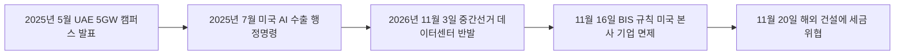

# 트럼프의 '해외 데이터센터 세금'은 집행되기 어렵지만, 한국에 남기는 질문은 진짜다…미국이 데이터센터의 위치를 충성의 문제로 다루기 시작했다

## 판단: 정책이 아니라 신호이고, 신호가 가리키는 곳은 동맹이다

도널드 트럼프 미국 대통령은 20일(현지시각) 백악관 기자회견에서 "기업들이 다른 나라에 데이터센터를 짓게 두지 않겠다"고 말했다. 이어 "그렇게 해도 된다. 하지만 엄청난 세금을 물리겠다"고 했다([AP(WRTV)](https://www.wrtv.com/news/politics/trump-threatens-tax-on-us-companies-building-ai-data-centers-overseas/)). 그는 "중국이 다 가져갈 것이기 때문에 데이터센터가 다른 나라로 가는 것을 허용하지 않는다"고 했고, 미국 안에는 "데이터센터를 간절히 원하는 곳이 많다"고 했다([뉴스위크](https://www.newsweek.com/trump-tax-us-data-centers-overseas-12748825), [CNBC](https://www.cnbc.com/2026/11/20/trump-data-centers-ai-companies-tax.html)). 그리고 "참모들에게도 아직 말하지 않았다. 지금 말하는 것"이라고 덧붙였다.

이 글의 판단은 세 가지다. **첫째, 이 발언은 그대로 집행되기 어렵다.** 금지인지 세금인지부터 한 문장 안에서 바뀌었고, 세율, 대상, 시작일, 기존 시설 적용 여부가 하나도 없다. 세금을 만들 권한은 의회에 있는데, 그 의회는 1월부터 민주당이 양원 다수다. **둘째, 그래도 가볍게 넘길 발언은 아니다.** 나흘 전 트럼프 정부의 상무부는 해외 데이터센터 규칙에서 미국 본사 기업을 면제해, 미국 기업이 해외에 짓는 데이터센터를 '믿을 수 있는 시설'로 대우했다. 대통령이 그 전제를 하루 기자회견으로 뒤집었다. 데이터센터를 어디에 짓느냐가 안보 규칙의 문제에서 대통령이 협상에 쓰는 카드로 옮겨 갔다는 뜻이다. **셋째, 한국에 남는 질문은 세금이 아니라 소유 구조다.** 한국의 AI 인프라 계획은 미국 기업이 한국에 짓는 데이터센터에 크게 기대고 있다. 미국 기업이 '짓는' 시설이 표적이 된다면, 한국 기업이 짓고 소유하며 미국 기업은 연산을 빌려 쓰는 구조가 이 위험을 피하는 길이다. 세 가지 모두 해석이다.

## 발언에 없는 것들

AP와 CNBC는 발언에 세율, 적용 기업, 시작일, 기존 시설 처리, 예외가 없었다고 전했다. CNBC는 이 구상이 참모들을 "놀라게 한 것으로 보인다"고 썼다. 뉴스위크에 따르면 트럼프는 핀란드의 데이터센터 사업은 진행되지 못할 것이라고 말했다. 그는 9월 구글의 핀란드 투자를 공개적으로 비판한 적이 있다([트리뷴](https://www.tribuneindia.com/news/usa-news/trump-not-happy-with-googles-finland-ai-plan-urges-tech-giant-to-rethink/)). 아마존, 구글, 마이크로소프트, 오라클은 CNBC의 논평 요청에 바로 답하지 않았다. 21일 오후(한국시각)까지 행정명령이나 재무부 지침, 백악관의 후속 설명은 찾지 못했다.

법적 길도 좁다. 미국 헌법 1조 8항은 과세권을 의회에 준다. 대통령이 쓰던 국제비상경제권한법(IEEPA)은 올해 연방대법원이 관세 부과의 근거가 될 수 없다고 판단했다([IBTimes UK](https://www.ibtimes.co.uk/trump-tax-ai-data-centres-abroad-legal-questions-1833720)). 해외에 짓는 건물은 수입품이 아니므로 관세로도 닿지 않는다. 액시오스도 행정부 단독으로 어떻게 세금을 매길지 불분명하다고 짚었다([액시오스](https://www.axios.com/2026/11/20/us-ai-trump-data-centers-overseas)). 남는 길은 의회 입법인데, 이달 3일 중간선거에서 민주당이 양원을 가져갔다.

## 나흘 전 자기 정부의 규칙과 어긋난다

이 발언이 가볍지 않은 이유는 그 앞의 정책과 부딪치기 때문이다. 상무부 산업안보국(BIS)은 16일 해외 데이터센터를 통한 원격 연산을 겨냥한 규칙을 냈다. 중국 기업에 대량 연산을 빌려주는 데이터센터로 가는 첨단 칩에 허가를 받게 하고, 인도네시아·말레이시아·싱가포르·태국·브라질 5개국에는 국가 단위 허가를 새로 붙였다. 그러면서 미국 본사 기업으로 가는 물량은 월간 보고를 조건으로 면제했다([BIS](https://www.bis.gov/press-release/bis-issues-rule-addressing-remote-access-american-super-intelligence-technology), [필스버리](https://www.pillsburylaw.com/en/news-and-insights/commerce-restricts-remote-access-advanced-chips.html), [관련 기사](https://now.zeta4.net/a/2026-11-18-us-remote-access-rule-compute-kyc-korea)). 미국 기업이 운영하는 해외 데이터센터라면 중국으로 연산이 새지 않는다고 보고, 고객 확인 책임을 맡긴 것이다.

트럼프의 "중국이 다 가져간다"는 이 규칙의 전제를 부정한다. 미국 기업이 운영해도 해외에 있으면 위험하다는 말이기 때문이다. 더 거슬러 올라가면 모순은 더 크다. 트럼프는 2025년 5월 아부다비 방문 때 5GW 규모의 'UAE-미국 AI 캠퍼스'를 발표했고, 상무부는 이를 미국 밖 최대 규모 배치라고 홍보했다([미 상무부](https://www.commerce.gov/node/7159)). 같은 해 7월에는 미국 AI 기술을 통째로 수출하자는 행정명령에 서명했다. 1년 반 동안 미국 정부는 해외 데이터센터를 미국 기술이 세계 표준이 되는 통로로 설명했다.

이 글은 방향이 바뀐 이유를 안보보다 국내 정치에서 찾는다. AP에 따르면 이달 중간선거에서 데이터센터에 대한 우려가 공화당의 패배에 작용했고, AP 유권자 조사에서 약 4분의 3이 자기 동네의 새 데이터센터에 반대했다. 3일 미국 지방 주민투표 41건 가운데 40건이 데이터센터를 막거나 제한했다([관련 기사](https://now.zeta4.net/a/2026-11-06-ai-selloff-data-center-ballots-korea)). 유권자가 데이터센터를 싫어하는데 일자리와 투자는 미국 안에 묶어 두고 싶을 때, 가장 쉬운 말은 '밖으로 나가는 쪽을 벌주겠다'다. 다만 이 계산에는 빈칸이 있다. 미국 안에 데이터센터를 원하는 곳이 많다는 대통령의 말과, 동네마다 막고 있다는 투표 결과는 같은 나라에서 동시에 나왔다. 이는 해석이다.

## 한국: 미국 기업이 '짓는' 데이터센터에 걸린 것

한국에서 진행 중이거나 추진 중인 미국 기업 관련 AI 데이터센터는 다음과 같다. 기존 사업이 대상인지는 발언에서 정해지지 않았다.

| 사업 | 내용 | 단계 |
|---|---|---|
| AWS·SK 울산 AI 데이터센터 | 울산 미포국가산단, 103MW, 약 7조 원. 2025년 8월 29일 착공 | 1단계 41MW 2027년, 전체 2029년 가동 목표(보도) |
| 오픈AI 스타게이트 코리아 | 2025년 10월 1일 삼성·SK와 의향서, SK텔레콤과 전남 데이터센터 업무협약 | 계획 단계 |
| 마이크로소프트 부산 | 강서구 데이터센터 | 1·2동 완공, 3동 투자 확정(보도) |
| 앤트로픽·SK텔레콤 | GW급 AI 데이터센터 비구속 업무협약 | 계획 단계(보도) |

출처: [SK텔레콤 뉴스룸](https://news.sktelecom.com/214708), [한국경제](https://www.hankyung.com/article/202508290952i), [오픈AI](https://openai.com/index/samsung-and-sk-join-stargate), [파이낸셜뉴스](https://www.fnnews.com/news/202611210309557646).

가장 직접 걸리는 곳은 울산이다. 이미 착공했고 미국 기업이 수조 원을 넣는 사업이기 때문이다. 그러나 이 글은 착공한 사업보다 아직 서명하지 않은 사업이 더 위험하다고 본다. 세금이 실제로 생길 가능성이 낮더라도, 해외 투자 결정을 앞둔 미국 기업 이사회는 대통령이 공개적으로 벌주겠다고 한 행동을 서두를 이유가 없다. 트럼프는 핀란드를 콕 집었다. 다음에 이름이 불릴 나라가 되지 않으려는 망설임이 계획 단계의 사업을 늦춘다. 21일 오후까지 과기정통부나 대통령실의 공식 반응은 찾지 못했다.

## 동맹이라는 이유로 빠지지 않는다

한국은 15일 미국 주도 '팍스 실리카'의 샌프란시스코 선언에 첫날 서명했다. 선언은 신뢰할 수 있는 나라끼리 AI 공급망을 함께 짓고 적대 세력의 접근을 막자는 문서다([관련 기사](https://now.zeta4.net/a/2026-11-16-pax-silica-san-francisco-declaration-korea)). 트럼프의 발언에는 동맹 예외가 없었다. 엿새 전 서명한 '함께 짓자'는 문서와, 미국 기업은 밖에서 짓지 말라는 대통령의 말이 같은 주에 나왔다. 한국이 동맹이라는 이유로 자동으로 빠질 것이라고 기대하기 어렵다는 뜻이다. 상무부의 규칙은 나라를 '위험이 높은 곳'과 아닌 곳으로 나눴지만, 대통령의 말은 미국 밖 전체를 하나로 묶었다.

## 한국이 해야 할 일: '누가 짓느냐'를 바꾼다

트럼프의 표현은 '짓는 것'(build)을 겨눈다. 실제로 집행 수단이 만들어진다면, 미국 기업이 해외 시설을 소유하고 투자하는 것이 대상이 될 가능성이 크다. 미국 기업이 한국 기업 소유의 시설에서 연산을 빌려 쓰거나 칩과 소프트웨어를 공급하는 계약은 같은 잣대로 잡기 어렵다. 세금의 기준이 될 '건설'과 '투자'를 정의하는 일부터가 다음 싸움이 된다.

그래서 이 글은 한국이 미국 기업의 직접 투자를 유치하는 데서, 한국 기업이 소유하고 미국 기업이 장기 계약으로 빌려 쓰는 구조로 무게를 옮겨야 한다고 본다. 이 구조는 트럼프의 위협을 피하는 수단이면서, 한국 정부가 말해 온 '소버린 AI'와도 같은 방향이다. 시설과 전력 계약을 한국 기업이 쥐면, 워싱턴의 정책이 바뀌어도 데이터센터는 한국에 남는다. 대가도 분명하다. 소유하면 위험과 비용도 한국 기업이 진다. 수조 원짜리 시설을 한국 기업이 짓고 미국 기업이 몇 년 뒤 계약을 끝내면 그 손실은 한국에 남는다. 장기 사용 계약과 최소 사용량 보장 같은 조건을 처음부터 계약서에 넣어야 하는 이유다. 이는 해석이다.

## 확인하지 못한 것

- 백악관이나 재무부, 상무부의 후속 설명, 행정명령, 지침은 21일 오후까지 찾지 못했다. 한국일보와 파이낸셜뉴스는 트럼프가 새 정책을 곧 발표하겠다고 했다고 전했지만 원문 발언은 확인하지 못했다.
- 핀란드 언급은 뉴스위크 보도로만 확인했다. 액시오스와 CBC 기사는 원문을 열지 못해 검색 요약으로 확인했다.
- IEEPA 관세 판결은 IBTimes UK 기사로 확인했고 판결문은 보지 못했다.
- 울산 데이터센터의 단계별 가동 일정, 마이크로소프트 부산 3동, 앤트로픽·SK텔레콤 협약은 국내 보도로만 확인했다. AWS 단독 투자액은 보도마다 달라 쓰지 않았다.
- 한국 정부와 업계의 공식 반응은 찾지 못했다.
- 발언의 동기, 집행 가능성, 한국에 미칠 영향과 소유 구조 제안은 이 글의 판단이다.

## 출처

- [Trump threatens tax on US companies building AI data centers overseas — AP(WRTV) (2026-11-20)](https://www.wrtv.com/news/politics/trump-threatens-tax-on-us-companies-building-ai-data-centers-overseas/)
- [Trump vows to stop U.S. companies from building data centers abroad, threatens 'tremendous tax' — CNBC (2026-11-20)](https://www.cnbc.com/2026/11/20/trump-data-centers-ai-companies-tax.html)
- [Trump tax on US data centers overseas — Newsweek (2026-11-20)](https://www.newsweek.com/trump-tax-us-data-centers-overseas-12748825)
- [Trump threatens tax on US companies building data centers overseas — Axios (2026-11-20)](https://www.axios.com/2026/11/20/us-ai-trump-data-centers-overseas)
- [Trump threatens companies that build AI data centers overseas — NBC News (2026-11-20)](https://www.nbcnews.com/business/corporations/trump-data-centers-overseas-penalties-rcna610445)
- [Trump's tax on AI data centres abroad raises legal questions — IBTimes UK (2026-11-20)](https://www.ibtimes.co.uk/trump-tax-ai-data-centres-abroad-legal-questions-1833720)
- [Trump not happy with Google's Finland AI plan — Tribune India (2026-09)](https://www.tribuneindia.com/news/usa-news/trump-not-happy-with-googles-finland-ai-plan-urges-tech-giant-to-rethink/)
- [BIS issues rule addressing remote access — 미 상무부 산업안보국 (2026-11-16)](https://www.bis.gov/press-release/bis-issues-rule-addressing-remote-access-american-super-intelligence-technology)
- [Commerce restricts remote access to advanced chips — Pillsbury (2026-11-17)](https://www.pillsburylaw.com/en/news-and-insights/commerce-restricts-remote-access-advanced-chips.html)
- [UAE and US AI campus announcement — 미 상무부 (2025-05-15)](https://www.commerce.gov/node/7159)
- [SK텔레콤·AWS 울산 AI 데이터센터 착공 — SK텔레콤 뉴스룸 (2025-08-29)](https://news.sktelecom.com/214708)
- [울산 AI 데이터센터 착공 — 한국경제 (2025-08-29)](https://www.hankyung.com/article/202508290952i)
- [Samsung and SK join OpenAI's Stargate — 오픈AI (2025-10-01)](https://openai.com/index/samsung-and-sk-join-stargate)
- [트럼프 해외 데이터센터 과세 경고와 국내 사업 — 파이낸셜뉴스 (2026-11-21)](https://www.fnnews.com/news/202611210309557646)
- [트럼프 "계획된 발표 아니었다" — 이투데이 (2026-11-21)](https://www.etoday.co.kr/news/view/2651166)
- [미국은 칩이 어디 있는지 대신 연산을 누가 쓰는지를 통제하기 시작했다 — Zeta4 Now (2026-11-18)](https://now.zeta4.net/a/2026-11-18-us-remote-access-rule-compute-kyc-korea)
- [AI 건설의 제동은 워싱턴이 아니라 오하이오 동네 투표에서 걸렸다 — Zeta4 Now (2026-11-06)](https://now.zeta4.net/a/2026-11-06-ai-selloff-data-center-ballots-korea)
- [한국은 빈칸이 남은 문서에 먼저 서명했다 — Zeta4 Now (2026-11-16)](https://now.zeta4.net/a/2026-11-16-pax-silica-san-francisco-declaration-korea)

---

이 글은 공개 출처를 바탕으로 AI가 자동 생성한 초안을 검토해 발행했으며, 중요한 판단 전에는 연결된 원문을 확인해야 합니다.
