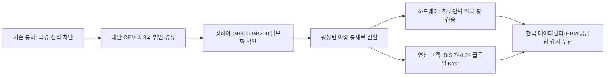

# 1.5톤짜리 블랙웰은 밀수가 아니라 대출 담보로 상하이에 서 있었다…'너무 커서 못 빼돌린다'는 신화가 무너지자 워싱턴의 화살은 칩 국경에서 연산 명부로 향한다

## 판단: 수출통제는 국경이 아니라 정상화된 제3국 유통망에서 뚫렸다

블룸버그는 27일(현지시각) 중국 금융·규제 서류를 분석해, 미국의 대중국 수출통제 대상인 엔비디아의 최신 블랙웰(Blackwell) 서버 시스템이 상하이 대규모 데이터센터 '창장(양쯔강) 삼각주 프로젝트'에 설치된 사실을 확인했다고 보도했다([연합뉴스](https://www.yna.co.kr/view/AKR20261128002400072), [코리아중앙데일리](https://www.koreajoongangdaily.com/business/nvidias-blackwell-chips-found-at-china-data-center-linked-to-alice-huang/12995289)). 중국 업체 상하이숴야오(Shanghai Shuoyao)는 블랙웰 울트라 GPU 72개와 그레이스 CPU 36개를 묶은 초고성능 랙 시스템 'GB300 NVL72'를 담보로 상하이이노베이션은행(Shanghai Innovation Bank)에서 9,600만 위안(약 1,400만 달러)을 대출받았고, 또 다른 업체 상하이커잔(Shanghai Kezhan)은 지난해 말 상하이 지방정부 산하 금융리스 업체에서 9,000만 위안을 빌리면서 같은 시설에 GB200 서버와 H200 서버 32대를 보유하고 있다고 신고했다([실리콘앵글](https://siliconangle.com/2026/11/27/report-links-alice-huang-to-chinese-firms-with-smuggled-nvidia-chips/), [아나돌루통신](https://www.aa.com.tr/en/science-technology/nvidia-blackwell-chips-found-at-china-data-center-linked-to-alice-huang-report/4140762)). 블룸버그가 대출 서류에 적힌 GB300 랙의 일련번호를 공개 보증 데이터베이스에 조회한 결과 제조사는 대만 서버 업체 기가바이트(Gigabyte)로 확인됐다([엔가젯](https://www.engadget.com/2329748/restricted-nvidia-chips-were-installed-at-a-chinese-data-center-linked-to-alice-huang/)).

이 사건을 젠슨 황 엔비디아 최고경영자(CEO)와 앨리스 황의 스캔들 연장선으로만 읽으면 본질을 놓친다. 이 글의 판단은 세 가지다. **첫째, 미국 수출통제는 밀수 국경이 아니라 제도권 금융의 담보 심사까지 통과할 만큼 정상화된 제3국 OEM·클라우드·지주회사 유통망에서 뚫렸다.** 통제 대상 1.5톤 액체냉각 랙이 지하실이 아니라 상업은행과 지방정부 리스사의 자산 목록에 일련번호째 올라가 1억 8,600만 위안의 담보로 평가받았다. **둘째, '너무 커서 빼돌릴 수 없다'는 엔비디아의 물리적 방어선이 의회 청문회 직전에 무너졌다.** 물리적 차단의 실패가 문서로 확인되면서, 워싱턴의 통제는 원격 연산 고객 확인(KYC)과 칩 위치 검증(Chip Security Act)으로 굳어진다. **셋째, 대만 제조사(기가바이트)와 일본 도쿄 모회사(넥스파워)가 서류에 나란히 등장한 사실은 동맹국 지위가 면죄부가 아님을 보여 준다.** 이는 한국 하이퍼스케일 데이터센터와 삼성전자·SK하이닉스 HBM 공급망의 감사·준수 비용으로 직결된다. 이는 해석이다.

## 금융 담보 서류가 드러낸 상하이 블랙웰의 실체

이번 보도가 기존 밀반입 의혹과 결정적으로 다른 지점은 정보 출처다. 익명 소식통의 전언이나 암시장 가격표가 아니라, 중국 금융기관에 제출된 공식 담보·대출 서류와 공개 보증 데이터베이스의 일련번호 대조에서 블랙웰의 실물이 확인됐다([엔가젯](https://www.engadget.com/2329748/restricted-nvidia-chips-were-installed-at-a-chinese-data-center-linked-to-alice-huang/), [서울신문](https://www.seoul.co.kr/news/international/2026/11/28/20261128500008)). 상하이 창장 삼각주 프로젝트는 향후 최대 80만 대의 서버를 수용할 수 있는 대형 캠퍼스로 알려져 있으며, 서류에 드러난 두 업체의 장비 구성과 지배구조는 다음과 같다.

| 구분 | 상하이숴야오 (Shanghai Shuoyao) | 상하이커잔 (Shanghai Kezhan) |
|---|---|---|
| 확인된 통제 장비 | 엔비디아 GB300 NVL72 랙 (블랙웰 울트라 GPU 72개·그레이스 CPU 36개) | 엔비디아 GB200 서버 랙 (블랙웰 B200 GPU 72개) 및 H200 서버 32대 |
| 금융 거래 내용 | 상하이이노베이션은행 9,600만 위안(약 1,400만 달러) 대출 담보 | 상하이 지방정부 산하 전액출자 금융리스사 9,000만 위안 대출(2025년 말) |
| 설치 위치 | 상하이 창장 삼각주 프로젝트 데이터센터 | 상하이 창장 삼각주 프로젝트 데이터센터 |
| 추적된 제조·지배 연결고리 | 일련번호 조회로 대만 기가바이트 제조 확인. 싱가포르 메가스피드 서비스 제공업체 | 중국 차이신 보도 기준 도쿄 소재 넥스파워(NeXPower Japan)가 지분 83.3% 간접 보유(앨리스 황 지배) |
| 당사자 입장 및 미확인 사항 | 메가스피드와의 관계는 "통상적 상업 협력"에 국한. 반입 경로 미확인 | 담보로 쓰이지 않은 추가 장비 보유 가능성 제기(블룸버그). 반입 경로 미확인 |

출처: 블룸버그 보도를 인용한 [연합뉴스](https://www.yna.co.kr/view/AKR20261128002400072), [코리아중앙데일리](https://www.koreajoongangdaily.com/business/nvidias-blackwell-chips-found-at-china-data-center-linked-to-alice-huang/12995289), [엔가젯](https://www.engadget.com/2329748/restricted-nvidia-chips-were-installed-at-a-chinese-data-center-linked-to-alice-huang/), [실리콘앵글](https://siliconangle.com/2026/11/27/report-links-alice-huang-to-chinese-firms-with-smuggled-nvidia-chips/).

서류 속 기업들은 모두 싱가포르 클라우드 업체 메가스피드(Megaspeed)와 그 전 지배주주 앨리스 황의 사업망과 겹친다. 앨리스 황은 2023년 메가스피드 지배지분을 인수했다가 2025년 8월 회사를 떠났고, 메가스피드는 2024년 투자자 발표 자료에서 창장 삼각주 프로젝트의 조감도를 쓰며 자사의 최대 데이터센터로 소개했지만 소재지가 중국이라는 점은 적지 않았다([엔가젯](https://www.engadget.com/2329748/restricted-nvidia-chips-were-installed-at-a-chinese-data-center-linked-to-alice-huang/), [실리콘앵글](https://siliconangle.com/2026/11/27/report-links-alice-huang-to-chinese-firms-with-smuggled-nvidia-chips/)). 창장 삼각주 프로젝트의 사장으로 등재된 인물인 캉웨이(Kang Wei)는 뉴욕타임스 등 외신이 앨리스 황의 남편으로 지목한 인물이다([코리아중앙데일리](https://www.koreajoongangdaily.com/business/nvidias-blackwell-chips-found-at-china-data-center-linked-to-alice-huang/12995289), [엔가젯](https://www.engadget.com/2329748/restricted-nvidia-chips-were-installed-at-a-chinese-data-center-linked-to-alice-huang/)).

다만 확인된 사실과 추정 사이에는 분명한 선을 그어야 한다. 블룸버그는 메가스피드가 상하이 시설로 해당 블랙웰 장비를 직접 우회 공급했다는 증거는 찾지 못했다고 명시했고, 메가스피드는 모든 불법 행위를 부인하고 있다([아나돌루통신](https://www.aa.com.tr/en/science-technology/nvidia-blackwell-chips-found-at-china-data-center-linked-to-alice-huang-report/4140762), [연합뉴스](https://www.yna.co.kr/view/AKR20261128002400072)). 상하이숴야오 역시 메가스피드와의 거래가 "통상적인 상업 협력에 국한된다"고 밝혔다([엔가젯](https://www.engadget.com/2329748/restricted-nvidia-chips-were-installed-at-a-chinese-data-center-linked-to-alice-huang/)). 기가바이트는 최초 구매자와 판매 시점 공개를 거부한 채 "모든 사업은 적용 법률과 내부 준수 요건에 따라 이뤄진다"고만 답했고, 엔비디아는 블룸버그와 엔가젯의 논평 요청에 응하지 않았다([엔가젯](https://www.engadget.com/2329748/restricted-nvidia-chips-were-installed-at-a-chinese-data-center-linked-to-alice-huang/)).

이 글이 주목하는 대목은 메가스피드의 직접 개입 여부보다 **수출통제 품목이 중국 금융권에서 정상 담보 자산으로 평가받았다는 사실**이다. 은행과 지방정부 리스사가 1억 8,600만 위안을 빌려주려면 장비의 실물·소유권·가동 상태와 잔존 가치 검증이 필요하다. 분해해 몰래 들여온 부품 묶음은 담보 심사를 통과하기 어렵다. 블룸버그가 담보로 쓰이지 않은 추가 엔비디아 장비 보유 가능성을 제기한 배경도 여기에 있다([실리콘앵글](https://siliconangle.com/2026/11/27/report-links-alice-huang-to-chinese-firms-with-smuggled-nvidia-chips/)). 이는 서류 구조에서 도출한 해석이다.

## '2톤짜리 냉장고는 배낭에 못 넣는다'는 물리적 방어선의 붕괴

이번 발견은 엔비디아와 젠슨 황 CEO가 1년 넘게 쌓아 온 수출통제 방어 논리의 핵심 기둥을 정면으로 부쉈다. 2025년 5월 대만 타이베이 컴퓨텍스(Computex) 기간 중 황 CEO는 AI 칩 우회 반입 의혹에 대해 "어떠한 AI 칩 전용(diversion)의 증거도 없다"고 일축하며, 그레이스 블랙웰 데이터센터 시스템은 무게가 거의 2톤에 달하는 통합 랙이기 때문에 비밀리에 빼돌리는 것은 비현실적이라고 주장했다([노트북체크](https://www.notebookcheck.net/Nvidia-CEO-dismisses-AI-chip-diversion-claims.1019870.0.html)). 당시 그는 고객사와 각국 정부가 규칙을 잘 알고 있으며 엔비디아 하드웨어를 계속 사기 위해 "스스로 매우 엄격하게 감시한다"고도 했다([노트북체크](https://www.notebookcheck.net/Nvidia-CEO-dismisses-AI-chip-diversion-claims.1019870.0.html)).

실제로 GB300 NVL72는 물리적 규격만 보면 황 CEO의 말이 그럴듯해 보이는 장비다. 표준형 기준 높이가 약 2미터, 무게가 1.5톤(약 3,300파운드)을 넘고, 전체가 직접 액체냉각(DLC) 기반으로 설계된 초대형 냉장고 크기의 서버 랙이다([연합뉴스](https://www.yna.co.kr/view/AKR20261128002400072), [엔가젯](https://www.engadget.com/2329748/restricted-nvidia-chips-were-installed-at-a-chinese-data-center-linked-to-alice-huang/)). 엔비디아 공식 기술 블로그에 따르면 랙 안에 들어가는 블랙웰 울트라 GPU는 개당 288GB의 HBM3E 메모리를 탑재해 H100의 3.6배, 기존 블랙웰(GB200)보다 50% 많은 온패키지 메모리를 갖추고 있으며, 72개 GPU와 36개 그레이스 CPU가 5세대 NVLink와 초당 800기가비트(Gb/s) ConnectX-8 네트워크로 하나의 거대 연산 단위처럼 묶인다([엔비디아 기술 블로그](https://developer.nvidia.com/blog/inside-nvidia-blackwell-ultra-the-chip-powering-the-ai-factory-era/)).

그럼에도 이 랙은 상하이에 들어갔고, 공개 보증 데이터베이스의 일련번호 조회 한 번으로 대만 기가바이트 조립품임이 드러났다([엔가젯](https://www.engadget.com/2329748/restricted-nvidia-chips-were-installed-at-a-chinese-data-center-linked-to-alice-huang/)). 이 글은 여기서 두 가지 맹점을 읽는다. 첫째, 현대의 칩 우회는 배낭 밀수가 아니다. 도난 차량이 컨테이너에 실려 국경을 넘듯, 1.5톤 랙도 대만 OEM이 적법해 보이는 제3국 구매자에게 출하한 뒤 중개법인과 상업 화물망을 타면 크기는 장벽이 되지 않는다. 둘째, 엔비디아가 OEM에 칩을 넘긴 뒤 최종 구매자 추적이 끊기는 유통 단절이 핵심 구멍이다. 기가바이트가 내부 준수를 말하면서도 최초 구매자 공개를 거부한 장면은 자율 준수 체계의 한계를 드러낸다. 이는 해석이다.

타이밍도 엔비디아에 최악이다. 엔비디아 이사회는 11월 12일 사임했던 젠슨 황을 22일(공시 23일) 도널드 트럼프 대통령과 미국 정부 고위층의 보증을 근거로 CEO에 전격 복귀시키며 독립이사 중심의 국가안보·수출통제위원회 신설과 최고준법책임자(CCO) 도입을 약속했다([엔비디아 SEC 공시](https://www.sec.gov/Archives/edgar/data/1045810/000104581026000090/nov23pressrelease.htm), [이전 기사](https://now.zeta4.net/a/2026-11-09-nvidia-huang-probe-korea-gpu-dependence)). 그러나 바로 그날(23일 시행, 25일 연방관보 게재) 미국 상무부 산업안보국(BIS)은 메가스피드 싱가포르 본사(Megaspeed International Pte. Ltd.)와 말레이시아·태국 계열사, 스위프트데이터, 에이펙스 엔터프라이즈 등 동남아 7개 법인을 '첨단 연산 품목의 비인가 최종 사용자 전용 위험'을 이유로 거래제한 명단(Entity List)에 올렸고, 원칙적 거부(presumption of denial) 심사를 적용했다([미국 연방관보 91 FR 76148](https://www.federalregister.gov/documents/2026/11/25/2026-23999/additions-to-the-entity-list), [알자지라](https://www.aljazeera.com/economy/2026/11/24/us-adds-megaspeed-firm-at-centre-of-nvidia-scandal-to-export-control-list)). 기존 선적분 경과조치(Savings Clause)는 12월 23일 종료된다([미국 연방관보 91 FR 76148](https://www.federalregister.gov/documents/2026/11/25/2026-23999/additions-to-the-entity-list)). 백악관이 황 CEO 복귀에 정치적 보증을 선 지 나흘 만에, 의회 증언을 불과 나흘 앞두고 상하이 GB300의 실물이 터져 나온 셈이다.

## 국경 통제에서 '위치 핑'과 '연산 KYC'로: 워싱턴의 이중 압박

이 글은 상하이 GB300 보도가 워싱턴 내부의 수출통제 노선 갈등을 사실상 종결짓는 촉매가 될 것이라고 본다. 그동안 트럼프 행정부 내부에서는 중국향 칩 판매에 유연한 백악관·상무부 일각과 강경한 재무부·국가안보회의(NSC) 사이의 불협화음이 노출됐다. 알자지라와 애틀랜틱카운슬에 따르면 스콧 베선트 재무장관은 상무부가 메가스피드 블랙리스트 등재를 수개월간 미뤘다고 공개 비판했고, 11월 16일 발표된 BIS 원격 접근 잠정최종규칙(IFR)조차 상무부 보도자료에 "재무부와 NSC가 작성하고 지시했다"는 이례적 문구가 박혔다([알자지라](https://www.aljazeera.com/economy/2026/11/24/us-adds-megaspeed-firm-at-centre-of-nvidia-scandal-to-export-control-list), [애틀랜틱카운슬](https://www.atlanticcouncil.org/dispatches/huang-is-back-at-nvidia-but-the-fight-over-who-controls-chip-exports-is-just-beginning/), [BIS 보도자료](https://www.bis.gov/press-release/bis-issues-rule-addressing-remote-access-american-super-intelligence-technology)).

그러나 GB300 랙이 상하이 은행 담보 서류에 등장하면서 '덩치가 커서 통제된다'거나 '기업 자율 준수로 충분하다'는 주장은 의회 청문회장에서 방어하기 어려워졌다. 젠슨 황 CEO는 12월 1일 하원 외교위·정보위·중국특위 합동 비공개 속기 인터뷰에 출석하고, 2일에는 팀 테터 엔비디아 법무책임자가 증언하며, 3일 오전 10시(미 동부시각)에는 상원 은행위원회 공개 청문회에 단독 증인으로 선다([엔가젯](https://www.engadget.com/2329748/restricted-nvidia-chips-were-installed-at-a-chinese-data-center-linked-to-alice-huang/), [애틀랜틱카운슬](https://www.atlanticcouncil.org/dispatches/huang-is-back-at-nvidia-but-the-fight-over-who-controls-chip-exports-is-just-beginning/)). 하워드 러트닉 상무장관 역시 12월 의회 증언 요구를 받은 상태다([애틀랜틱카운슬](https://www.atlanticcouncil.org/dispatches/huang-is-back-at-nvidia-but-the-fight-over-who-controls-chip-exports-is-just-beginning/)).

의회가 준비 중인 해법은 행정부 재량에 의존하던 수출통제를 법률로 못 박는 것이다. 미국혁신재단(FAI)과 애틀랜틱카운슬 분석에 따르면, 미 의회는 12월 중 처리할 2027 회계연도 국방수권법(NDAA)에 칩 수출통제 핵심 법안들을 묶어 넣으려 하고 있다([미국혁신재단](https://policygradients.thefai.org/p/congress-is-about-to-tighten-chip), [애틀랜틱카운슬](https://www.atlanticcouncil.org/dispatches/huang-is-back-at-nvidia-but-the-fight-over-who-controls-chip-exports-is-just-beginning/)). 그중 가장 통과 가능성이 높은 **칩보안법(Chip Security Act)**은 하원 외교위원회를 만장일치로 통과했고, 톰 코튼 공화당 상원의원은 황 CEO 복귀 직후에도 "나의 칩보안법을 포함한 초당적 칩 수출통제 법안을 압도적으로 통과시킬 것"이라고 공언했다([미국혁신재단](https://policygradients.thefai.org/p/congress-is-about-to-tighten-chip), [애틀랜틱카운슬](https://www.atlanticcouncil.org/dispatches/huang-is-back-at-nvidia-but-the-fight-over-who-controls-chip-exports-is-just-beginning/)).

여기서 결정적인 사실 하나가 더해진다. 엔비디아가 회원사로 있는 미국반도체산업협회(SIA)는 지난 3월 칩보안법의 위치 추적 의무가 "새롭고 검증되지 않았으며 실행 불가능할 수 있다"고 반대했다([AI 거버넌스](https://aigovernance.com/news/nvidias-private-chip-tracking-admission-widens-export-control-compliance-gap)). 하지만 법안 공동 발의자인 빌 포스터 민주당 하원의원은 MIT 테크놀로지 리뷰와의 인터뷰에서, 엔비디아 관계자들이 비공개 기술 논의에서는 위치 검증 구현이 가능하냐는 질문에 "물론 할 수 있다(yeah, of course we can do this)"고 답했다고 폭로했다([AI 거버넌스](https://aigovernance.com/news/nvidias-private-chip-tracking-admission-widens-export-control-compliance-gap)). 현재 초안의 칩보안법은 칩이 온라인에 연결될 때 물리적 위치를 신호(ping)로 보고하는 수준이지만, 포스터 의원은 2027년 초 **유효한 수출 허가가 확인돼야 첨단 GPU가 네트워크에 연결되도록 하는 사전 접속 검증 법안**까지 추가 발의할 계획이라고 밝혔다([AI 거버넌스](https://aigovernance.com/news/nvidias-private-chip-tracking-admission-widens-export-control-compliance-gap)). 여기에 BIS에 원격 연산 규제 권한을 법률로 명시하는 원격접근보안법(RASA), 의회에 대중 첨단 칩 수출 허가 30일 심사·차단권을 주는 AI 오버워치법, 동맹국의 장비 통제 동조를 압박하는 MATCH법까지 NDAA 협상 테이블에 올라 있다([애틀랜틱카운슬](https://www.atlanticcouncil.org/dispatches/huang-is-back-at-nvidia-but-the-fight-over-who-controls-chip-exports-is-just-beginning/)). 내년 1월 민주당이 상원 은행위원회를 장악하고 엘리자베스 워런 의원이 위원장을 맡게 되면, 백악관의 정치적 보증만으로는 수출통제 완화를 밀어붙이기 더 어려워진다([애틀랜틱카운슬](https://www.atlanticcouncil.org/dispatches/huang-is-back-at-nvidia-but-the-fight-over-who-controls-chip-exports-is-just-beginning/)). 이는 기존 규칙([이전 기사](https://now.zeta4.net/a/2026-11-18-us-remote-access-rule-compute-kyc-korea))과 의회 동향을 종합한 이 글의 해석이다.

## 한국에 남는 청구서: 동맹국 예외는 끝나고, 데이터센터와 HBM 양쪽이 감사대에 오른다

한국의 시각에서 상하이 GB300 사건이 남기는 가장 뼈아픈 사실은 **서류 위에 등장한 제3국이 동남아만이 아니라는 점**이다. 지금까지 국내 업계와 정부는 BIS가 11월 16일 원격 접근 규칙에서 국가 단위 허가 대상으로 지정한 5개국(말레이시아·싱가포르·태국·인도네시아·브라질)에 한국이 빠졌다는 점에 안도해 왔다([BIS 규칙 원문](https://www.bis.gov/media/documents/rin-0694-ak50.pdf), [이전 기사](https://now.zeta4.net/a/2026-11-18-us-remote-access-rule-compute-kyc-korea)). 그러나 이번 블룸버그·차이신 추적에서 드러난 GB300 랙의 조립처는 미국의 핵심 반도체 파트너인 대만의 기가바이트였고, GB200과 H200을 보유한 상하이커잔의 지분 83.3%를 간접 지배한 회사는 미국의 최우방 동맹국인 일본 도쿄 소재 넥스파워였다([연합뉴스](https://www.yna.co.kr/view/AKR20261128002400072), [코리아중앙데일리](https://www.koreajoongangdaily.com/business/nvidias-blackwell-chips-found-at-china-data-center-linked-to-alice-huang/12995289)).

이 글은 이 지점이 한국 산업에 두 방향의 압박을 만든다고 본다. **첫째, 한국 하이퍼스케일 데이터센터와 26만 장 GPU 도입 계획이다.** BIS 원격 접근 규칙(§744.24)은 목적지를 가리지 않고 중국 등 우려국 최종 모회사 기업에 총 처리 성능(TPP) 1,200만 이상 연산을 제공하면 수출 허가를 요구하며, 데이터센터가 고객 확인 자료를 못 내면 칩 공급자가 위반을 안 것으로 추정한다([BIS 규칙 원문](https://www.bis.gov/media/documents/rin-0694-ak50.pdf)). 동맹국 OEM과 법인을 거친 우회가 드러난 이상, 내년 2월 17일 90일 허가 유예 종료에 맞춰 엔비디아·미 당국·글로벌 은행의 고객 실사 요구는 한국 데이터센터에도 한층 촘촘하게 내려온다. 칩보안법의 위치 핑이나 사전 접속 허가 검증까지 입법되면 네이버클라우드·SK텔레콤·KT·삼성·현대차와 국가AI컴퓨팅센터의 GPU 클러스터는 반입 이후에도 미국 측 텔레메트리와 라이선스 검증 체계 아래 놓인다. 이는 해석이다.

**둘째, 삼성전자와 SK하이닉스의 HBM 공급망이다.** 상하이에서 확인된 GB300 NVL72 랙 한 대에만 블랙웰 울트라 GPU 72개, 개당 288GB씩 총 20테라바이트(TB)가 넘는 12단 HBM3E가 들어간다([엔비디아 기술 블로그](https://developer.nvidia.com/blog/inside-nvidia-blackwell-ultra-the-chip-powering-the-ai-factory-era/)). 트렌드포스는 SK하이닉스가 GB300용 12단 HBM3E 초기 주력 공급망을 선점했고 삼성전자가 12단 HBM3E 인증과 HBM4 베이스 다이(로직 공정 기반) 경쟁에 나섰다고 보도했으며, 전자신문도 두 회사가 올해 8월 핫칩스 2026에서 HBM4·첨단 패키징 전략을 공개했다고 전했다([트렌드포스](https://www.trendforce.com/news/2025/03/18/news-sk-hynix-reportedly-locks-in-exclusive-12h-hbm3e-deal-for-nvidias-gb300/), [전자신문](https://en.etnews.com/20260825200005)). 한국 메모리 업체가 중국에 블랙웰 랙을 직접 팔지는 않지만, 대만 OEM과 동남아 클라우드 유통망이 집중 감사에 걸리고 AI 오버워치법의 30일 의회 심사가 더해지면 엔비디아향 HBM·패키징 출하 일정과 최종 수요지 증빙 부담이 상류로 전가된다. 당장의 물량 급감보다 위험한 것은 행선지 소명 지연에 따른 출하 병목과 규제 연루 리스크다. 이는 해석이다.

한국 정부와 기업이 지금 점검해야 할 과제는 분명하다.

- **국내 하이퍼스케일 데이터센터의 공통 최종소유주(UBO) 실사 표준을 내년 2월 17일 전에 마련해야 한다.** 일본 도쿄 법인이 상하이 장비 보유사의 모회사로 등장했듯, 서류상 국적만으로는 중국계 자본이나 우회 임차를 거를 수 없다. 과기정통부·산업통상부와 국내 클라우드 사업자가 공동으로 최종 모회사 확인, 접속 IP·워크로드 감사 로그, 제3자 재임대 차단 약관을 표준화해 미국 상무부와 엔비디아의 실사 요구에 선제적으로 대응해야 한다.
- **26만 장 GPU 도입 계약서에 위치 검증·텔레메트리·준수 책임 조항을 명시적으로 따져야 한다.** 칩보안법이 NDAA에 반영될 경우, 국가AI컴퓨팅센터와 공공·국방·금융 AI 인프라에 들어오는 GPU가 외부 위치 핑이나 원격 라이선스 인증에 종속될 때의 보안·가용성 경계(폐쇄망 운용 예외 등)를 미국 측과 사전에 협의해야 한다.
- **삼성전자·SK하이닉스 등 HBM·패키징 공급망은 '직거래 없음'을 넘어 OEM 재수출 추적 리스크에 대비해야 한다.** 엔비디아·TSMC·대만 서버 OEM으로 이어지는 공급 사슬에서 일련번호·로트 추적과 최종 용도 확인(end-use verification) 요구가 강화될 가능성에 맞춰, 법무·통상 준수 체계를 부품 단위까지 정비할 필요가 있다.

## 확인하지 못한 것

- 블룸버그 원문 기사는 유료 장벽으로 직접 열람하지 못했고, 블룸버그 보도를 인용한 연합뉴스, 코리아중앙데일리, 서울신문, 엔가젯, 실리콘앵글, 아나돌루통신을 교차 대조해 핵심 사실을 확인했다.
- 상하이숴야오가 상하이이노베이션은행에서 9,600만 위안 대출을 받은 정확한 날짜, 담보 서류에 오르지 않은 추가 블랙웰 장비의 실제 대수, 그리고 대만 기가바이트의 최초 구매자에서 상하이 데이터센터까지 이어진 구체적 물류·통관 경로는 공개 보도에서 확인되지 않았다.
- 블룸버그 자체도 메가스피드가 상하이 창장 삼각주 프로젝트로 해당 블랙웰 장비를 직접 우회 공급했다는 증거는 확보하지 못했다고 밝혔으며, 메가스피드는 혐의를 부인했고 엔비디아는 언론 질의에 답하지 않았다.
- 상하이에서 발견된 특정 GB300 NVL72 랙 내부에 탑재된 HBM3E가 SK하이닉스 제품인지 삼성전자·마이크론 제품인지는 확인하지 못했다. SK하이닉스의 GB300용 12단 HBM3E 초기 주력 공급은 2025년 3월 트렌드포스 보도에 근거한다.
- 빌 포스터 하원의원의 "물론 할 수 있다" 발언은 MIT 테크놀로지 리뷰 원문이 아니라 이를 인용·정리한 AI 거버넌스 보도로 확인했다.
- 상하이 GB300 사건이 제3국 유통망의 정상화를 드러낸다는 진단, 칩 위치 추적·연산 KYC로의 비가역적 전환 전망, 그리고 한국 데이터센터·HBM 공급망의 감사 부담과 대응 과제는 이 글의 해석과 판단이다.

## 출처

- [Additions to the Entity List (91 FR 76148) — 미국 연방관보 (2026-11-25 게재, 11-23 시행)](https://www.federalregister.gov/documents/2026/11/25/2026-23999/additions-to-the-entity-list)
- [BIS Issues Rule Addressing Remote Access to American Super Intelligence Technology — 미국 상무부 산업안보국 (2026-11-16)](https://www.bis.gov/press-release/bis-issues-rule-addressing-remote-access-american-super-intelligence-technology)
- [Addressing Remote Access to Advanced Semiconductors (RIN 0694-AK50) — 미국 상무부 산업안보국 (2026-11-16)](https://www.bis.gov/media/documents/rin-0694-ak50.pdf)
- [NVIDIA Board Reinstates Jensen Huang as CEO (Form 8-K Exhibit) — 엔비디아·SEC (2026-11-23)](https://www.sec.gov/Archives/edgar/data/1045810/000104581026000090/nov23pressrelease.htm)
- [Inside NVIDIA Blackwell Ultra: The Chip Powering the AI Factory Era — 엔비디아 기술 블로그 (2025)](https://developer.nvidia.com/blog/inside-nvidia-blackwell-ultra-the-chip-powering-the-ai-factory-era/)
- [Huang is back at Nvidia. But the fight over who controls chip exports is just beginning. — 애틀랜틱카운슬 (2026-11-24)](https://www.atlanticcouncil.org/dispatches/huang-is-back-at-nvidia-but-the-fight-over-who-controls-chip-exports-is-just-beginning/)
- [Congress Is About to Tighten Chip Exports. Here's How. — 미국혁신재단 (2026-11-24)](https://policygradients.thefai.org/p/congress-is-about-to-tighten-chip)
- [Nvidia's Private Chip-Tracking Admission Widens Export Control Compliance Gap — AI 거버넌스 (2026-11)](https://aigovernance.com/news/nvidias-private-chip-tracking-admission-widens-export-control-compliance-gap)
- [Restricted NVIDIA Chips Were Installed At A Chinese Data Center Linked To Alice Huang — 엔가젯 (2026-11-27)](https://www.engadget.com/2329748/restricted-nvidia-chips-were-installed-at-a-chinese-data-center-linked-to-alice-huang/)
- [Report links Alice Huang to Chinese firms with smuggled Nvidia chips — 실리콘앵글 (2026-11-27)](https://siliconangle.com/2026/11/27/report-links-alice-huang-to-chinese-firms-with-smuggled-nvidia-chips/)
- [Nvidia Blackwell chips found at China data center linked to Alice Huang: Report — 아나돌루통신 (2026-11-28)](https://www.aa.com.tr/en/science-technology/nvidia-blackwell-chips-found-at-china-data-center-linked-to-alice-huang-report/4140762)
- [US adds Megaspeed to trade blacklist as Nvidia's Huang returns as CEO — 알자지라 (2026-11-24)](https://www.aljazeera.com/economy/2026/11/24/us-adds-megaspeed-firm-at-centre-of-nvidia-scandal-to-export-control-list)
- [Nvidia CEO dismisses AI chip diversion claims — 노트북체크 (2025-05)](https://www.notebookcheck.net/Nvidia-CEO-dismisses-AI-chip-diversion-claims.1019870.0.html)
- [Nvidia's Blackwell chips found at China data center linked to Alice Huang — 코리아중앙데일리 (2026-11-28)](https://www.koreajoongangdaily.com/business/nvidias-blackwell-chips-found-at-china-data-center-linked-to-alice-huang/12995289)
- ['젠슨황 불륜 상대' 연계 中시설서 엔비디아 최첨단 칩 발견 — 연합뉴스 (2026-11-28)](https://www.yna.co.kr/view/AKR20261128002400072)
- [젠슨황 불륜녀 연관 中시설서 '엔비디아 최첨단 칩' 발견…"덩치 커 밀반입 어렵다"더니 — 서울신문 (2026-11-28)](https://www.seoul.co.kr/news/international/2026/11/28/20261128500008)
- [SK hynix Reportedly Locks in Exclusive 12H HBM3E Deal for NVIDIA's GB300 — 트렌드포스 (2025-03-18)](https://www.trendforce.com/news/2025/03/18/news-sk-hynix-reportedly-locks-in-exclusive-12h-hbm3e-deal-for-nvidias-gb300/)
- [Samsung, SK Hynix Take Divergent HBM Paths — 전자신문 영문판 (2026-08-25)](https://en.etnews.com/20260825200005)

---

이 글은 공개 출처를 바탕으로 AI가 자동 생성한 초안을 검토해 발행했으며, 중요한 판단 전에는 연결된 원문을 확인해야 합니다.
