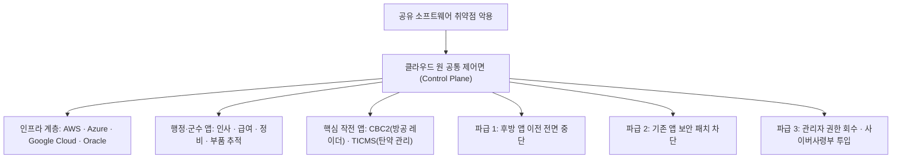

# 연간 침입 시도 1,000만 건을 '100% 막았다'던 미 공군 클라우드가 '만능 리모컨' 한 층에서 멈췄다…통합이 보안을 키운다는 통념은 컨트롤 플레인이 뚫리는 순간 단일 장애점으로 뒤집힌다

## 판단: 멀티 클라우드가 안전망이 아니라 단일 장애점이 된 순간

해커들이 미 공군의 핵심 클라우드 플랫폼 '클라우드 원(Cloud One)'에 침입해 제어면(control plane)에 도달했다고 로이터가 27일 복수의 소식통을 인용해 단독 보도했다([디펜스뉴스(로이터)](https://www.defensenews.com/pentagon/2026/11/27/hackers-breach-us-air-force-flagship-cloud-one-computing-platform/)). 침해는 최근 한 달 사이 시스템 업그레이드 과정에서 발견됐고, 미군 사이버사령부가 피해 규모 평가에 투입됐다. 이후 공군은 후방 행정 앱의 클라우드 이전을 멈추고, 이미 가동 중인 앱의 업데이트를 차단했으며, 일부 사용자의 관리자 권한을 회수했다. 미 공군은 특정 네트워크의 보안 태세나 취약점, 가동 상태에 논평하지 않는다고 밝혔고, 국방부는 시스템이 안전하게 관리되고 있으며 임무 필수 작전을 유지하고 있다고 했다([CBS 뉴스](https://www.cbsnews.com/news/u-s-air-force-cloud-platform-breached-by-hackers/)).

외신 보도는 주로 공격자의 정체와 기밀 유출 여부에 쏠린다. 이 글의 판단은 다르다. **첫째, 자료 유출이 확인되기 전이라도 이 사건은 '보안을 위한 통합'이라는 클라우드 정책의 전제를 뒤집었다.** 노후 시스템을 하나의 멀티 클라우드 허브로 모으면 방어가 단단해진다는 통념은, 그 허브를 통째로 다스리는 공유 제어면이 뚫리는 순간 단일 장애점(SPOF)으로 바뀐다. **둘째, 이번 사고에서 이미 확인된 가장 큰 타격은 '운영 마비와 패치 중단'이다.** 업계 전반에 새 중대 취약점이 잇따르는 시점에 기존 앱의 수정 패치까지 막히며, 통합 플랫폼이 전군 차원의 2차 방어 공백을 만들었다. **셋째, 이 경고는 한국에 그대로 겹친다.** 2030년대 초 메이븐 유사 AI 지휘체계와 국방AI데이터센터 통합을 추진하는 한국군, 2030년 범정부 클라우드 전면 전환을 앞둔 행정안전부, 물리적 망분리를 풀고 데이터 등급제와 제로트러스트로 옮겨 가는 국가정보원과 금융위원회 모두 '공급자 다변화'가 아니라 '제어면 격리와 폭발 반경 분할'이라는 과제를 정면으로 마주하게 됐다. 세 가지 모두 해석이다.

## '100% 방어'의 원스톱 허브가 '만능 리모컨' 한 층에서 멈춘 구조

클라우드 원은 2017년 미 공군이 분산된 IT 인프라를 하나로 묶기 위해 출범시킨 엔터프라이즈 클라우드 허브다. 아마존웹서비스(AWS), 마이크로소프트 애저, 오라클, 알파벳(구글 클라우드) 네 사업자의 자원을 한 지붕 아래 통합해 인사·급여·군수·정비 같은 행정 체계부터 작전 체계까지 수십 개 이상의 애플리케이션을 구동한다([디펜스뉴스(로이터)](https://www.defensenews.com/pentagon/2026/11/27/hackers-breach-us-air-force-flagship-cloud-one-computing-platform/)). 이 위에는 북미 전역의 방공 레이더와 센서 데이터를 취합하는 클라우드 기반 지휘통제체계(CBC2)와 전 세계 200곳 이상 미 공군 기지의 폭탄·미사일 재고를 추적하는 전구통합전투탄약체계(TICMS)가 올라가 있다([가디언](https://www.theguardian.com/technology/2026/nov/27/hackers-breach-us-air-force-cloud-computing)).

미 공군은 이 플랫폼에 대규모 예산을 투입해 왔다. 2020년 SAIC가 약 800개 공군·육군 앱 이전을 목표로 5년 7억 2,700만 달러 계약을 맡았고([페드스쿱](https://fedscoop.com/saic-cloud-one-contract-leidos/)), 2025년 이후 '클라우드 원 넥스트'로 확장하며 계약은 더 커졌다. 부즈앨런해밀턴이 2025년 5월 앱 현대화·이전으로 7억 4,310만 달러 계약을([워싱턴 테크놀로지](https://www.washingtontechnology.com/contracts/2025/05/booz-allen-wins-743m-cloud-app-modernization-job/404993/)), 레이도스가 2025년 12월 아키텍처·공통 공유 서비스 운영으로 4억 5,490만 달러 계약을 수주해 SAIC의 주계약자 지위를 넘겨받았다([레이도스](https://www.leidos.com/insights/leidos-modernize-and-secure-us-air-force-cloud-operations-faster-safer-mission-readiness)). 이어 2026년 1월 AWS가 5억 8,100만 달러 단독 계약을([CRN](https://www.crn.com/news/cloud/2026/aws-wins-581m-cloud-deal-from-u-s-air-force-s-cloud-one-program-1)), 2월 오라클이 8,800만 달러 직접 계약을 맺으며([워싱턴 테크놀로지](https://www.washingtontechnology.com/contracts/2026/02/oracle-books-88m-air-force-cloud-one-contract/411358/)) 4사 멀티 클라우드 진용을 굳혔다.

불과 3년 전만 해도 클라우드 원 지도부는 방어 기록을 자부했다. 2023년 2월 페드스쿱 기고문에서 이들은 "보안에 있어 실수가 용납될 여지는 없다"며 "연간 1,000만 건의 침입 시도에 대해 100% 방어 성공률을 유지하고 있다"고 밝혔다([페드스쿱](https://fedscoop.com/cloud-one-taking-aim-at-the-enemy-one-application-at-a-time/)). 같은 글에서 2020년 이전 이후 가동률이 개선된 대표 사례로 든 체계가 전 세계 210개 기지의 탄약을 관리하는 TICMS였다.

이번 침해가 치명적인 이유는 공격자가 개별 앱이 아니라 플랫폼 전체를 통제하는 제어면(control plane)에 도달했다는 점이다. 소식통은 제어면을 '만능 리모컨(universal remote)'에 비유했다. 해커가 실제로 실행했는지는 확인되지 않았지만, 이론상 제어면 접근 권한만으로도 군용기의 작전 가동 상태나 예비 부품 이동 현황을 살필 수 있는 위치에 섰다는 뜻이다([디펜스뉴스(로이터)](https://www.defensenews.com/pentagon/2026/11/27/hackers-breach-us-air-force-flagship-cloud-one-computing-platform/)).

하부에 세계 최대 클라우드 사업자 네 곳을 깔아 놓아도, 인증과 권한, 배포 파이프라인, 업그레이드 오케스트레이션을 하나의 공통 제어면이 쥐고 있으면 공격자는 네 회사의 데이터센터를 따로 뚫을 필요가 없다. 본지가 앞서 짚은 ['금고 밖 믿었던 통로'의 문제](https://now.zeta4.net/a/2026-11-03-three-breaches-trusted-paths)가 클라우드 인프라의 심장부로 올라온 셈이다. 금고 벽을 두껍게 쌓아도 금고 전체를 원격 관리하는 통합 관제판이 단일 취약점에 열리면 방어 전제가 무너진다. 이는 해석이다.

## 데이터 유출보다 먼저 닥친 피해: 패치 중단과 연방 기관 연쇄 침해

침해 발견 뒤 이어진 대응은 통합 클라우드의 역설을 그대로 드러냈다. 소식통들에 따르면 공군은 후방 행정 앱의 클라우드 원 이전을 중단했고, 이미 가동 중인 앱의 업데이트를 막았다. 로이터는 기술 업계 전반에 심각한 신규 소프트웨어 취약점이 잇달아 공개되던 시점에, 공군 인력이 클라우드 원 내 앱에 보안 수정 패치를 적용할 수 없는 상태에 놓였다고 전했다([디펜스뉴스(로이터)](https://www.defensenews.com/pentagon/2026/11/27/hackers-breach-us-air-force-flagship-cloud-one-computing-platform/)).

클라우드 통합의 핵심 명분은 표준화된 자동 배포 파이프라인으로 취약점을 빠르게 고치고 복원력을 높이는 데 있다. 그러나 공통 제어면이 오염됐을 가능성이 제기되는 순간, 자동 배포 통로는 '패치 경로'에서 '악성코드 전파 경로'로 의심받는다. 운영자는 추가 오염을 막으려 업데이트 자체를 잠그고, 그 결과 플랫폼 위의 모든 정상 앱이 신규 취약점에 노출되는 2차 방어 마비가 벌어진다. 이 글은 이를 '중앙화 패치의 역설'로 본다. 분산 환경에서는 한 체계의 침해가 다른 부대의 긴급 패치를 막지 않지만, 제어면을 공유하는 통합 허브에서는 격리 검증이 끝날 때까지 조직 전체의 면역 체계가 동시에 멈춘다. 이는 해석이다.

클라우드 원 침해는 2026년 가을 이후 미 연방 안보·행정 기관을 연달아 강타한 사이버 침해·장애 물결 속에서 터졌다. 로이터·가디언·CBS 뉴스 보도를 종합하면 최근 몇 달 사이 미국 정부가 대응 중인 연방 기관 사이버 사건은 클라우드 원 외에도 최소 여섯 건을 넘는다.

| 대상 기관·시스템 | 보도·공개된 침해 또는 장애 내용 | 확인된 영향 및 공식 입장 |
|---|---|---|
| 미 공군 클라우드 원(Cloud One) | 업그레이드 중 침입 발견, 소프트웨어 취약점으로 제어면 접근 | 앱 이전 중단, 패치 차단, 관리자 권한 회수, 사이버사령부 조사. 유출·공격자 미확인 |
| 미 국방부 국방인력데이터센터(DMDC) | 국방부 인력 데이터베이스 침해 | 생존자 276만 명·사망자 29만 4,000명의 사회보장번호·성명·군 특기 등 노출 |
| 미 연방수사국(FBI) | 최근 두 차례 침해, 전국 법집행기관 범죄기록 DB 접근 포함 | 전국 경찰·수사기관 공용 기록망 노출 우려, 조사 진행 |
| 미 중앙정보국(CIA)·국가정보국(ODNI) | 공개출처정보(OSINT) 분석용 비기밀 내부망 침입 | ODNI "핵심 역량·기밀 시스템 장애 없음", CIA 논평 거부 |
| 미 국가안보국(NSA) | PHP 취약점 긴급 패치 중 기밀 공유 내부망 오프라인 전환 | 긴급 패치 대응 과정에서 내부망 일시 중단 |
| 미 국토안보부(DHS)·재무부·FAA | DHS 인사 정보 유출, 재무부 해킹, 연방항공청(FAA) 장애 | FAA 전국 이륙 중단 사태로 수만 명 공항 혼란 |

출처: [디펜스뉴스(로이터)](https://www.defensenews.com/pentagon/2026/11/27/hackers-breach-us-air-force-flagship-cloud-one-computing-platform/), [가디언](https://www.theguardian.com/technology/2026/nov/27/hackers-breach-us-air-force-cloud-computing), [CBS 뉴스](https://www.cbsnews.com/news/u-s-air-force-cloud-platform-breached-by-hackers/).

이 연쇄 위기 와중인 지난주 백악관 국가사이버국장 션 케언크로스가 경질됐고([CBS 뉴스](https://www.cbsnews.com/news/u-s-air-force-cloud-platform-breached-by-hackers/)), AI 모델이 넓은 클라우드 공격 표면에서 약점을 고속 탐색하는 'AI 기반 침입' 우려까지 겹치고 있다([디펜스뉴스(로이터)](https://www.defensenews.com/pentagon/2026/11/27/hackers-breach-us-air-force-flagship-cloud-one-computing-platform/)). NSA가 PHP 취약점을 급히 막다 기밀 내부망을 오프라인으로 내렸다는 보도와 공군이 클라우드 원 패치를 통째로 멈췄다는 보도는, 공격 속도가 빨라질수록 거대 통합망의 운영 경직성이 얼마나 큰 위험으로 작동하는지 보여 준다.

## 멀티 클라우드라는 착시: 공급자 분산은 제어면 분리가 아니다

클라우드 원은 겉보기에 멀티 클라우드의 모범 답안이었다. 빅테크 종속을 피하려 4대 사업자를 끌어들였고, 2025년 이후 앱 현대화(부즈앨런), 아키텍처·공유 서비스(레이도스), 인프라 직접 조달(AWS·오라클)로 계약까지 나눴다([워싱턴 테크놀로지](https://www.washingtontechnology.com/contracts/2026/02/oracle-books-88m-air-force-cloud-one-contract/411358/)). 2024년 가을 액센츄어 연방 자회사가 수주한 16억 달러 리셀러 계약이 2025년 봄 정부효율부(DOGE) 검토로 취소된 뒤 인프라 직접 계약으로 선회했지만, 원격 접속·파일 전송·고객 온보딩 같은 공유 서비스는 여전히 하나의 '클라우드 랜딩 존'에 묶였다([워싱턴 테크놀로지](https://www.washingtontechnology.com/contracts/2025/05/booz-allen-wins-743m-cloud-app-modernization-job/404993/)).

미국 회계감사원(GAO)은 2026년 6월 연방 클라우드 조달 감사 보고서(`GAO-26-107530`)에서 복수 사업자를 도입한 대형 기관들이 상호운용성 난제에 부딪히고 있으며, 예산관리국(OMB)과 국립표준기술연구소(NIST)의 지침 충돌, 클라우드 정의조차 없는 20년 묵은 연방조달규정(FAR)이 부담을 키운다고 지적했다([GAO](https://files.gao.gov/reports/GAO-26-107530/index.html)).

기술적으로 하부 사업자가 늘수록 이를 묶는 통합 관리 계층의 권한과 복잡도는 커진다. 네 사업자의 서로 다른 API, 계정 정책, 네트워크 경계를 하나의 공통 서비스 계층으로 추상화해야 하기 때문이다. 이 글은 이 구조에서 "멀티 클라우드니까 안전하다"는 믿음이 착시라고 본다. 공급자 분산은 특정 사업자의 장애나 가격 인상에 대비하는 보험이지, 공통 제어면 취약점에 대한 방화벽이 아니다. 인사·급여 같은 행정 체계와 방공 레이더·탄약 관리 같은 작전 체계를 같은 우산 아래 두면, 업그레이드 과정의 취약점 하나가 작전 가시성과 패치 체계 전체를 동시에 멈춰 세운다. 이는 해석이다.

## 한국: 국방 AI 데이터센터·범정부 클라우드·금융 망분리 해제에 남는 네 가지 조건

클라우드 원 침해는 한국 국방·정부·금융이 2026~2030년 동시에 밟고 있는 전환 로드맵에 정면으로 닿는다.

국방에서는 손석락 공군참모총장이 2026년 5월 "2030년대 초까지 미국 팔란티어의 '메이븐 스마트 시스템'과 유사한 AI 기반 긴급표적 처리체계를 구축할 것"이라고 밝혔고([뉴스1(다음)](https://v.daum.net/v/20260518060158762), [관련 기사](https://now.zeta4.net/a/2026-11-27-ai-targeting-iran-un-speed-not-names)), 국방부는 10월 각 군에 흩어진 GPU를 클라우드 통합 자원으로 묶어 차세대 한국군 지휘통제체계(KCCS)와 '국방AI데이터허브'로 연결하는 '국방AI데이터센터 구축 정보화전략계획(ISP)' 사전규격을 공개했다([전자신문](https://www.etnews.com/20261023000175)). 2027년 하반기 설계 완료가 목표다.

범정부와 금융권의 방향도 같다. 국가정보원은 2026년 5월 1일 「국가 사이버보안 기본지침」을 개정해 20여 년간 유지된 일률적 물리적 망분리 조항(구 제40조)을 폐지하고, 기밀(C)·민감(S)·공개(O) 3등급 기반 국가 망 보안체계(N2SF)를 도입했다([안랩](https://www.ahnlab.com/ko/contents/content-center/36176)). 행정안전부는 국가정보자원관리원 대전센터(693개 시스템) 폐쇄와 맞물려 2030년까지 전 행정·공공시스템(2025년 말 1만 820개 중 클라우드 이용 42.4%, 네이티브 7.3%)을 전면 전환하는 로드맵을 12월 공개하며, 우선 50개 시스템의 민간 클라우드 이전을 2027년 1분기까지 진행 중이다([행정안전부](https://www.mois.go.kr/frt/bbs/type010/commonSelectBoardArticle.do?bbsId=BBSMSTR_000000000008&nttId=129489), [디지털데일리](https://www.ddaily.co.kr/page/view/2026101214552692985)). 금융위원회도 4월 내부 업무망 클라우드 SaaS 예외를 시행한 데 이어([금융위원회](https://www.fsc.go.kr/po010101/86745)), 2027년 1분기까지 '망분리 전면해제 TF'를 통해 제로트러스트 기반 대체 보안체계를 마련할 계획이다([이데일리](https://marketin.edaily.co.kr/News/ReadE?newsId=03578486645649328)). 그러나 9월 30일~11월 3일 한 달 남짓 사이에만 금융권 37개사에서 40건의 침해사고가 신고돼 약 47만 3,000건의 정보가 유출됐다.

이 글은 한국이 클라우드 통합이나 망분리 완화를 멈춰야 한다고 보지 않는다. 다만 제어면 단일 장애점을 피하려면 곧 확정될 세 영역의 설계 문서에 네 가지 조건을 박아 넣어야 한다. 이는 해석이자 제안이다.

1. **작전·기밀 제어면과 행정 제어면의 물리·논리적 분리**: 국방AI데이터센터 ISP는 GPU 풀을 통합하더라도 전장망·지휘통제(KCCS·긴급표적 체계)의 인증·배포·오케스트레이션 제어면을 일반 행정·군수 제어면과 같은 평면에 묶지 말아야 한다. N2SF의 C·S·O 등급 분리도 저장소뿐 아니라 제어면과 관리 API 단위로 적용해야 한다.
2. **폭발 반경(Blast Radius) 구획화와 독립 패치 경로 확보**: 한 구획의 제어면이 침해돼도 나머지 구획의 긴급 패치와 작전 앱이 동시 중단되지 않도록 구획별 독립 인증서와 독립 배포 파이프라인을 의무화해야 한다.
3. **제어면 침해 시 검증 가능한 폴백(Fallback)과 단절 훈련**: 금융위 망분리 해제 기준과 행안부 2030 로드맵 승인 요건에 평시 다중인증(MFA)뿐 아니라, 제어면 탈취 시 핵심 송금·결제와 필수 행정·군수 기능을 격리된 로컬·수동 모드로 전환하는 단절 운용 훈련과 복구 목표 시간(RTO) 검증을 넣어야 한다.
4. **CSP·MSP·발주기관 간 사고 책임과 공개 원칙 명문화**: 레이도스가 공군으로 답변을 넘기고 공군이 확인도 부인도 하지 않은 모호함을 되풀이하지 않으려면, 제어면 취약점 발생 시 권한 회수 주체·대국민 공개 시한·손실 분담 원칙을 계약과 법령에 미리 규정해야 한다.

미 공군이 2023년 자부한 '100% 방어'는 뚫리지 않는 성벽이 아니라 아직 뚫리지 않았을 뿐인 통계였다. 클라우드 전환의 성패는 평시 가동률이 아니라, 가장 믿었던 제어면이 뚫린 날 나머지 체계가 얼마나 덜 멈추고 얼마나 빨리 독립 복구되느냐에서 갈린다. 12월 범정부 로드맵, 내년 1분기 금융 망분리 해제 기준, 내년 하반기 국방AI데이터센터 ISP가 나오기 전에 클라우드 원의 경고를 설계도에 반영해야 한다.

## 확인하지 못한 것

- 클라우드 원에 침입한 해커의 정체, 악용된 구체적 소프트웨어 취약점(CVE 등), 최초 침입 및 발견의 정확한 날짜, 실제 군사·인사·군수 데이터 유출 여부와 범위는 로이터 보도와 미 공군·국방부 입장에서 확인되지 않았다.
- 미 공군·국방부·사이버사령부·레이도스·SAIC의 상세 조사 결과나 미 의회 보고 일정은 공개되지 않았다. 현재 클라우드 원의 정확한 가동 앱 총수 역시 로이터 보도("수십 개 이상")와 2020년 SAIC 계약 목표("약 800개") 외에 미 공군 최신 집계 원문은 접근 제한(HTTP 403)으로 대조하지 못했다.
- 미 국방부(war.gov)의 2025년 12월 레이도스 계약 공고 원문은 접근 제한으로 열람하지 못했고, 레이도스 공식 보도자료와 워싱턴 테크놀로지 보도를 교차 확인했다.
- DMDC·FBI·CIA·ODNI·NSA·FAA 연쇄 침해·장애의 세부 내용은 가디언과 CBS 뉴스 보도에 근거했으며, 각 기관의 포렌식 보고서 원문은 공개되지 않았다.
- 클라우드 원 침해를 '클라우드 중앙화의 역설과 제어면 단일 장애점'으로 규정한 분석, 중앙화 패치 역설 해석, 한국 국방·공공·금융에 대한 네 가지 설계 조건은 이 글의 판단이다.

## 출처

- [Leidos to modernize and secure U.S. Air Force cloud operations for faster, safer mission readiness — 레이도스 (2026-03-11)](https://www.leidos.com/insights/leidos-modernize-and-secure-us-air-force-cloud-operations-faster-safer-mission-readiness)
- [Cloud Computing: Federal Government Needs to Address Procurement Challenges (GAO-26-107530) — 미국 회계감사원(GAO) (2026-06-23)](https://files.gao.gov/reports/GAO-26-107530/index.html)
- [50개 행정·공공정보시스템을 시작으로 민간 클라우드 이전 본격화 — 행정안전부 (2026-09-15)](https://www.mois.go.kr/frt/bbs/type010/commonSelectBoardArticle.do?bbsId=BBSMSTR_000000000008&nttId=129489)
- [4월 20일부터 금융회사는 내부 업무망에서 클라우드 기반 응용소프트웨어(SaaS)를 보다 원활하게 활용할 수 있습니다 — 금융위원회 (2026-04-20)](https://www.fsc.go.kr/po010101/86745)
- [Hackers breach US Air Force flagship Cloud One computing platform — 로이터(디펜스뉴스 게재, 2026-11-27)](https://www.defensenews.com/pentagon/2026/11/27/hackers-breach-us-air-force-flagship-cloud-one-computing-platform/)
- [Hackers reportedly breach US air force’s flagship cloud computing platform — 가디언 (2026-11-27)](https://www.theguardian.com/technology/2026/nov/27/hackers-breach-us-air-force-cloud-computing)
- [U.S. Air Force cloud platform breached by hackers, report says — CBS 뉴스 (2026-11-27)](https://www.cbsnews.com/news/u-s-air-force-cloud-platform-breached-by-hackers/)
- [Cloud One: Taking aim at the enemy, one application at a time — 클라우드 원 지도부(페드스쿱 기고, 2023-02-08)](https://fedscoop.com/cloud-one-taking-aim-at-the-enemy-one-application-at-a-time/)
- [SAIC survives protest to hold onto $727M Air Force cloud contract — 페드스쿱 (2020-01-13)](https://fedscoop.com/saic-cloud-one-contract-leidos/)
- [Booz Allen wins $743M cloud app modernization job — 워싱턴 테크놀로지 (2025-05-01)](https://www.washingtontechnology.com/contracts/2025/05/booz-allen-wins-743m-cloud-app-modernization-job/404993/)
- [AWS Wins $581M Cloud Deal From U.S. Air Force’s Cloud One Program — CRN (2026-01-27)](https://www.crn.com/news/cloud/2026/aws-wins-581m-cloud-deal-from-u-s-air-force-s-cloud-one-program-1)
- [Oracle books $88M Air Force Cloud One contract — 워싱턴 테크놀로지 (2026-02-12)](https://www.washingtontechnology.com/contracts/2026/02/oracle-books-88m-air-force-cloud-one-contract/411358/)
- [육·해·공에 흩어진 GPU 통합…국방AI데이터센터 밑그림 착수 — 전자신문 (2026-10-25)](https://www.etnews.com/20261023000175)
- [행안부 "2030년까지 범정부 시스템 클라우드 전면 전환"…오는 12월 로드맵 공개 — 디지털데일리 (2026-10-12)](https://www.ddaily.co.kr/page/view/2026101214552692985)
- [‘망분리 전면해제’ TF 가동 초읽기…금융권 보안체계부터 손본다 — 이데일리 (2026-11-25)](https://marketin.edaily.co.kr/News/ReadE?newsId=03578486645649328)
- [국가 사이버보안 기본지침 개정 핵심 정리… 무엇이 달라졌나 — 안랩 (2026-05-26)](https://www.ahnlab.com/ko/contents/content-center/36176)
- [공군 "2030년대 초 메이븐 유사 AI 긴급표적 처리체계" — 뉴스1(다음 게재, 2026-05-18)](https://v.daum.net/v/20260518060158762)

---

이 글은 공개 출처를 바탕으로 AI가 자동 생성한 초안을 검토해 발행했으며, 중요한 판단 전에는 연결된 원문을 확인해야 합니다.
