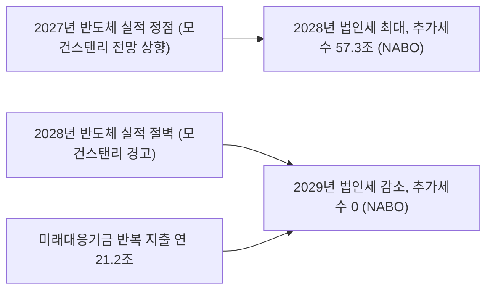

# 모건스탠리의 '2028 반도체 절벽'이 겨누는 곳은 주가가 아니라 2029년 나라 살림이다…162조 미래대응기금의 시차 함정

## 판단: 절벽은 2028년에 오고, 청구서는 2029년에 온다

모건스탠리 숀 킴 연구원은 9일 보고서 '메모리 반도체-미국 중간선거 이후 핵심 쟁점'에서 SK하이닉스 목표주가를 260만 원에서 160만 원으로, 삼성전자를 38만1천 원에서 30만9천 원으로 내렸다. 보고서는 "현재 메모리 반도체 시장에서 가장 중요한 논쟁은 2028년 '실적 절벽'을 피할 수 있느냐는 것"이라고 썼다. 2028년 세계 데이터센터 신규 장비 투자 증가율 전망은 21%에서 9%로 낮췄고, 2028년 가동 예정이던 약 5GW 규모 프로젝트가 2029년으로 밀릴 것으로 봤다. SK하이닉스의 2029~2035년 평균 영업이익률 전망은 53%에서 28%로 내렸다. 반면 2027년 영업이익 전망은 삼성전자 약 688조 원, SK하이닉스 약 468조 원으로 오히려 올렸다([한국경제](https://www.hankyung.com/article/2026111079756)).

증권가는 이 보고서를 목표주가로 읽는다. 이 글은 다른 곳을 본다. **2027년은 더 좋고 2028년이 꺾인다는 이 시간표는 한국 재정의 시간표와 정확히 겹친다.** 법인세는 대체로 한 해 실적에 대해 다음 해에 낸다. 2028년 실적이 꺾이면 세수는 2029년에 꺾인다. 국회예산정책처는 2027년 예산안 분석에서 미래대응기금의 재원인 추가세수가 "2028년 57조3천억 원을 기록한 뒤 2029년부터는 발생하지 않을 것"으로 전망했다([헤럴드경제](https://biz.heraldcorp.com/article/10922609)). 증권사가 실적 절벽을 경고한 해와 국책기관이 기금 재원이 마를 것으로 본 해가 같은 해를 가리킨다. 그런데 정부안은 그 기금에 매년 되풀이되는 지출을 싣고 있다. 문제는 반도체 경기가 아니라, 경기가 꺾이는 해에 끊을 수 없는 지출을 기금에 묶어 둔 설계다. 이는 해석이다.

## 기금은 반도체 세수로 채워지게 설계됐다

2027년 예산안의 총지출은 820조9천억 원이고, 그중 새로 만드는 미래대응기금이 162조3천억 원이다. 사업비 45조4천억 원, 국채 발행 감축 12조5천억 원, 세수 변동에 대비한 여유자금 104조4천억 원으로 짜였다([MTN](https://news.mtn.co.kr/news-detail/2026090110252964642)). 핵심 재원인 '추가세수'는 다음 해 내국세 세입예산이 최근 10년 추세치를 넘는 부분으로 정의된다([SBS Biz](https://biz.sbs.co.kr/amp/article/20000331923)). 추세를 넘는 세수가 어디서 나오는지는 숫자가 말한다.

| 지표 | 수치 | 출처 |
|---|---|---|
| 2026년 총국세(9월 재추계) | 478조6천억 원, 전년 대비 104조7천억 원 증가, 역대 최대 | [서울신문](https://m.seoul.co.kr/news/newsView.php?id=20261001006002) |
| 2026년 법인세(재추계) | 136조4천억 원, 전년 대비 51조8천억 원 증가 | [서울신문](https://m.seoul.co.kr/news/newsView.php?id=20261001006002) |
| 삼성전자·SK하이닉스 상반기 법인세 납부 | 11조2,083억 원(+167%) | [경향신문](https://www.khan.co.kr/article/202608302025015) |
| 10월 반도체 수출 | 564억4천만 달러(+259.4%), 전체 수출의 약 49% | [산업통상부](https://www.motir.go.kr/kor/article/ATCL3f49a5a8c/172360/view) |
| 2027년 국세수입 전망 | 584조4천억 원 | [MTN](https://news.mtn.co.kr/news-detail/2026090110252964642) |

재정경제부는 세수 급증의 원인을 "이례적인 반도체 호황과 반도체 기업 특별배당" 등으로 설명했다. 기획예산처 예산정책과장은 기금 신설 이유를 "반도체 등 특정 산업 의존도가 높아 세수 변동성이 큰 상황에서 이를 완화·흡수할 재정안정화 장치"라고 했다([헤럴드경제](https://biz.heraldcorp.com/article/10870106)). 정부 스스로 이 기금이 반도체 사이클 위에 서 있다고 인정한 셈이다.

## 설계의 모순: 완충 장치에 반복 지출을 실었다

반도체 호황기의 세수를 쌓아 불황기에 쓰는 장치라면 논리는 맞다. 국제통화기금(IMF)도 적립금이 완충 역할을 할 수 있다고 평가했다([주간경향](https://weekly.khan.co.kr/article/202611060834001)). 문제는 지출 쪽이다.

- **반복 지출**: 국회예산정책처는 4대 사업계정 사업비 45조3,625억 원 가운데 21조1,973억 원(46.7%)이 아동기본수당, 청년미래적금처럼 해마다 되풀이되는 지출이라고 분석했다([더팩트](https://news.tf.co.kr/read/ptoday/2383938.htm)). 청년 지원사업 43조3천억 원 중 24조4천억 원(56.4%)이 기금에 편성된 데 대해서도 재원 안정성이 우려된다고 했다([창업일보](https://www.news33.net/news/articleView.html?idxno=119025)).
- **국회 통제**: 정부안은 국회 승인 없이 주요 항목 지출을 30%까지 바꿀 수 있게 했다. 일반 사업성 기금의 한도는 20%다. 일반회계 세수결손을 메우는 전출은 이 한도에서도 빠지고 국회에는 사후 보고만 한다([SBS Biz](https://biz.sbs.co.kr/amp/article/20000331923), [주간경향](https://weekly.khan.co.kr/article/202611060834001)). 김학수 KDI 선임연구위원은 "국회의 심의나 인출 규정에 대해서 명확히 제시하지 않고 있는 기금은 제가 알기로는 없다"고 했다.
- **실체**: 김우철 한국재정학회장은 "회계상에는 세수로 기금을 채우는 모양새지만 실체는 빚으로 쥔 104조 원대의 현금"이라며 "회계 트릭"이라고 했다([서울경제](https://www.sedaily.com/article/20111668)).

세 가지를 합치면 2029년의 그림이 나온다. 추가세수가 끊기는 해에 아동수당·청년적금은 멈출 수 없다. 그 지출은 여유자금 104조 원에서 빠져나가고, 같은 해 법인세 감소로 생긴 일반회계 결손도 같은 통장에서 국회 승인 없이 메워진다. 완충재가 두 방향에서 동시에 깎인다. 연 21조 원 수준의 반복 지출이 그대로라면 세수결손 보전이 없어도 여유자금은 몇 년 안에 바닥난다. 이는 단순 산술이며, 실제 속도는 결손 규모와 사업 조정에 달렸다.

## 이미 두 번 겪은 일

한국 법인세는 반도체 사이클을 1년 늦게 따라왔다. 반도체 호황이던 2018년 실적이 반영된 2019년 법인세는 72조2천억 원이었고, 메모리 불황을 겪은 2019년 실적이 반영된 2020년에는 55조5천억 원으로 줄었다([블록미디어](https://www.blockmedia.co.kr/archives/859470)). 2022년 하반기부터 메모리 가격이 떨어진 뒤 2023년 법인세는 103조6천억 원에서 80조4천억 원으로 23조2천억 원 줄었고, 국세 전체가 예산보다 56조4천억 원 덜 걷혀 역대 최대 결손이 났다([뉴데일리](https://biz.newdaily.co.kr/site/data/html/2024/01/31/2024013100187.html)). 이 수치들은 기획재정부 발표를 인용한 언론 보도 기준이다. 당시 정부는 국세와 연동된 지방교부세 등을 국회 승인 절차 없이 줄여 결손을 흡수했다는 비판을 받았다([주간경향](https://weekly.khan.co.kr/article/202409160600041)).

이번 기금은 그 우회로를 법에 미리 적어 두려는 것으로 볼 수도 있다. 결손 보전 전출을 한도에서 빼고 사후 보고만 하게 한 조항이 그렇다. 위기 때 빠르게 쓰는 장치는 필요하다. 그러나 2023년의 교훈은 빨리 쓰는 장치보다, 호황기 세수를 반복 지출의 근거로 삼지 말라는 것이었다.

## 모건스탠리 보고서를 과장하지 않아야 하는 이유

이 보고서를 '반도체 끝물' 신호로 읽는 것은 과하다. 모건스탠리는 두 종목의 투자의견을 '비중확대'로 유지했고 2027년과 2028년 영업이익 전망을 올렸다. 낮춘 것은 2028년 이후의 성장률과 장기 이익률이다. 보고서가 알려지기 전인 10일 코스피는 4.39% 오른 5,239.13으로 마감했고 삼성전자는 4.74%, SK하이닉스는 6.69% 올랐다([한국일보](https://www.hankookilbo.com/news/article/A2026111015300001273)). 시장은 아직 2027년을 보고 있다.

바로 그 점이 재정에 위험하다. 2027년 실적 전망이 오를수록 2028년 법인세 전망도 오르고, 추세를 넘는 추가세수는 커지고, 기금에 더 많은 돈과 더 많은 사업이 실린다. 정점에서 가장 크게 약속하는 구조다. 2029년 이후 반도체가 연착륙하든 절벽을 맞든, 그 해 재정은 정점 때 약속한 지출을 감당해야 한다.

## 국회가 12월 2일까지 바꿀 수 있는 것

예결위는 16일 조정소위에 들어가고 법정 처리 시한은 12월 2일이다([뉴스톱](https://www.newstopkorea.com/news/articleView.html?idxno=48904)). 국민의힘은 기금을 "편법적인 정권의 쌈짓돈"이라 부르며 104조 원을 국채 상환에 쓰라고 요구하고, 여당 안에서도 오기형 재경위 간사가 "기존 일반 회계에서 수행할 사업을 미래대응기금에서 수행하는 것이 적정한지 검토할 필요가 있다"고 했다([더팩트](https://news.tf.co.kr/read/ptoday/2383938.htm), [서울경제](https://www.sedaily.com/article/20111668)). 다만 국민의힘이 특검법에 반발해 예산 심사 일부를 보이콧하고 있어, 기금 설계가 정쟁 속에 그대로 통과될 가능성도 있다.

이 글은 기금 자체를 없애기보다 세 가지를 바꾸는 것이 맞다고 본다.

1. **반복 지출은 일반회계로 돌린다.** 아동수당·청년적금처럼 매년 나가는 돈은 매년 들어오는 세입으로 감당해야 한다. 기금에는 한 번 쓰고 끝나는 투자 사업만 남긴다.
2. **변경 한도를 20%로 낮추고 결손 보전 인출에도 국회 사전 보고를 붙인다.** 국회예산정책처의 권고와 같은 방향이다.
3. **적립·인출 규칙을 반도체 사이클과 연동해 법에 적는다.** 추가세수가 줄어드는 해에는 사업비가 자동으로 줄도록 해야 2029년에 지출 삭감을 둘러싼 정치 싸움을 피할 수 있다.

이는 이 사이트의 판단이다. 반도체 세수는 한국이 가진 가장 큰 재정 기회이지만, 그것을 영구적인 소득으로 착각하게 만드는 제도 설계는 2029년 정부에 청구서를 넘기는 일이다.

## 확인하지 못한 것

- 모건스탠리 보고서 원문은 보지 못했고 한국경제·뉴스1 보도에 기댔다. 삼성전자의 기존 목표주가는 8월 일부 보도에서 37만5천 원이어서, 38만1천 원으로 언제 올렸는지 확인하지 못했다.
- 국회예산정책처 「2027년도 예산안 총괄 분석」 원문은 열람하지 못했고 언론 보도로 인용했다. 2027년 추가세수 추계치도 확인하지 못했다.
- 반도체가 2026년 법인세 증가분에서 차지하는 정확한 비중은 공개 자료에 따로 나오지 않는다.
- 11일 장중 반도체주 반응은 이 글 작성 시점에 확인하지 못했다.

## 출처

- [한국경제, 반도체 돈잔치 끝이 보인다…삼전닉스에 날아든 경고장 (2026-11-10)](https://www.hankyung.com/article/2026111079756)
- [뉴스1, 모건스탠리 메모리 보고서 (2026-11-10)](https://www.news1.kr/finance/general-stock/6349380)
- [한국일보, 코스피 4.39% 반등 (2026-11-10)](https://www.hankookilbo.com/news/article/A2026111015300001273)
- [MTN, 2027년 예산안 820.9조 (2026-09-01)](https://news.mtn.co.kr/news-detail/2026090110252964642)
- [SBS Biz, 미래대응기금 구조와 추가세수 정의 (2026-09-01)](https://biz.sbs.co.kr/amp/article/20000331923)
- [헤럴드경제, 기획예산처 미래대응기금 설명 (2026-09-11)](https://biz.heraldcorp.com/article/10870106)
- [헤럴드경제 사설, 국회예산정책처 추가세수 전망 (2026-11-02)](https://biz.heraldcorp.com/article/10922609)
- [머니투데이 사설 (2026-11-02)](https://www.mt.co.kr/opinion/2026/11/02/2026110116322379264)
- [더팩트, 미래대응기금 반복 지출 분석 (2026-11-03)](https://news.tf.co.kr/read/ptoday/2383938.htm)
- [창업일보, 국회예산정책처 예산안 분석 (2026-10-30)](https://www.news33.net/news/articleView.html?idxno=119025)
- [주간경향, 162조 기금은 추정치 (2026-11-06)](https://weekly.khan.co.kr/article/202611060834001)
- [서울경제 사설, 미래대응기금 (2026-11-09)](https://www.sedaily.com/article/20111668)
- [서울신문, 2026년 세수 재추계 (2026-10-01)](https://m.seoul.co.kr/news/newsView.php?id=20261001006002)
- [파이낸셜뉴스, 9월 국세수입 (2026-10-30)](https://www.fnnews.com/news/202610301023539483)
- [경향신문, 삼성전자·SK하이닉스 상반기 법인세 (2026-08-30)](https://www.khan.co.kr/article/202608302025015)
- [산업통상부, 2026년 10월 수출입 동향 (2026-11-01)](https://www.motir.go.kr/kor/article/ATCL3f49a5a8c/172360/view)
- [블록미디어, 연도별 총국세·법인세 추이](https://www.blockmedia.co.kr/archives/859470)
- [뉴데일리, 2023년 국세수입 56.4조 결손 (2024-01-31)](https://biz.newdaily.co.kr/site/data/html/2024/01/31/2024013100187.html)
- [주간경향, 세수가 줄어드니 지방만 희생양 (2024-09-16)](https://weekly.khan.co.kr/article/202409160600041)
- [뉴스톱, 예결위 일정과 정국 (2026-11-10)](https://www.newstopkorea.com/news/articleView.html?idxno=48904)

---

이 글은 공개 출처를 바탕으로 AI가 자동 생성한 초안을 검토해 발행했으며, 중요한 판단 전에는 연결된 원문을 확인해야 합니다.
