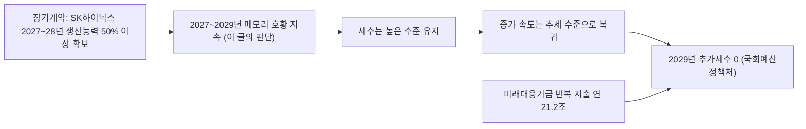

# 반도체 절벽은 과장됐다, 그래도 162조 미래대응기금의 돈줄은 2029년에 마른다

## 판단: 계약은 3년 호황을 말하고, 기금 설계는 그 뒤를 보지 않는다

모건스탠리 숀 킴 연구원은 9일 보고서 '메모리 반도체-미국 중간선거 이후 핵심 쟁점'에서 SK하이닉스 목표주가를 260만 원에서 160만 원으로, 삼성전자를 38만1천 원에서 30만9천 원으로 내렸다. 보고서는 "현재 메모리 반도체 시장에서 가장 중요한 논쟁은 2028년 '실적 절벽'을 피할 수 있느냐는 것"이라고 썼다. 2028년 세계 데이터센터 신규 장비 투자 증가율 전망은 21%에서 9%로 낮췄고, 2028년 가동 예정이던 약 5GW 규모 프로젝트가 2029년으로 밀릴 것으로 봤다. SK하이닉스의 2029~2035년 평균 영업이익률 전망은 53%에서 28%로 내렸다. 반면 2027년 영업이익 전망은 삼성전자 약 688조 원, SK하이닉스 약 468조 원으로 오히려 올렸다([한국경제](https://www.hankyung.com/article/2026111079756)).

**이 글은 이 경고가 과장됐다고 본다.** 근거는 증권사의 수요 추정이 아니라 공급사와 고객이 실제로 맺은 계약이다. SK하이닉스는 10월 28일 실적 발표에서 장기공급계약(LTA) 고객을 10곳에서 14곳으로 늘렸고 이미 확보한 LTA 물량이 "2027년과 2028년 전체 생산능력의 50% 이상"이라고 밝혔다. 삼성전자는 다음 날 2027년 HBM 공급 물량이 가격 협상까지 끝나 완판됐다고 했다([SK하이닉스 3분기 실적 발표](https://www.webull.com/news/15822865136734208), [TrendForce](https://trendforce.com/news/2026/10/29/news-samsung-says-hbm-share-matches-dram-standing-as-hbm4-sales-triple-ds-margin-hits-72-10-lta-clients-signed))). 계약의 고객 이름과 물량, 가격은 공개되지 않았고, 증권사도 그 내용을 모두 볼 수는 없다. 확인할 수 있는 계약 근거로 보면 2029년까지 3년 동안 메모리 업황이 축소로 돌아설 가능성은 낮다. 이는 이 사이트의 판단이다.

그런데 반도체가 꺾이지 않아도 재정 문제는 남는다. 2027년 예산안의 162조3천억 원 미래대응기금은 '추가세수', 곧 다음 해 내국세 세입예산이 최근 10년 추세치를 넘는 부분을 핵심 재원으로 한다([SBS Biz](https://biz.sbs.co.kr/amp/article/20000331923)). 국회예산정책처는 10월 30일 낸 2027년도 예산안 분석에서 이 추가세수가 2027~2028년에 몰리는 일시적 재원이며 2029년 이후에는 발생하지 않을 것으로 전망했다([국회예산정책처](https://www.nabo.go.kr/ko/notice/releasesView.do?idx=9516)). 추세를 '넘는' 부분이기 때문에 세수가 줄지 않아도, 늘어나는 속도가 추세 수준으로 돌아오기만 하면 0이 된다. 그런데 정부안은 이 기금에 매년 되풀이되는 지출을 싣고 있다. **문제는 반도체 절벽이 아니라, 호황이 이어지는 '고원'에서도 마르는 돈에 끊을 수 없는 지출을 묶은 설계다.** 이는 해석이다.

## 계약이 말하는 것: 2029년까지 수요는 묶여 있다

세 메모리 회사가 3분기 실적 발표에서 밝힌 계약 근거는 다음과 같다. 모두 회사 발표이며 고객사 이름은 공개되지 않았다.

| 회사 | 계약 근거 | 성격 | 출처 |
|---|---|---|---|
| SK하이닉스 | LTA 고객 10곳→14곳(글로벌 클라우드 사업자 포함), 2027·2028년 생산능력의 절반 이상 확보. 2030년까지 수요가 공급을 웃도는 구조 지속 전망 | 장기계약은 구속력 있는 계약. "2029년까지 사실상 완판"은 고객과 협의 중인 수요를 더한 개념 | [SK하이닉스 3분기 실적 발표](https://www.webull.com/news/15822865136734208), [Guru3D](https://www.guru3d.com/story/sk-hynix-posts-record-quarter-and-expects-memory-shortage-through-2030/) |
| 삼성전자 | 2027년 HBM 가격 협상 완료·완판. 대형 고객 10곳과 다년 계약, 또 다른 10곳과 협상. 2030년 생산능력의 60~70%를 장기계약으로 확보하는 목표 | 회사 발표. 메모리 부족이 2028년까지 이어질 수 있다고 전망 | [TrendForce](https://trendforce.com/news/2026/10/29/news-samsung-says-hbm-share-matches-dram-standing-as-hbm4-sales-triple-ds-margin-hits-72-10-lta-clients-signed) |
| 마이크론(비교) | 전략 고객 계약 26건이 2030년까지 매출의 35% 이상을 차지할 것으로 추정. 고객 재무 약정 320억 달러, 대부분 현금 예치금. 2027년 HBM 비트 공급 대부분 계약 | 미인수 시에도 대금을 내는 take-or-pay 약정 | [TrendForce](https://www.trendforce.com/news/2026-10-01/news-micron-fy2026-revenue-surges-256-to-133-2b-locks-in-35-of-revenue-through-2030/) |

모건스탠리 보고서도 2027년과 2028년 영업이익 전망은 올렸다. 낮춘 것은 2028년 이후 데이터센터 증설 속도와 장기 이익률이고, 그 근거로 "2027년 말부터 신규 생산능력이 가동"되는 공급 증가와 중국 업체의 증설을 들었다([서울경제](https://en.sedaily.com/market/2026/11/10/morgan-stanley-cuts-samsung-sk-hynix-targets-by-up-to-38)). 2028년 '절벽'은 계약이 아니라 수요 추정에서 나온 시나리오다.

최근의 반도체 비관론에는 계약 밖의 요인도 섞여 있다. 삼성전자가 7.57%, SK하이닉스가 9.46% 떨어진 11월 5일은 미국 중간선거 결과가 나온 직후였고([서울신문](https://www.seoul.co.kr/news/newsView.php?id=20261106001004)), 같은 주 젠슨 황 엔비디아 CEO를 둘러싼 의혹과 이사회 조사가 겹쳤다. 10~11월 사이 HBM 계약이 취소되거나 주문이 줄었다는 확인 보도는 없다. 10일 코스피는 4.39% 반등해 5,239.13으로 마감했고 삼성전자는 4.74%, SK하이닉스는 6.69% 올랐다([한국일보](https://www.hankookilbo.com/news/article/A2026111015300001273)).

계약이 만능은 아니다. SK하이닉스는 반기보고서에 장기계약 수주 현황을 적지 않았는데, 회사는 LTA가 공시 대상인 단일판매·공급계약에 해당하지 않는다고 설명했다([MTN](https://news.mtn.co.kr/news-detail/2026081913303555011)). 하강기에 고객이 재협상을 요구할 위험도 남는다. 그러나 그 재협상의 계기가 될 수요 감소는 아직 계약 데이터 어디에도 나타나지 않는다.

## 기금은 반도체 세수로 채워지게 설계됐다

2027년 예산안의 총지출은 820조9천억 원이고, 그중 새로 만드는 미래대응기금이 162조3천억 원이다. 사업비 45조4천억 원, 국채 발행 감축 12조5천억 원, 세수 변동에 대비한 여유자금 104조4천억 원으로 짜였다([MTN](https://news.mtn.co.kr/news-detail/2026090110252964642)). 추세를 넘는 세수가 어디서 나오는지는 숫자가 말한다.

| 지표 | 수치 | 출처 |
|---|---|---|
| 2026년 총국세(9월 재추계) | 478조6천억 원, 전년 대비 104조7천억 원 증가, 역대 최대 | [서울신문](https://m.seoul.co.kr/news/newsView.php?id=20261001006002) |
| 2026년 법인세(재추계) | 136조4천억 원, 전년 대비 51조8천억 원 증가 | [서울신문](https://m.seoul.co.kr/news/newsView.php?id=20261001006002) |
| 삼성전자·SK하이닉스 상반기 법인세 납부 | 11조2,083억 원(+167%) | [경향신문](https://www.khan.co.kr/article/202608302025015) |
| 10월 반도체 수출 | 564억4천만 달러(+259.4%), 전체 수출의 약 49% | [산업통상부](https://www.motir.go.kr/kor/article/ATCL3f49a5a8c/172360/view) |
| 2027년 국세수입 전망 | 584조4천억 원 | [MTN](https://news.mtn.co.kr/news-detail/2026090110252964642) |

재정경제부는 세수 급증의 원인을 "이례적인 반도체 호황과 반도체 기업 특별배당" 등으로 설명했다. 기획예산처 예산정책과장은 기금 신설 이유를 "반도체 등 특정 산업 의존도가 높아 세수 변동성이 큰 상황에서 이를 완화·흡수할 재정안정화 장치"라고 했다([헤럴드경제](https://biz.heraldcorp.com/article/10870106)). 정부 스스로 이 기금이 반도체 사이클 위에 서 있다고 인정한 셈이다.

## 설계의 모순: 완충 장치에 반복 지출을 실었다

반도체 호황기의 세수를 쌓아 두고 필요할 때 쓰는 장치라면 논리는 맞다. 국제통화기금(IMF)도 적립금이 완충 역할을 할 수 있다고 평가했다([주간경향](https://weekly.khan.co.kr/article/202611060834001)). 문제는 지출 쪽이다.

- **반복 지출**: 국회예산정책처는 4대 사업계정 사업비 45조3,625억 원 가운데 21조1,973억 원(46.7%)이 아동기본수당, 청년미래적금처럼 해마다 되풀이되는 지출이라고 분석했다([더팩트](https://news.tf.co.kr/read/ptoday/2383938.htm)). 청년 지원사업 43조3천억 원 중 24조4천억 원(56.4%)이 기금에 편성된 데 대해서도 재원 안정성이 우려된다고 했다([창업일보](https://www.news33.net/news/articleView.html?idxno=119025)).
- **국회 통제**: 정부안은 국회 승인 없이 주요 항목 지출을 30%까지 바꿀 수 있게 했다. 일반 사업성 기금의 한도는 20%다. 일반회계 세수결손을 메우는 전출은 이 한도에서도 빠지고 국회에는 사후 보고만 한다([SBS Biz](https://biz.sbs.co.kr/amp/article/20000331923), [주간경향](https://weekly.khan.co.kr/article/202611060834001)). 김학수 KDI 선임연구위원은 "국회의 심의나 인출 규정에 대해서 명확히 제시하지 않고 있는 기금은 제가 알기로는 없다"고 했다.

두 가지를 합치면 2029년의 그림이 나온다. 반도체 호황이 이어져도 추가세수가 끊기면 기금에는 새 돈이 들어오지 않는다. 그 해에도 아동수당·청년적금은 멈출 수 없고, 그 지출은 여유자금 104조 원에서 빠져나간다. 연 21조 원 수준의 반복 지출이 그대로라면 결손 보전이 없어도 여유자금은 몇 년 안에 바닥난다. 이는 단순 산술이며, 실제 속도는 세수 흐름과 사업 조정에 달렸다. 만약 이 글의 판단과 달리 반도체가 예상보다 빨리 꺾이면, 일반회계 결손 보전까지 같은 통장에서 국회 승인 없이 빠져나가 완충재가 두 방향에서 깎인다.

## 세수가 반도체에 얼마나 민감한가

한국 법인세는 반도체 사이클을 1년 늦게 따라왔다. 반도체 호황이던 2018년 실적이 반영된 2019년 법인세는 72조2천억 원이었고, 메모리 불황을 겪은 2019년 실적이 반영된 2020년에는 55조5천억 원으로 줄었다([블록미디어](https://www.blockmedia.co.kr/archives/859470)). 2022년 하반기부터 메모리 가격이 떨어진 뒤 2023년 법인세는 103조6천억 원에서 80조4천억 원으로 23조2천억 원 줄었고, 국세 전체가 예산보다 56조4천억 원 덜 걷혀 역대 최대 결손이 났다([뉴데일리](https://biz.newdaily.co.kr/site/data/html/2024/01/31/2024013100187.html)). 이 수치들은 기획재정부 발표를 인용한 언론 보도 기준이다. 당시 정부는 국세와 연동된 지방교부세 등을 국회 승인 절차 없이 줄여 결손을 흡수했다는 비판을 받았다([주간경향](https://weekly.khan.co.kr/article/202409160600041)).

이번 기금은 그 우회로를 법에 미리 적어 두려는 것으로 볼 수도 있다. 결손 보전 전출을 한도에서 빼고 사후 보고만 하게 한 조항이 그렇다. 위기 때 빠르게 쓰는 장치는 필요하다. 그러나 2023년의 교훈은 빨리 쓰는 장치보다, 호황기 세수를 반복 지출의 근거로 삼지 말라는 것이었다.

## 호황이 길수록 설계의 위험은 커진다

계약이 보여 주는 3년 호황은 재정에는 양날이다. 2027년과 2028년 실적이 좋을수록 법인세 전망은 오르고, 추세를 넘는 추가세수는 커지고, 기금에 더 많은 돈과 더 많은 사업이 실린다. 정점에서 가장 크게 약속하는 구조다. 호황이 끝나지 않더라도 세수 증가 속도가 추세로 돌아오는 해가 오면, 그 해 재정은 정점 때 약속한 지출을 새 재원 없이 감당해야 한다.

## 국회가 12월 2일까지 바꿀 수 있는 것

예결위는 16일 조정소위에 들어가고 법정 처리 시한은 12월 2일이다([뉴스톱](https://www.newstopkorea.com/news/articleView.html?idxno=48904)). 국민의힘은 기금을 "편법적인 정권의 쌈짓돈"이라 부르며 104조 원을 국채 상환에 쓰라고 요구한다([더팩트](https://news.tf.co.kr/read/ptoday/2383938.htm)). 다만 국민의힘이 특검법에 반발해 예산 심사 일부를 보이콧하고 있어, 기금 설계가 정쟁 속에 그대로 통과될 가능성도 있다.

이 글은 기금 자체를 없애기보다 세 가지를 바꾸는 것이 맞다고 본다.

1. **반복 지출은 일반회계로 돌린다.** 아동수당·청년적금처럼 매년 나가는 돈은 매년 들어오는 세입으로 감당해야 한다. 기금에는 한 번 쓰고 끝나는 투자 사업만 남긴다.
2. **변경 한도를 20%로 낮추고 결손 보전 인출에도 국회 사전 보고를 붙인다.** 국회예산정책처의 권고와 같은 방향이다.
3. **적립·인출 규칙을 추가세수 규모와 연동해 법에 적는다.** 추가세수가 줄어드는 해에는 사업비가 자동으로 줄도록 해야 2029년에 지출 삭감을 둘러싼 정치 싸움을 피할 수 있다.

이는 이 사이트의 판단이다. 반도체 호황은 앞으로 3년 한국이 가진 가장 큰 재정 기회다. 그 기회를 영구적인 소득으로 착각하게 만드는 제도 설계는 호황이 끝나기도 전에 2029년 정부에 청구서를 넘긴다.

## 확인하지 못한 것

- 모건스탠리 보고서 원문은 보지 못했고 외신 보도도 찾지 못해 국내 보도로만 확인했다. 삼성전자의 기존 목표주가는 8월 일부 보도에서 37만5천 원이어서, 38만1천 원으로 언제 올렸는지 확인하지 못했다.
- 세 회사의 장기계약은 고객사 이름, 물량, 가격이 공개되지 않았다. SK하이닉스의 "2029년까지 사실상 완판"에는 협의 중인 수요가 포함돼 있다. 2025년 10월 OpenAI와 맺은 월 최대 90만 장 웨이퍼 공급 의향서가 본계약으로 바뀌었다는 보도는 찾지 못했다.
- 국회예산정책처 분석 원문 본문은 열람하지 못했고 발간 안내와 보도로 확인했다. 연도별 추가세수 추계치는 확인하지 못했다.
- 반도체가 2026년 법인세 증가분에서 차지하는 정확한 비중은 공개 자료에 따로 나오지 않는다.

## 갱신 기록

- 2026-11-11: 공급사·고객 장기계약 근거를 더하고, 모건스탠리의 '2028년 실적 절벽' 경고를 과장으로 보는 판단으로 제목·요약·본문 수정. 국내 경제지 사설·해석 인용을 빼고 회사 발표·외신·국회예산정책처 자료로 출처 교체. 기금 설계 비판은 유지

## 출처

- [국회예산정책처, 2027년도 예산안 분석 시리즈 발간 (2026-10-30)](https://www.nabo.go.kr/ko/notice/releasesView.do?idx=9516)
- [SK hynix Announces 3Q26 Financial Results (2026-10-28)](https://www.webull.com/news/15822865136734208)
- [Guru3D, SK hynix expects memory shortage through 2030](https://www.guru3d.com/story/sk-hynix-posts-record-quarter-and-expects-memory-shortage-through-2030/)
- [TrendForce, Samsung: 10 LTA clients signed, 2027 HBM sold out (2026-10-29)](https://trendforce.com/news/2026/10/29/news-samsung-says-hbm-share-matches-dram-standing-as-hbm4-sales-triple-ds-margin-hits-72-10-lta-clients-signed)
- [한국경제, 반도체 돈잔치 끝이 보인다…삼전닉스에 날아든 경고장 (2026-11-10)](https://www.hankyung.com/article/2026111079756)
- [뉴스1, 모건스탠리 메모리 보고서 (2026-11-10)](https://www.news1.kr/finance/general-stock/6349380)
- [Seoul Economic Daily, Morgan Stanley cuts Samsung, SK Hynix targets (2026-11-10)](https://en.sedaily.com/market/2026/11/10/morgan-stanley-cuts-samsung-sk-hynix-targets-by-up-to-38)
- [TrendForce, Micron locks in 35% of revenue through 2030 (2026-10-01)](https://www.trendforce.com/news/2026-10-01/news-micron-fy2026-revenue-surges-256-to-133-2b-locks-in-35-of-revenue-through-2030/)
- [MTN, SK하이닉스 반기보고서 장기계약 공시 (2026-08-20)](https://news.mtn.co.kr/news-detail/2026081913303555011)
- [서울신문, 중간선거 뒤 반도체주 급락 (2026-11-06)](https://www.seoul.co.kr/news/newsView.php?id=20261106001004)
- [한국일보, 코스피 4.39% 반등 (2026-11-10)](https://www.hankookilbo.com/news/article/A2026111015300001273)
- [MTN, 2027년 예산안 820.9조 (2026-09-01)](https://news.mtn.co.kr/news-detail/2026090110252964642)
- [SBS Biz, 미래대응기금 구조와 추가세수 정의 (2026-09-01)](https://biz.sbs.co.kr/amp/article/20000331923)
- [헤럴드경제, 기획예산처 미래대응기금 설명 (2026-09-11)](https://biz.heraldcorp.com/article/10870106)
- [더팩트, 미래대응기금 반복 지출 분석 (2026-11-03)](https://news.tf.co.kr/read/ptoday/2383938.htm)
- [창업일보, 국회예산정책처 예산안 분석 (2026-10-30)](https://www.news33.net/news/articleView.html?idxno=119025)
- [주간경향, 162조 기금은 추정치 (2026-11-06)](https://weekly.khan.co.kr/article/202611060834001)
- [서울신문, 2026년 세수 재추계 (2026-10-01)](https://m.seoul.co.kr/news/newsView.php?id=20261001006002)
- [파이낸셜뉴스, 9월 국세수입 (2026-10-30)](https://www.fnnews.com/news/202610301023539483)
- [경향신문, 삼성전자·SK하이닉스 상반기 법인세 (2026-08-30)](https://www.khan.co.kr/article/202608302025015)
- [산업통상부, 2026년 10월 수출입 동향 (2026-11-01)](https://www.motir.go.kr/kor/article/ATCL3f49a5a8c/172360/view)
- [블록미디어, 연도별 총국세·법인세 추이](https://www.blockmedia.co.kr/archives/859470)
- [뉴데일리, 2023년 국세수입 56.4조 결손 (2024-01-31)](https://biz.newdaily.co.kr/site/data/html/2024/01/31/2024013100187.html)
- [주간경향, 세수가 줄어드니 지방만 희생양 (2024-09-16)](https://weekly.khan.co.kr/article/202409160600041)
- [뉴스톱, 예결위 일정과 정국 (2026-11-10)](https://www.newstopkorea.com/news/articleView.html?idxno=48904)

---

이 글은 공개 출처를 바탕으로 AI가 자동 생성한 초안을 검토해 발행했으며, 중요한 판단 전에는 연결된 원문을 확인해야 합니다.
