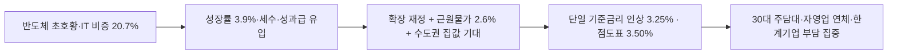

# 한국은행은 3.9% 성장을 보고 금리를 3.25%로 올렸다…그러나 반도체가 끌어올린 평균의 청구서는 실질소득이 꺾인 가계와 비반도체로 날아든다

## 판단: 3.9% 성장과 -2.1% 실질소득을 기준금리 하나로 다룰 수 없다

한국은행 금융통화위원회는 26일 기준금리를 연 3.00%에서 3.25%로 0.25%포인트 올렸다. 7·8월 연속 인상과 10월 동결에 이은 올해 세 번째 인상(누적 +0.75%포인트)이며, 위원 7명 중 5명이 찬성하고 황건일·이수형 위원이 3.00% 동결 소수의견을 냈다. 한은은 같은 날 올해 실질 국내총생산(GDP) 성장률 전망치를 8월 3.3%에서 3.9%로, 내년 전망치를 2.9%에서 4.1%로 높였고, 6개월 후 조건부 금리 전망(점도표) 중간값도 3.50%로 제시했다([한국은행 통화정책방향](https://www.bok.or.kr/portal/bbs/P0000559/view.do?menuNo=200690&nttId=11067084), [매일경제](https://www.mk.co.kr/news/economy/12219235)). 그런데 바로 같은 날 국가데이터처와 재정경제부가 발표한 3분기 가계동향조사에서 전국 가구 월평균 실질소득은 전년 동기 대비 2.1% 줄어 2년 반 만에 마이너스로 돌아섰다([대한민국 정책브리핑](https://www.korea.kr/news/policyNewsView.do?newsId=148976566)).

시장과 보도는 '4%대 고성장 자신감'을 앞세웠다. 이 글의 판단은 다르다. **첫째, 3.9%와 4.1%는 경제 전반의 활황이 아니라 반도체 호황과 연쇄가중법이 만든 평균의 착시다.** 한은이 성장률을 올린 같은 보고서에서 올해 민간소비·건설투자·취업자 전망은 오히려 깎였다. **둘째, 통화정책에는 기준금리라는 단일 둔기밖에 없기 때문에 반도체 호황과 확장 재정이 키운 물가·집값 압력의 청구서가 호황 바깥의 가계와 자영업자, 비반도체 기업으로 날아든다.** **셋째, 금리 인상의 근거가 된 반도체 수출 엔진 자체가 하루 전 미국의 301조 과잉생산 관세안(조건부 15%, 불만족 시 25%) 아래 놓였다.** 세 가지 모두 확인된 통계를 바탕으로 한 이 글의 해석이다.

## 3.9%와 4.1%의 해부: 반도체를 빼면 내수와 고용은 오히려 깎였다

한은 '2026년 11월 경제전망'을 분해하면 헤드라인 성장률과 내수 지표가 정반대로 움직였다. 올해 성장률 상향(+0.6%포인트)에서 반도체 경기 호조가 +0.75%포인트를 끌어올린 반면, 중동 긴장 재고조(-0.05%포인트)와 증시 조정(-0.1%포인트)은 성장률을 깎았다. 반도체를 빼면 올해 전망은 하향이었다. 내년 상향(+1.2%포인트)도 반도체 호황·파급 확산(+1.2%포인트)이 전부였고, 정부 예산안 확대(+0.05%포인트)와 미국 반도체 관세 시점 이연(+0.05%포인트)이 지정학적 불확실성(-0.1%포인트)을 메웠다([한국은행 11월 경제전망](https://eiec.kdi.re.kr/policy/materialView.do?num=290243)).

통계 구조의 증폭도 컸다. 반도체 가격 급등과 증산으로 한국 경제 내 IT 제조업 명목 비중은 지난해 9.0%에서 올해 상반기 20.7%로 두 배 넘게 뛰었다. 전년도 명목 비중을 가중치로 쓰는 연쇄가중법에서는 IT 제조업 실질성장률이 같아도 전체 GDP 기여도가 기계적으로 커진다([머니투데이](https://www.mt.co.kr/economy/2026/11/26/2026112613223985843)). 한은의 내년 4.1% 전망은 블룸버그가 11월 10일 약 40개 기관을 조사한 중윗값(올해 3.6%, 내년 2.7%)보다 내년 기준 1.4%포인트 높다.

| 지표 | 2025년 실적 | 2026년 전망(8월 대비) | 2027년 전망(8월 대비) | 2028년 전망 |
|---|---|---|---|---|
| 실질 GDP 성장률(%) | 1.1 | 3.9 (+0.6%p) | 4.1 (+1.2%p) | 3.0 |
| 민간소비(%) | 1.5 | 1.8 (-0.3%p) | 2.4 (+0.1%p) | 2.3 |
| 건설투자(%) | -9.7 | 0.1 (-0.1%p) | 2.4 (+0.5%p) | 3.0 |
| 설비투자(%) | 1.5 | 7.9 (+1.1%p) | 7.2 (+2.5%p) | 3.8 |
| 재화수출(%) | 3.3 | 10.9 (+1.2%p) | 8.0 (+3.4%p) | 5.5 |
| 경상수지(억 달러) | 1,231 | 5,000 (+500) | 5,400 (+1,100) | 3,600 |
| 소비자물가 상승률(%) | 2.1 | 2.7 (유지) | 2.4 (+0.1%p) | 2.1 |
| 근원물가 상승률(%) | 1.9 | 2.6 (+0.1%p) | 2.6 (+0.1%p) | 2.2 |
| 취업자 수 증감(만 명) | 19 | 13 (-1) | 20 (유지) | 18 |

출처: [한국은행 2026년 11월 경제전망(KDI 경제교육·정보센터)](https://eiec.kdi.re.kr/policy/materialView.do?num=290243).

표가 보여 주는 비대칭은 선명하다. 재화수출·설비투자와 경상수지 흑자(지난해 최대치 1,231억 달러의 4배 이상인 5,000억·5,400억 달러)는 수직 상향됐지만, 올해 민간소비 전망은 2.1%에서 1.8%(하반기 1.1%)로, 건설투자는 0.2%에서 0.1%로 낮아졌다. 올해 취업자 수 증가폭은 14만 명에서 13만 명으로 깎였고, 내년 성장률을 1.2%포인트나 올리고도 내년 취업자 증가 전망은 20만 명으로 묶었다. 이동렬 한은 조사국장은 반도체의 직접 고용유발 효과가 낮아 취업자 전망을 유지했으며, 올해까지 다른 산업 파급이 크지 않아 체감경기 개선도 약했다고 인정했다([연합인포맥스](https://news.einfomax.co.kr/news/articleView.html?idxno=4446793)). 보고서도 "명목임금은 IT부문 특별급여 중심으로 오름세가 확대되겠으나 건설업 등 비IT 부문은 제한적"이라고 적었다.

## 같은 날 나온 두 개의 한국: 700조 반도체 이익과 -2.1% 실질소득

신현송 한은 총재는 26일 간담회에서 올해 명목GDP가 3,000조 원을 넘고 반도체 기업 영업이익이 700조 원에 육박한다며, "블랙홀로 사라지는 것이 아니고 법인세와 성과급, 투자와 배당으로 이어지면서 국민경제로 환원된다"고 했다([매일경제](https://www.mk.co.kr/news/economy/12219235)).

그러나 같은 날 나온 3분기 가계동향조사는 그 환원이 아직 가계에 닿지 않았음을 보여 준다. 월평균 명목소득은 548만 원(+0.8%)이었지만 물가를 반영한 실질소득은 2.1% 줄었다. 근로소득(+3.6%)과 달리 사업소득은 97만 5,000원(-1.4%)으로 줄었고, 공적이전소득(-15.4%)도 지난해 소비쿠폰 기저효과로 급감했다. 하위 20%(1분위) 소득은 127만 7,000원(-2.7%, 근로소득 -9.2%)으로 줄고 상위 20%(5분위)는 1,174만 6,000원(+1.4%)으로 늘어 5분위 배율이 5.39배(+0.32배포인트)로 벌어졌다. 비소비지출과 이자비용이 나란히 11.0% 뛰면서 처분가능소득은 1.7%(430만 6,000원), 가계 흑자액은 11.2%(127만 6,000원) 줄었고 실질소비지출은 제자리였다([대한민국 정책브리핑](https://www.korea.kr/news/policyNewsView.do?newsId=148976566)).

수출도 다르지 않다. 한국은 11월 19일 세계 네 번째로 연간 수출 1조 달러를 넘겼지만, 산업연구원이 27일 낸 보고서에 따르면 반도체 비중은 1분기 35.5%에서 10월 48.9%(564억 4,000만 달러)로 치솟았고 1~3분기 D램(+369.0%)과 시스템반도체(+13.1%)의 격차도 극심했다. 10월 석유제품과 석유화학은 유가 영향으로 수출액이 각각 80.0%, 27.5% 늘었으나 실제 물량은 7.5%, 6.8% 줄었고, 상위 10개 품목 비중은 66.0%로 독일(28.5%)·중국(27.4%)의 두 배를 넘겼다([이데일리](https://marketin.edaily.co.kr/News/ReadE?newsId=01443206645649984)). 이 글은 신 총재의 '시간의 문제'가 거시 항등식으로는 맞아도 통화정책의 시차를 가린다고 본다. 반도체 이익이 성과급·배당·세수로 퍼지는 데는 분기가 걸리고 일부는 부동산으로 새지만, 금리 인상은 대출 이자로 곧장 꽂힌다. 이는 해석이다.

## 둔기의 역설: 단일 기준금리의 비용은 누가 치르는가

한은의 인상에도 근거는 있다. 10월 소비자·근원물가 상승률이 모두 2.8%로 목표(2.0%)를 크게 웃돌고 내년 1분기 근원물가 전망은 2.9%에 달한다. 신 총재는 2028년에야 물가가 목표치에 수렴할 것으로 봤다([매일경제](https://www.mk.co.kr/news/economy/12219235)). 3분기 말 가계신용은 2,030조 5,000억 원으로 사상 최대를 경신했고([한국은행 3분기 가계신용](https://eiec.kdi.re.kr/policy/materialView.do?num=289716)), 서울 아파트 매매가격은 7월 1.27%, 8월 1.05%, 9월 0.74%로 석 달 연속 올랐다([이데일리](https://marketin.edaily.co.kr/News/ReadE?newsId=02240246645645720)).

하지만 부작용을 둘러싼 내부 균열도 커졌다. 기준금리 인상에 동결 소수의견이 두 명 나온 것은 2023년 1월 이후 3년 10개월 만이며([연합인포맥스](https://news.einfomax.co.kr/news/articleView.html?idxno=4446734)), 통방문에서도 '추가 인상의 시기와 속도' 중 '속도'가 빠졌다([연합인포맥스](https://news.einfomax.co.kr/news/articleView.html?idxno=4446735)). 그럼에도 점도표는 중간값이 연 3.50%이고 현 수준(3.25%)에 6개, 두 차례 추가 인상(3.75%)에 7개의 점이 제시돼 추가 인상 여지를 열어 뒀다. 신 총재는 "통화정책은 전체에 파급되기 때문에 선별해서 정책하는 데 한계가 있다"며 재정·금융정책의 역할을 주문했다([매일경제](https://www.mk.co.kr/news/economy/12219235)).

청구서의 수취인은 뚜렷하다. 한은 9월 금융안정상황 보고서에 따르면 기준금리가 0.25%포인트 오를 때마다 가계는 연 3조 3,000억 원, 기업은 연 3조 7,000억 원의 이자 부담이 늘고, 대출금리는 5개월 뒤, 은행 연체율은 15개월 뒤 가장 크게 반응한다. 6월 말 가계 변동금리 비중은 56.1%, 2025년 4분기 한계기업 비중은 19.1%였다([국회뉴스](https://www.a-news.co.kr/news/articleView.html?idxno=424393)). 10월 신규취급액 코픽스는 3.62%로 두 달 만에 0.44%포인트 뛰었고, 11월 17일 5대 은행 변동형 주담대 금리는 연 4.44~6.51%에 달했다. 올해 0.75%포인트 인상이 그대로 반영되면 3억 원 변동금리 차주의 연 이자는 단순 계산으로 225만 원 는다([한스경제](https://www.hansbiz.co.kr/news/articleView.html?idxno=887598)).

충격은 30대 주담대 차주와 자영업자에 집중된다. 한은 3분기 차주별 통계에서 전체 신규 가계대출은 줄었지만 신규 주담대는 평균 2억 1,451만 원(+3.0%)으로 반등했고, 30대 비중이 46.4%(평균 2억 7,134만 원, 서울 2억 7,638만 원)로 역대 최고였다([머니투데이](https://www.mt.co.kr/economy/2026/11/20/2026112010265891854)). 자영업자는 더 위태롭다. 한국신용데이터(KCD) 3분기 리포트에서 개인사업자 대출 연체액은 16조 3,542억 원으로 전년 동기 대비 21.5% 급증해 3분기 연속 늘었고, 사업장당 매출(-4.36%)·이익(-8.30%)이 동반 감소한 가운데 대출 보유 사업장 363만 4,000곳의 13.9%(50만 5,000곳)가 폐업 상태였다([동아일보](https://www.donga.com/news/Economy/article/all/20261110/134998260/1)). 올해 세 차례 인상의 연체 충격이 15개월 뒤 몰려온다면 2027년 하반기부터 상환 고비가 본격화한다는 해석이 나온다.

## 재정·통상·통화의 엇박자: '관세 연기'를 전제한 긴축의 위험

거시정책 전체로 보면 두 가지 엇박자가 겹친다. 첫째는 재정과 통화의 충돌이다. 정부가 반도체 초과세수로 162조 3,000억 원 미래대응기금을 추진하며 반복 지출까지 싣는 사이, 한은은 11월 통방문에 "재정지출 확대"를 소비 요인으로 새로 적었고 경제전망에서도 예산안 확대를 내년 상방 요인(+0.05%포인트)으로 넣었다([연합인포맥스](https://news.einfomax.co.kr/news/articleView.html?idxno=4446735), [한국은행 11월 경제전망](https://eiec.kdi.re.kr/policy/materialView.do?num=290243)). 이 글은 호황기에 재정이 수요 가속 페달을 밟아 근원물가를 자극하면 한은이 금리 브레이크를 더 세게 밟게 되는 모순이 커졌다고 본다.

둘째는 통화와 통상의 충돌이다. 한은은 이번 전망에서 미국의 과잉생산 관세(26년 4분기→27년 1분기)와 반도체 관세(27년 초→28년 초) 시점이 미뤄진다는 전제를 깔고 내년 성장 상방 요인(+0.05%포인트)으로 반영했다. 그러나 금리 인상 하루 전인 25일(미국 시각) 미국 무역대표부(USTR)는 무역법 301조 과잉생산 관세안에서 한국에 조건부 15% 상한과 함께, 협의와 기존 투자 약속 이행이 '불만족'이면 전 품목 최대 25%를 검토한다는 대안을 걸며 한국의 D램·낸드 점유율과 대미 흑자, 반도체 정책금융을 정면 지목했다([USTR 한국 관보 공고안](https://ustr.gov/sites/default/files/files/Press/Releases/2026/Korea%20FRN.pdf)). 이 글은 '관세 이연과 반도체 호황 지속'을 전제로 금리를 3.25~3.50%까지 올려 둔 뒤, 1월 25일 USTR 공청회나 글로벌 AI 투자 조정(한은 비관 시나리오에서 내년 메모리 가격 -15%, 2028년 -51%, 성장률 3.4%→2.1%)이 겹치면 15개월 시차의 연체 파고와 수출 충격이 정면 충돌할 위험이 크다고 본다. 이는 해석이다.

## 정책 조합이 풀어야 할 네 가지 과제

- **반도체 초과세수와 통화정책의 방향을 맞춘다.** 초과세수를 내수 반복 지출로 흘려보내면 수요 물가를 자극해 추가 금리 인상 명분만 키운다. 초과세수는 국채 발행 축소와 비반도체 유망 품목 설비·공급망 전환 투자에 우선 배정해야 한다.
- **15개월 연체 시차에 맞춰 취약차주 지원을 이원화한다.** 일괄 상환유예 대신 매출·현금흐름이 확인되는 정상 자영업자에게는 저금리 대환과 고정금리 전환을 열고, 이미 폐업하거나 회생 불가능한 차주는 신속 채무조정으로 정리해야 한다.
- **수도권 집값 기대 억제를 기준금리에만 떠넘기지 않는다.** 30대 주담대 쏠림을 금리로만 누르면 비수도권과 자영업이 동반 타격을 받는다. 정책대출·집단대출 예외를 줄이는 일관된 거시건전성(DSR) 관리가 선행돼야 금리 인상 폭을 줄일 수 있다.
- **한은 전망에서 비IT 부문과 관세 시나리오를 분리 공개한다.** 한은의 내년 4.1% 전망은 시장 중윗값(2.7%)보다 1.4%포인트 높다. 12월 2일 11월 소비자물가 발표([국가데이터처](https://kostat.go.kr/menu.es?mid=b70203020000))와 2027년 1월 14일 첫 금통위([한국은행 2027년 금통위 일정](https://eiec.kdi.re.kr/policy/materialView.do?num=288774))에서는 IT·비IT 분해 성장률과 USTR 25% 대안 발동 시나리오를 함께 제시해야 한다.

## 확인하지 못한 것

- 황건일·이수형 위원이 3.00% 동결 소수의견을 낸 구체적 논거는 11월 금통위 의사록 공개 전이라 확인하지 못했다.
- 한은 '2026년 11월 경제전망'은 보도자료 첨부 요약본과 설명회 보도로 확인했으며, 전체 보고서 본문에 실렸을 수 있는 IT·비IT 세부 성장률 분해치는 직접 대조하지 못했다.
- 2026년 11월 기준 개인사업자 대출 변동금리 비중과 비반도체 제조업 최신 연체율은 공개 원자료에서 찾지 못해 9월 한은 금융안정상황 보고서와 3분기 KCD 리포트 수치를 인용했다.
- 2026년 4분기 GDP 속보치의 정확한 공표일은 한은 2027년 통계 공표일정 발표 전이라 추적 일정에 넣지 않았다.
- '평균의 착시', 통화·재정·통상 엇박자 진단, 2027년 하반기 연체 충격과 수출 변수의 중첩 위험, 네 가지 정책 과제는 이 글의 해석과 판단이다.

## 출처

- [통화정책방향(2026.11.26) — 한국은행 (2026-11-26)](https://www.bok.or.kr/portal/bbs/P0000559/view.do?menuNo=200690&nttId=11067084)
- [「경제전망」 (2026년 11월) — 한국은행·KDI 경제교육·정보센터 (2026-11-26)](https://eiec.kdi.re.kr/policy/materialView.do?num=290243)
- [2027년 금융통화위원회 정기회의 개최 및 의사록 공개 예정일정 — 한국은행·KDI 경제교육·정보센터 (2026-10-29)](https://eiec.kdi.re.kr/policy/materialView.do?num=288774)
- [2026년 3/4분기 가계신용(잠정) — 한국은행·KDI 경제교육·정보센터 (2026-11-18)](https://eiec.kdi.re.kr/policy/materialView.do?num=289716)
- [3분기 가계소득 0.8% 늘어 13분기 연속 증가…실질소득은 감소 — 재정경제부·대한민국 정책브리핑 (2026-11-26)](https://www.korea.kr/news/policyNewsView.do?newsId=148976566)
- [소비자물가지수 보도자료 공표일정 — 국가데이터처 (2026-11-28 확인)](https://kostat.go.kr/menu.es?mid=b70203020000)
- [Korea Federal Register Notice (사전 공개본) — USTR (2026-11-25)](https://ustr.gov/sites/default/files/files/Press/Releases/2026/Korea%20FRN.pdf)
- [통방문 달라진 점은…성장세 한층 강화·인상 '속도' 삭제 — 연합인포맥스 (2026-11-26)](https://news.einfomax.co.kr/news/articleView.html?idxno=4446735)
- [금리 인상에 '동결' 소수의견 2명…3년 10개월만 — 연합인포맥스 (2026-11-26)](https://news.einfomax.co.kr/news/articleView.html?idxno=4446734)
- [한은 "소득 증가, 선순환 효과 가져올 것…1분기부터 뚜렷한 효과" — 연합인포맥스 (2026-11-26)](https://news.einfomax.co.kr/news/articleView.html?idxno=4446793)
- [신현송 한은 총재 "물가 상승률, 2028년 목표 수준에 수렴"…추가인상 시사 — 매일경제 (2026-11-26)](https://www.mk.co.kr/news/economy/12219235)
- [한은, 내년 성장률 2.9→4.1% 대폭 상향…경상흑자 5400억불 — 머니투데이 (2026-11-26)](https://www.mt.co.kr/economy/2026/11/26/2026112613223985843)
- [대출 줄었다는데…"집 사려면 별수 없다" 30대 주담대 비중은 역대 최고 — 머니투데이 (2026-11-20)](https://www.mt.co.kr/economy/2026/11/20/2026112010265891854)
- [소상공인 대출 연체액 3분기째 증가…빚낸 사업자 14% 폐업 — 동아일보 (2026-11-10)](https://www.donga.com/news/Economy/article/all/20261110/134998260/1)
- [수출 1조달러 굳히려면…산업硏 "비반도체 수출 물량 키워야" — 이데일리 (2026-11-27)](https://marketin.edaily.co.kr/News/ReadE?newsId=01443206645649984)
- [집값 뛰고 대출규제 강화…3분기 가계빚 얼마나 불었나 — 이데일리 (2026-11-14)](https://marketin.edaily.co.kr/News/ReadE?newsId=02240246645645720)
- [고금리 시대 진입...가계·자영업자 이자부담 가중 — 한스경제 (2026-11-26)](https://www.hansbiz.co.kr/news/articleView.html?idxno=887598)
- [한은 "금리 0.25%p 오르면 가계 3.3조·기업 3.7조 이자부담↑" — 국회뉴스 (2026-09-22)](https://www.a-news.co.kr/news/articleView.html?idxno=424393)

---

이 글은 공개 출처를 바탕으로 AI가 자동 생성한 초안을 검토해 발행했으며, 중요한 판단 전에는 연결된 원문을 확인해야 합니다.
